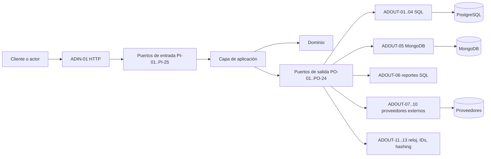

# NEXUSMARKET — Catálogo de adapters

**Identificador documental:** `ENT-AD`  
**Versión:** 1.0  
**Estado:** `COMPLETO` con bloqueos externos registrados  
**Última actualización:** 26 de octubre de 2026  
**Raíz documental:** `BackendSDD/`  
**Ámbito:** catálogo, inventario y relaciones de los adapters justificados por la arquitectura y por los contratos de Input Ports y Output Ports. No contiene código, endpoints, esquemas ejecutables, SDKs ni decisiones de negocio.

---

## 1. Propósito y límites

Este catálogo responde a una sola pregunta: **¿qué adapters existen, qué límite arquitectónico atraviesan, qué puertos implementan o invocan y qué documentos los especifican?**

No sustituye a los documentos individuales. Cada adapter tiene su propio archivo, donde se detallan propósito, límites, contratos relacionados, flujo, traducción, errores, dependencias y criterios de validación.

Tampoco define rutas HTTP, códigos de estado, tablas, colecciones, índices, protocolos de proveedores, algoritmos criptográficos ni formatos de identificadores. Esos detalles dependen de decisiones aún no aprobadas y se registran como bloqueos reales.

---

## 2. Fuentes y autoridad

| Abreviatura | Fuente | Uso |
|---|---|---|
| `[ARQ]` | [`nexusmarket-arquitectura.md`](../Software%20Architecture/nexusmarket-arquitectura.md) | Capas, límites, ubicación de adapters, dependencias, persistencia y composición. |
| `[PI]` | [`nexusmarket-input-ports.md`](../Application/nexusmarket-input-ports.md) | Contratos de entrada que invoca el adapter HTTP. |
| `[PO]` | [`nexusmarket-output-ports.md`](../Application/nexusmarket-output-ports.md) | Contratos de salida que implementan los adapters de persistencia e integración. |
| `[MOD]` | [`nexusmarket-domain-model.md`](../Domain/nexusmarket-domain-model.md) | Agregados, invariantes y propiedad de datos. |
| `[VO]` | [`nexusmarket-domain-object-values.md`](../Domain/nexusmarket-domain-object-values.md) | Objetos de valor y catálogos que deben conservarse en la traducción. |
| `[DS]` | [`nexusmarket-domain-services.md`](../Domain/nexusmarket-domain-services.md) | Reglas que no deben trasladarse al adapter. |
| `[UC]` | [`nexusmarket-use-cases-checkout-query-order.md`](../Application/nexusmarket-use-cases-checkout-query-order.md) | Contexto de invocación, autorización, idempotencia y transacciones de `UC-01`/`UC-02`. |
| `[PM]` | [`Prompt-maestro-documentacion.md`](../Prompt-maestro-documentacion.md) | Reglas documentales, estados, calidad y agrupación. |
| `[EST]` | [`DOCUMENTATION_STATUS.md`](../DOCUMENTATION_STATUS.md) | Inventario, decisiones, conflictos y limitaciones vigentes. |

**Jerarquía aplicada:** instrucción actual del usuario > arquitectura y puertos aprobados > modelo de dominio y VOs > decisiones de diseño documentadas > inferencias. Las limitaciones de fuente no se convierten en reglas.

---

## 3. Reglas arquitectónicas que gobiernan los adapters

1. El dominio no depende de adapters, HTTP, SQL, MongoDB ni SDKs (`[ARQ]` §2.2, §16).
2. La aplicación depende de sus puertos; los adapters implementan o invocan esos puertos (`[ARQ]` §16).
3. Los adapters de entrada traducen peticiones externas a invocaciones de `PI-01`…`PI-25`; no contienen reglas de negocio ni acceden a bases de datos (`[ARQ]` §3.3, §8).
4. Los adapters de salida implementan `PO-01`…`PO-24`; traducen modelos de dominio a representaciones externas y viceversa (`[ARQ]` §3.4).
5. El punto de composición construye las implementaciones concretas; ningún caso de uso importa un adapter (`[ARQ]` §3.5, §16).
6. SQL es la fuente de verdad transaccional; MongoDB es complementaria para auditoría y proyecciones justificadas (`[MOD]` §24; `[ARQ]` §9).
7. Una transacción SQL no cubre MongoDB ni proveedores externos; la coordinación usa outbox y estados intermedios (`[ARQ]` §9.4; `[MOD]` §24 (punto 5)).
8. Los errores de infraestructura se traducen en el límite del adapter y no exponen detalles internos (`[ARQ]` §8.3, §16).
9. Los adapters no deciden autorización, transiciones, cálculos, elegibilidad ni saldos; invocan o preservan esas decisiones (`[DS]`, `[UC]`).

---

## 4. Inventario canónico

| ID | Adapter | Tipo | Puertos | Módulos principales | Documento | Estado |
|---|---|---|---|---|---|---|
| `ADIN-01` | Adaptador de entrada HTTP | Entrada | Invoca `PI-01`…`PI-25` | Todos los módulos expuestos | [`nexusmarket-adapter-http-input.md`](nexusmarket-adapter-http-input.md) | `COMPLETO`; limitado por `L-27` |
| `ADOUT-01` | Repositorios SQL de identidad y perfiles | Salida / persistencia | Implementa `PO-01`…`PO-04` | `identity`, `buyers`, `sellers`, `warehouses` | [`nexusmarket-adapter-sql-identity-profiles.md`](nexusmarket-adapter-sql-identity-profiles.md) | `COMPLETO`; limitado por `L-01`, `L-03`, `L-08`, `L-09`; `L-16` cerrada por `DEC-W1-007` |
| `ADOUT-02` | Repositorios SQL de catálogo, inventario y carrito | Salida / persistencia | Implementa `PO-05`…`PO-07` | `catalog`, `inventory`, `cart` | [`nexusmarket-adapter-sql-catalog-inventory-cart.md`](nexusmarket-adapter-sql-catalog-inventory-cart.md) | `COMPLETO`; limitado por `L-04`, `L-07`, `L-13` |
| `ADOUT-03` | Repositorios SQL del ciclo de pedido | Salida / persistencia | Implementa `PO-08`…`PO-13` | `orders`, `payments`, `billing`, `shipping`, `returns`, `refunds` | [`nexusmarket-adapter-sql-order-lifecycle.md`](nexusmarket-adapter-sql-order-lifecycle.md) | `COMPLETO`; limitado por `L-04`, `L-11`, `L-17`, `L-21`, `L-22`, `L-23` |
| `ADOUT-04` | Unidad de trabajo y outbox SQL | Salida / transacción y eventos | Implementa `PO-15`, `PO-23` | `shared` | [`nexusmarket-adapter-sql-unit-of-work-outbox.md`](nexusmarket-adapter-sql-unit-of-work-outbox.md) | `COMPLETO`; limitado por `L-14` y configuración transaccional |
| `ADOUT-05` | Repositorio MongoDB de auditoría | Salida / persistencia documental | Implementa `PO-14` | `reporting` | [`nexusmarket-adapter-mongodb-audit.md`](nexusmarket-adapter-mongodb-audit.md) | `COMPLETO`; limitado por `L-11`, `L-14`, `L-15` |
| `ADOUT-06` | Consultas SQL de reportes | Salida / lectura | Implementa `PO-24` | `reporting` | [`nexusmarket-adapter-sql-reporting-query.md`](nexusmarket-adapter-sql-reporting-query.md) | `COMPLETO`; limitado por `L-19` |
| `ADOUT-07` | Pasarela de pagos | Salida / integración externa | Implementa `PO-16` | `payments` | [`nexusmarket-adapter-payment-gateway.md`](nexusmarket-adapter-payment-gateway.md) | `COMPLETO`; limitado por `L-22` |
| `ADOUT-08` | Proveedor logístico | Salida / integración externa | Implementa `PO-17` | `shipping` | [`nexusmarket-adapter-shipping-provider.md`](nexusmarket-adapter-shipping-provider.md) | `COMPLETO`; limitado por `L-23` |
| `ADOUT-09` | Envío de notificaciones | Salida / integración externa | Implementa `PO-18` | `shared` | [`nexusmarket-adapter-notification-sender.md`](nexusmarket-adapter-notification-sender.md) | `COMPLETO`; limitado por `L-24` |
| `ADOUT-10` | Entrega digital | Salida / integración externa | Implementa `PO-19` | `shared` | [`nexusmarket-adapter-digital-delivery.md`](nexusmarket-adapter-digital-delivery.md) | `COMPLETO`; limitado por `L-18` |
| `ADOUT-11` | Reloj del sistema | Salida / capacidad técnica | Implementa `PO-20` | `shared` | [`nexusmarket-adapter-system-clock.md`](nexusmarket-adapter-system-clock.md) | `COMPLETO` |
| `ADOUT-12` | Generador de identificadores | Salida / capacidad técnica | Implementa `PO-21` | `shared` | [`nexusmarket-adapter-id-generator.md`](nexusmarket-adapter-id-generator.md) | `COMPLETO`; limitado por `L-13` |
| `ADOUT-13` | Hashing de credenciales | Salida / capacidad técnica | Implementa `PO-22` | `identity` | [`nexusmarket-adapter-password-hasher.md`](nexusmarket-adapter-password-hasher.md) | `COMPLETO`; política `DEC-W1-008`; biblioteca en W4 |

**Cobertura:** 24 Output Ports cubiertos por 13 adaptadores de salida y 25 Input Ports invocados por un único adaptador de entrada HTTP. La cobertura es documental y completa a nivel de contrato; no implica que exista implementación. La implementación concreta depende de los bloqueos externos indicados.

---

## 5. Agrupaciones justificadas y descartes

### 5.1 Agrupaciones

| Agrupación | Motivo | Límite que se conserva |
|---|---|---|
| Repositorios SQL por familia de contexto (`ADOUT-01`…`ADOUT-03`) | Comparten tecnología, traducción, errores y participación en la unidad de trabajo; separarlos en 13 documentos duplicaría las mismas reglas. | Cada puerto conserva su propia implementación por agregado y módulo. No existe un repositorio universal. |
| Unidad de trabajo y outbox en un solo documento (`ADOUT-04`) | El outbox crítico se escribe en la misma transacción que la mutación; su contrato y sus errores están acoplados al límite transaccional. | `PO-15` y `PO-23` siguen siendo puertos distintos. |
| Reloj, identificadores y hashing en documentos separados | Son capacidades técnicas con responsabilidades y bloqueos diferentes; agruparlas ocultaría decisiones independientes. | Cada una implementa un único puerto. |
| Un único adapter HTTP | La arquitectura describe un solo límite de entrada HTTP; las rutas se distribuyen por módulo, pero comparten autenticación, DTOs, errores y correlación. | No se inventan rutas ni se mezclan reglas de negocio. |

### 5.2 Descartes

| Candidato | Disposición | Motivo |
|---|---|---|
| Un adapter por cada `PI` | Descartado | El adapter HTTP es un límite único; los `PI` son capacidades invocadas, no adapters. |
| Un adapter por cada `PO` | Descartado | Los repositorios SQL se agrupan por contexto; los puertos técnicos y externos conservan documentos individuales por responsabilidad. |
| Adapter de autenticación/sesiones | Descartado del catálogo | `[PI]` §6.3 y `[PO]` §6.3 lo ubican en infraestructura/adaptador de entrada; no hay mecanismo aprobado (`L-27`). Se menciona como límite del adapter HTTP. |
| Adapter de broker de mensajes | Descartado | No hay broker aprobado; el outbox puede publicarse con un relay sin introducir mensajería no justificada. |
| Adapter de almacenamiento de PDF/facturas | Descartado | `PO-10` no incluye generación/almacenamiento de artefactos; `documentoUri` es opcional y no hay requisito. |
| Adapter MongoDB de reportes | Descartado como implementación inicial | `PO-24` permite SQL, MongoDB o combinación; se adopta SQL como fuente inicial por ser la verdad transaccional. Una proyección documental requeriría una necesidad concreta. |
| Adapter de caché, logger o métricas | Descartado | Son preocupaciones de infraestructura, no puertos de aplicación (`[PO]` §6.3). |

---

## 6. Relaciones puerto → adapter

### 6.1 Entrada

| Puerto | Adapter | Relación | Resultado |
|---|---|---|---|
| `PI-01`…`PI-25` | `ADIN-01` | El adapter invoca el puerto de entrada después de autenticar, validar formato y construir el contexto. | Resultado de aplicación (`EXITO`, `RECHAZO`, `ERROR`) traducido a respuesta HTTP. |

El adapter HTTP no implementa los `PI`; los invoca. La implementación de cada `PI` pertenece a la capa de aplicación.

### 6.2 Salida

| Puerto | Adapter | Relación | Componente que lo consume |
|---|---|---|---|
| `PO-01`…`PO-04` | `ADOUT-01` | Implementa repositorios SQL de identidad y perfiles. | Casos de uso de registro, perfiles, bodegas, checkout y devoluciones. |
| `PO-05`…`PO-07` | `ADOUT-02` | Implementa repositorios SQL de catálogo, inventario y carrito. | Casos de uso de catálogo, inventario, carrito y checkout. |
| `PO-08`…`PO-13` | `ADOUT-03` | Implementa repositorios SQL del ciclo de pedido y posventa. | Casos de uso de pedidos, pagos, facturación, logística, devoluciones y reembolsos. |
| `PO-15`, `PO-23` | `ADOUT-04` | Implementa la unidad de trabajo SQL y el outbox. | Casos de uso multiagregado y relay de eventos. |
| `PO-14` | `ADOUT-05` | Implementa el repositorio append-only de auditoría en MongoDB. | Casos de uso que auditan y `PI-25`. |
| `PO-24` | `ADOUT-06` | Implementa consultas de lectura de reportes sobre SQL. | `PI-24`. |
| `PO-16` | `ADOUT-07` | Implementa la integración con el proveedor de pagos. | `PI-12`, `PI-14`, `PI-15`, `PI-23`. |
| `PO-17` | `ADOUT-08` | Implementa la integración logística. | `PI-17`, `PI-18`. |
| `PO-18` | `ADOUT-09` | Implementa el envío de notificaciones. | Casos de uso que notifican. |
| `PO-19` | `ADOUT-10` | Implementa la provisión/revocación de entrega digital. | `PI-15`, `PI-18`, `PI-22`. |
| `PO-20` | `ADOUT-11` | Implementa el reloj UTC. | Casos de uso que crean o marcan recursos. |
| `PO-21` | `ADOUT-12` | Implementa la generación de identificadores tipados. | Casos de uso que crean agregados o eventos. |
| `PO-22` | `ADOUT-13` | Implementa el hashing de credenciales. | `PI-01`, `PI-02`. |

---

## 7. Flujo conceptual

El flujo es conceptual. No prescribe frameworks, rutas, drivers, SDKs ni secuencias de implementación. La composición concreta se realiza en el punto de composición (`[ARQ]` §3.5).

---

## 8. Traducción y errores transversales

| Aspecto | Regla común |
|---|---|
| Entrada | El adapter HTTP valida forma y tipos; no decide reglas de negocio. Las invariantes se protegen de nuevo en dominio y aplicación. |
| Salida | Los adapters reconstruyen agregados válidos y no exponen filas, documentos, DTOs de persistencia ni payloads crudos. |
| Errores | Los errores técnicos se traducen a los códigos del puerto; no se filtran mensajes internos, SQL, stack traces ni secretos. |
| Idempotencia | Se preserva en los puertos que la exigen; el adapter no inventa políticas de reintento. |
| Transacciones | Solo cubren los recursos que realmente pueden garantizar; no se simula una transacción distribuida. |
| Auditoría | La auditoría crítica se coordina con outbox; MongoDB no participa en la transacción SQL. |
| Autorización | El adapter autentica y construye contexto; la decisión de negocio se verifica en la aplicación/dominio. |
| Datos sensibles | No cruzan el puerto contraseñas en claro, tokens, datos completos de tarjeta, secretos ni documentos crudos. |

---

## 9. Bloqueos reales y límites

| ID | Bloqueo | Adapters afectados | Qué queda definido | Qué falta |
|---|---|---|---|---|
| `L-27` | No existe contrato HTTP/OpenAPI aprobado. | `ADIN-01` | Responsabilidad, flujo, validación de formato, mapeo conceptual de errores y contexto. | Rutas, métodos, códigos HTTP, autenticación, versionado, límites de tasa y esquemas públicos. |
| `L-22` | Protocolo del proveedor de pago no definido. | `ADOUT-07` | Frontera, estados normalizados, idempotencia, no exposición de datos de tarjeta. | Proveedor, autorización/captura, webhooks, reintentos y cancelación. |
| `L-23` | Integración logística no definida. | `ADOUT-08` | Frontera, estados normalizados, tracking, evidencia y minimización. | Proveedor, eventos, formato de evidencia y reintentos. |
| `L-24` | Catálogo de notificaciones, canales y consentimiento no definido. | `ADOUT-09` | Frontera, minimización, idempotencia y no modificación del estado. | Canales, plantillas, consentimiento y rate limits. |
| `L-18` | Modelo de entrega digital no definido. | `ADOUT-10` | Frontera, provisión/consulta/revocación, evidencia e idempotencia. | Modelo de licencias/accesos y mecanismo concreto. |
| `L-12`, `L-20` | **CERRADAS (`DEC-W1-008`)**: Argon2id, parámetros, PHC, fortaleza y verificación aprobados. | `ADOUT-13` | Frontera, no reversibilidad, no registro de la credencial. | Biblioteca y adaptador ejecutable en W4. |
| `L-13` | Formato físico de identificadores no definido. | `ADOUT-12` | Frontera, opacidad, unicidad y tipo nominal. | UUID, ULID, secuencia u otro mecanismo. |
| `L-17` | Numeración/serie fiscal no definida. | `ADOUT-03` | Persistencia de la factura, unicidad e inmutabilidad. | Serie, formato, jurisdicción y corrección. |
| `L-19` | Catálogo de reportes no definido. | `ADOUT-06` | Frontera de lectura, filtros, paginación y no mutación. | Tipos de reporte, fórmulas, filtros y límites. |
| `L-11`, `L-14`, `L-15` | Snapshots, eventos y gravedad de auditoría no cerrados. | `ADOUT-03`, `ADOUT-04`, `ADOUT-05` | Persistencia, append-only, minimización y outbox. | Composición exacta, catálogo y mapeo de gravedad. |
| `L-25` | Valores de timeout/reintento no fijados. | `ADOUT-04` | `READ COMMITTED` por defecto, reintentos acotados, misma clave, sin transacción distribuida (`D-16`). | Valores numéricos configurables. |

**Nota:** `L-25` no es un bloqueo abierto de diseño; sus valores numéricos quedan en configuración. Los demás límites no autorizan inventar protocolos, rutas, algoritmos ni reglas de negocio.

---

## 10. Trazabilidad

| Elemento | Fuente |
|---|---|
| Capas y límites | `[ARQ]` §3.1–§3.5, §16 |
| Organización por módulo | `[ARQ]` §4, §4.1, §4.2 |
| Puertos de entrada | `[PI]` §2–§5 |
| Puertos de salida | `[PO]` §2–§5 |
| HTTP | `[ARQ]` §8; `[PI]` §4.1–§4.3 |
| Persistencia SQL/MongoDB | `[ARQ]` §9; `[MOD]` §24 |
| Transacciones y outbox | `[ARQ]` §9.4; `[MOD]` §24 (punto 5); `[PO]` `PO-15`, `PO-23` |
| Auditoría | `[MOD]` §15.1, §20; `[DS]` `DS-09`; `[PO]` `PO-14` |
| Checkout/consulta | `[UC]` `UC-01`, `UC-02` |
| Reglas documentales | `[PM]` §5.6–§5.7, §12 |
| Estado y bloqueos | `[EST]` §7, §8, §9 |

---

## 11. Criterios de validación documental

- [x] Cada adapter tiene un documento individual con identificación, propósito, límites, puertos, flujo, traducción, errores, dependencias, trazabilidad y validación.
- [x] Los 24 `PO` están cubiertos por al menos un adapter y los 25 `PI` son invocados por el adapter HTTP.
- [x] No se confunde un puerto con su implementación.
- [x] No se crea un repositorio universal; las familias SQL declaran implementaciones por agregado y módulo.
- [x] Las dependencias apuntan hacia el núcleo: entrada → `PI`; aplicación → `PO`; adapters implementan `PO`.
- [x] No se trasladan reglas de negocio a los adapters.
- [x] No se inventan rutas, protocolos, algoritmos, formatos, códigos HTTP ni políticas de reintento.
- [x] Los bloqueos externos están registrados y separados de lo que sí puede definirse.
- [x] No se creó código, pseudocódigo, endpoints, esquemas ejecutables ni pruebas.
- [x] Las rutas y enlaces relativos del catálogo resuelven.

---

## 12. Registro de cambios

| Fecha | Cambio |
|---|---|
| 2026-10-26 | Creación del catálogo de adapters con 14 documentos individuales, inventario, agrupaciones justificadas, relaciones `PI`/`PO`, flujo, bloqueos y criterios de validación. |
