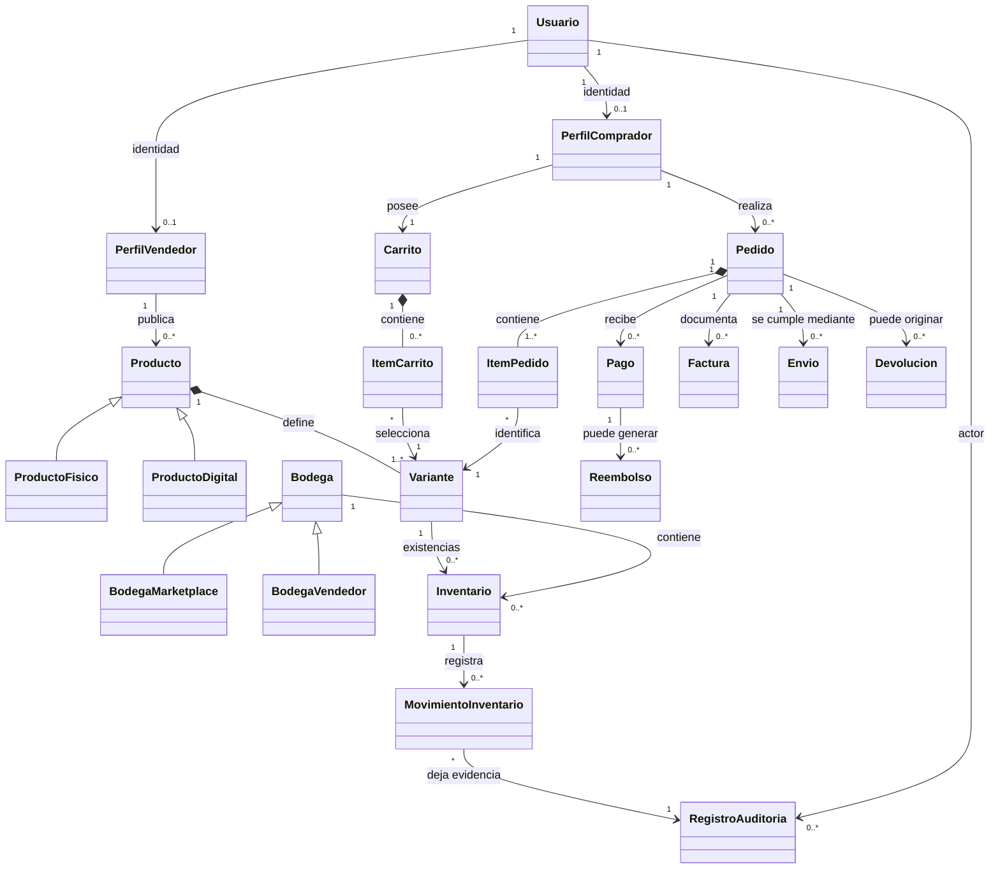

# NEXUSMARKET — Modelo de Dominio (SDD)

**Identificador:** NM-SDD-DOM-001  
**Versión:** 2.0 — reconstrucción integral  
**Estado:** línea base de diseño del dominio  
**Fecha:** 24 de octubre de 2026  
**Tecnología objetivo:** TypeScript sobre Node.js; DDD y arquitectura hexagonal; persistencia transaccional SQL complementada con MongoDB  
**Documento relacionado:** Especificación funcional de NexusMarket y arquitectura de referencia del profesor

---

## Control del documento

| Campo | Descripción |
|---|---|
| Propósito | Definir de forma verificable el modelo conceptual y conductual del negocio NexusMarket. |
| Audiencia | Equipo de desarrollo, arquitectura, pruebas, revisión académica y responsables funcionales. |
| Alcance | Identidad y roles, compradores, vendedores, catálogo, variantes, bodegas, inventario, carrito, pedidos, pagos, facturación, logística, devoluciones, reembolsos, auditoría y consulta administrativa. |
| Convenciones | Los nombres de dominio se presentan en español; los identificadores técnicos podrán usar equivalentes consistentes en TypeScript. |
| Jerarquía de fuentes | (1) requisitos explícitos de la especificación funcional; (2) modelo de dominio del profesor; (3) arquitectura de referencia del profesor, adaptada de Go a TypeScript/Node.js; (4) decisiones de diseño razonadas documentadas en este SDD. |
| Regla de interpretación | Una decisión de diseño de este documento no debe confundirse con un requisito textual de la fuente. La procedencia de las reglas se identifica como **Explícita**, **Derivada** o **Decisión de diseño**. |

## Historial de cambios

| Versión | Cambio |
|---|---|
| 1.0 | Documento previo de dominio, útil como inventario inicial de requisitos, pero con vacíos y decisiones sin resolver. |
| 2.0 | Reconstrucción del modelo; reconciliación de identidad/perfiles, reglas de inventario y pedidos; incorporación estructurada de pagos, facturación, logística, devoluciones, reembolsos, agregados, invariantes y pruebas de aceptación. |

---

# 1. Propósito y objetivos de diseño

El Modelo de Dominio de NexusMarket define los conceptos del negocio, su identidad, responsabilidades, relaciones, estados, invariantes y reglas de interacción. Constituye la base de la arquitectura de software, los casos de uso, el contrato de persistencia, la autorización y las pruebas.

NexusMarket es un marketplace centralizado que conecta compradores con vendedores y coordina el ciclo comercial desde la incorporación de vendedores y la publicación de productos hasta el pago, el cumplimiento logístico, la entrega, la facturación y los procesos posventa. El inventario se distribuye entre bodegas del marketplace y bodegas pertenecientes a vendedores.

Este documento persigue los siguientes objetivos:

1. Mantener los conceptos centrales del modelo del profesor, incluyendo usuarios, roles, productos físicos/digitales, variantes, bodegas, inventario, carrito, pedido, movimientos y auditoría.
2. Alinear el modelo con el alcance funcional: compradores, vendedores, bodegas, catálogo, inventario, carrito, pedidos, facturación, logística, devoluciones, reembolsos y reportes.
3. Separar entidades, objetos de valor, agregados, servicios de dominio y políticas de aplicación.
4. Definir invariantes y transiciones válidas para impedir estados imposibles, existencias negativas, cambios ilegales y operaciones fuera del rol o ámbito de propiedad.
5. Establecer una base independiente de tecnología. TypeScript, Node.js, SQL y MongoDB son decisiones de implementación; no deben contaminar las entidades del dominio.
6. Resolver ambigüedades de diseño con decisiones explícitas y justificadas en vez de dejar indefiniciones operativas.

## 1.1 Alcance funcional incluido

- Gestión de cuentas, roles, estado de acceso e identidad comercial.
- Registro de compradores y administración de su información de compra.
- Incorporación administrativa de vendedores y creación de su primera bodega.
- Catálogo, categorías, productos, variantes, SKU, precio y publicación.
- Bodegas Marketplace y Bodegas de Vendedor.
- Existencias por variante y bodega, reservas, salidas, ajustes y devoluciones.
- Carrito de compra y confirmación de compra.
- Pedido, líneas, precio congelado, estado comercial y coordinación de cumplimiento.
- Registro y resultado de pagos.
- Facturas asociadas a compras y su trazabilidad.
- Preparación, despacho, envío y confirmación de entrega para productos físicos.
- Entrega digital para productos digitales después del pago confirmado.
- Solicitud y resolución de devoluciones y ejecución de reembolsos.
- Auditoría de operaciones críticas y reportes administrativos de consulta.

## 1.2 Fuera del modelo de dominio

No forman parte del modelo conceptual las pantallas, el diseño visual, la navegación web/móvil, los controladores HTTP, los DTO de transporte, los modelos ORM, el esquema físico de tablas/colecciones, las credenciales de proveedores, los SDK de pagos/envíos ni la configuración de despliegue. Se documentarán en los SDD y artefactos técnicos correspondientes.

---

# 2. Base de conocimiento y criterio de reconciliación

## 2.1 Elementos conservados de las fuentes

Se conserva del modelo del profesor:

- La clasificación de usuarios por roles funcionales: Comprador, Vendedor, Operador Logístico, Administrador y Supervisor.
- Los conceptos Producto abstracto, ProductoFísico, ProductoDigital, Variante, Bodega, BodegaMarketplace, BodegaVendedor, Inventario, Carrito, ItemCarrito, Pedido, ItemPedido, MovimientoInventario y RegistroAuditoria.
- El inventario controlado por variante y bodega, no solo por producto.
- La obligación de auditar movimientos de inventario.
- La restricción de que los vendedores no se autorregistran: los incorpora un Administrador.
- Los estados de producto `PUBLICADO`, `SUSPENDIDO` y `DESCONTINUADO`.
- La entrega física y la entrega digital como rutas diferentes.

Se conserva de la especificación funcional del proyecto el alcance de facturación, logística, devoluciones, reembolsos y reportes, aunque el modelo inicial del profesor no detalla todos sus ciclos.

## 2.2 Reconciliación: Usuario frente a Comprador/Vendedor

La representación por herencia del modelo del profesor se considera útil como taxonomía conceptual, pero la arquitectura de referencia recomienda que `Usuario`, `Comprador` y `Vendedor` sean conceptos de dominio separados y relacionados, en lugar de convertir cada perfil comercial en una subclase de identidad. Este SDD adopta la segunda alternativa:

- `Usuario` representa la cuenta, la identidad de acceso, el correo, el documento, el estado de acceso y el rol.
- `PerfilComprador` representa los datos y el estado comercial necesarios para comprar.
- `PerfilVendedor` representa la identidad comercial, el estado de incorporación y los recursos del vendedor.
- Los roles no se usan como sustituto de propiedad de recursos ni de reglas de negocio.

**Regla de línea base:** cada cuenta tiene exactamente un rol. Una cuenta con rol `COMPRADOR` tiene un perfil de comprador; una cuenta con rol `VENDEDOR` tiene un perfil de vendedor; los roles administrativos no tienen perfil comercial de comprador/vendedor por defecto. No se permite que una misma cuenta tenga simultáneamente los roles comprador y vendedor. Esta decisión conserva la restricción explícita de rol único y evita una ambigüedad de autorización. Si el negocio requiere en el futuro que una persona compre y venda, se modelará mediante cuentas/identidades diferenciadas o una ampliación formal de la política de roles, no mediante una excepción implícita.

## 2.3 Clasificación de afirmaciones

- **Explícita:** aparece en la especificación funcional o en el modelo de dominio de referencia.
- **Derivada:** necesaria para que una regla explícita sea consistente o comprobable.
- **Decisión de diseño:** resolución adoptada para cerrar un vacío operativo; es la línea base del diseño y debe aplicarse uniformemente en implementación y pruebas.

No se etiquetará como requisito de negocio algo que solo sea una elección técnica. Cuando la fuente no fija un comportamiento, se adopta aquí una política de diseño conservadora, segura y trazable.

---

# 3. Lenguaje ubicuo

| Término | Definición normativa |
|---|---|
| Cuenta/Usuario | Identidad registrada que se autentica y ejecuta operaciones con un único rol. |
| Comprador | Participante que consulta el catálogo, administra su carrito, crea pedidos y solicita posventa sobre sus propias compras. |
| Vendedor | Comerciante incorporado por un Administrador, propietario de sus productos y de las bodegas que registra como propias. |
| Operador logístico | Usuario autorizado para ejecutar operaciones físicas asignadas, como preparación, empaque, despacho y movimientos operativos permitidos. |
| Administrador | Usuario con autoridad global para incorporar vendedores, administrar usuarios y bodegas del marketplace y ejecutar las operaciones administrativas permitidas. |
| Supervisor | Usuario de consulta y seguimiento; no modifica datos comerciales ni ejecuta movimientos de negocio. |
| Producto | Oferta comercial general que agrupa una o más variantes y pertenece a un vendedor. |
| Variante | Presentación vendible e identificable de un producto; unidad de SKU, precio e inventario. |
| Bodega | Ubicación física que puede contener existencias de variantes. |
| Existencia física (`onHand`) | Unidades físicamente registradas en una combinación variante-bodega, incluidas las unidades reservadas, pero excluidas las unidades dadas de baja definitivamente. |
| Reservado (`reserved`) | Unidades comprometidas temporalmente con pedidos que aún no han consumido definitivamente el stock. |
| Dañado/no vendible (`unavailable`) | Unidades físicamente registradas pero no aptas para reservar o vender. |
| Disponible para venta | Cantidad derivada `onHand - reserved - unavailable`; nunca se persiste como una cifra independiente que pueda divergir de sus componentes. |
| Reserva | Compromiso temporal de unidades para un pedido, sin representar todavía la salida física. |
| Movimiento de inventario | Registro de una operación que incrementa, disminuye, reserva, libera o reclasifica existencias. |
| Carrito | Selección provisional editable; no es un pedido ni garantiza precio o disponibilidad al momento de confirmar. |
| Pedido | Registro formal de la intención de compra confirmada, con líneas, cantidades, precios aplicados y ciclo de cumplimiento. |
| Pago | Intento/operación financiera asociada a un pedido; su estado no se confunde con el estado logístico del pedido. |
| Factura | Documento comercial/fiscal emitido conforme a la compra y sujeto a reglas de emisión y corrección. |
| Envío | Unidad de cumplimiento logístico de productos físicos, asociada a un conjunto de líneas y a una dirección de entrega congelada. |
| Devolución | Solicitud y proceso de retorno de productos o revocación de acceso digital conforme a una causa y resolución. |
| Reembolso | Devolución de dinero total o parcial asociada a un pago/captura previa y a una decisión aprobada. |
| Auditoría | Registro append-only que permite reconstruir acciones críticas, actor, momento, recurso y resultado. |

---

# 4. Mapa conceptual del dominio



**Nota de lectura:** el diagrama expresa relaciones conceptuales, no una obligación de implementar herencia física en SQL ni de convertir cada concepto en tabla o microservicio. Las cardinalidades normativas se detallan en la sección 8.

---

# 5. Contextos delimitados y límites de responsabilidad

El sistema se organiza conceptualmente en contextos delimitados. Son límites de lenguaje, reglas y consistencia; **no implican microservicios independientes**. La primera implementación puede ser un monolito modular con arquitectura hexagonal.

| Contexto | Responsabilidad | Conceptos principales | Fuente de verdad propuesta |
|---|---|---|---|
| Identidad y acceso | Cuenta, unicidad, estado de acceso y rol. | Usuario, CorreoElectronico, DocumentoIdentidad, RolSistema, EstadoUsuario. | SQL. |
| Compradores | Perfil, estado comercial, direcciones y propiedad de compras. | PerfilComprador, Direccion, EstadoComercial. | SQL. |
| Vendedores | Incorporación, datos comerciales y titularidad de catálogo/bodegas. | PerfilVendedor, EstadoVendedor. | SQL. |
| Catálogo | Productos, categorías, variantes, precios y publicación. | Producto, Variante, CategoriaProducto, SKU, Precio. | SQL. |
| Bodegas e inventario | Ubicaciones, cantidades, reservas, movimientos y ajustes. | Bodega, Inventario, ReservaInventario, MovimientoInventario. | SQL transaccional. |
| Compra | Carrito, confirmación, precios aplicados y creación de pedido. | Carrito, ItemCarrito, Pedido, ItemPedido, DirecciónSnapshot. | SQL. |
| Pagos | Intentos, confirmación, captura, rechazo y referencia externa. | Pago, EstadoPago, TransaccionPago. | SQL; respuesta del proveedor como evidencia. |
| Facturación | Emisión, numeración, datos fiscales y documento asociado. | Factura, LineaFactura, DatosFacturacion. | SQL para estado y metadatos; almacenamiento de archivo si aplica. |
| Logística | Preparación, paquetes, despacho, seguimiento y entrega. | Envio, Paquete, EventoEnvio, EstadoEnvio. | SQL. |
| Posventa | Solicitudes de devolución, resolución, recepción y reembolso. | Devolucion, LineaDevolucion, Reembolso. | SQL. |
| Auditoría y consulta | Registro inmutable y vistas de seguimiento/reportes. | RegistroAuditoria, EventoDominio, Proyecciones de consulta. | MongoDB para documentos de auditoría; SQL conserva las transacciones de negocio. |

## 5.1 Dependencias entre contextos

- Compra consulta catálogo y disponibilidad; no modifica directamente las existencias.
- Inventario es el único contexto que decide si una reserva, salida, liberación o ajuste de stock es válido.
- Pagos informa el resultado financiero; no cambia por sí solo la cantidad de inventario ni el estado de entrega.
- Pedido coordina el ciclo comercial, pero delega el pago a Pagos, la reserva a Inventario, el documento a Facturación y el cumplimiento a Logística.
- Posventa coordina devolución y reembolso; Inventario determina si las unidades retornadas pueden reingresar como vendibles.
- Auditoría registra acciones y resultados; no se usa como sustituto del estado transaccional actual.

---

# 6. Modelo de identidad, roles y participantes

## 6.1 Entidad `Usuario`

**Propósito:** representar una cuenta registrada y su capacidad de actuar en el sistema.

| Atributo | Tipo de dominio | Obligatorio | Restricciones |
|---|---|---:|---|
| `id` | `UsuarioId` | Sí | Identificador estable, único e inmutable. |
| `nombreCompleto` | `NombreCompleto` | Sí | No vacío; espacios normalizados. |
| `correoElectronico` | `CorreoElectronico` | Sí | Único después de normalización; formato válido. |
| `documentoIdentidad` | `DocumentoIdentidad` | Sí | Único en la plataforma; dato protegido. |
| `credencial` | `HashCredencial` | Sí | Solo se conserva un hash seguro; nunca contraseña en texto plano. |
| `rol` | `RolSistema` | Sí | Exactamente un rol. |
| `estado` | `EstadoUsuario` | Sí | ACTIVO, INACTIVO o BLOQUEADO. |
| `creadoEn` | `Instant` | Sí | Fecha/hora de creación en UTC. |
| `actualizadoEn` | `Instant` | Sí | Fecha/hora de última modificación. |

**Comportamientos:** `activar()`, `desactivar()`, `bloquear(motivo)`, `cambiarCorreo(correoVerificado)` y `puedeAutenticarse()`. La validación de contraseña, emisión de tokens y sesiones pertenecen al servicio de identidad/aplicación, no a la entidad como mecanismo criptográfico.

**Invariantes:**

- `USR-01`: correo normalizado único.
- `USR-02`: documento de identidad único.
- `USR-03`: rol obligatorio y único.
- `USR-04`: una cuenta INACTIVA o BLOQUEADA no puede iniciar nuevas sesiones ni ejecutar operaciones protegidas.
- `USR-05`: una contraseña no se almacena ni registra en auditoría en texto plano.
- `USR-06`: los cambios de rol se tratan como operación administrativa privilegiada y deben auditarse.

**Estados de acceso:**

| Estado actual | Evento | Estado resultante | Actor autorizado | Condición |
|---|---|---|---|---|
| ACTIVO | Desactivar cuenta | INACTIVO | Administrador | Motivo registrado. |
| ACTIVO | Bloquear cuenta | BLOQUEADO | Administrador / política de seguridad autorizada | Motivo y evidencia registrados. |
| INACTIVO | Reactivar | ACTIVO | Administrador | Se verifica que no exista bloqueo vigente. |
| BLOQUEADO | Desbloquear | ACTIVO | Administrador | Requiere resolución explícita del bloqueo. |
| INACTIVO | Bloquear | BLOQUEADO | Administrador | Se conserva motivo y trazabilidad. |
| BLOQUEADO | Desactivar | No permitido | — | La transición no aporta semántica; se debe resolver primero el bloqueo. |

**Decisión de diseño:** se distinguen `INACTIVO` y `BLOQUEADO`, siguiendo el catálogo de objetos de valor del proyecto. No se añade un estado de eliminación lógica al catálogo de acceso; el cierre de cuenta, si se requiere, se representa como proceso separado que preserva historial comercial y auditoría.

## 6.2 `RolSistema`

Valores cerrados: `COMPRADOR`, `VENDEDOR`, `OPERADOR_LOGISTICO`, `ADMINISTRADOR`, `SUPERVISOR`.

El rol expresa la clase de capacidades generales. No concede acceso automático a todos los recursos de ese tipo. La autorización efectiva es la combinación de rol, acción, estado de cuenta, propiedad/alcance del recurso y estado actual del proceso.

## 6.3 `PerfilComprador`

| Atributo | Tipo | Obligatorio | Regla |
|---|---|---:|---|
| `id` | `CompradorId` | Sí | Identidad propia del perfil. |
| `usuarioId` | `UsuarioId` | Sí | Referencia única a Usuario con rol COMPRADOR. |
| `estadoComercial` | `EstadoComercial` | Sí | HABILITADO o RESTRINGIDO. |
| `direcciones` | `Direccion[]` | Sí | Puede estar vacía al registrarse; se requiere una dirección válida para compra física. |
| `creadoEn` | `Instant` | Sí | Fecha de creación. |

Un comprador tiene un único carrito activo y cero o más pedidos. Solo puede consultar/modificar sus propios datos, carrito, pedidos y solicitudes de posventa. `RESTRINGIDO` impide crear nuevos pedidos; no borra pedidos anteriores ni impide consultar operaciones propias salvo restricción legal o de seguridad.

## 6.4 `PerfilVendedor`

| Atributo | Tipo | Obligatorio | Regla |
|---|---|---:|---|
| `id` | `VendedorId` | Sí | Identificador estable. |
| `usuarioId` | `UsuarioId` | Sí | Referencia única a Usuario con rol VENDEDOR. |
| `razonSocial` | `NombreComercial` | Sí | No vacía. |
| `estado` | `EstadoVendedor` | Sí | EN_REVISION, ACTIVO, SUSPENDIDO o INACTIVO. |
| `incorporadoPor` | `UsuarioId` | Sí | Debe corresponder a un Administrador autorizado. |
| `creadoEn` | `Instant` | Sí | Fecha de incorporación. |

**Reglas:** un vendedor no puede autorregistrarse; la incorporación la ejecuta un Administrador y el proceso crea la primera `BodegaVendedor`. La incorporación se considera completa únicamente si el perfil y la primera bodega quedan creados consistentemente. El vendedor solo puede administrar productos y bodegas de su propiedad. Un vendedor suspendido no puede publicar nuevos productos ni iniciar nuevas ventas; las obligaciones existentes se deben resolver, no eliminar.

## 6.5 `OperadorLogistico`, `Administrador` y `Supervisor`

Son perfiles de autorización asociados a cuentas cuyo rol es, respectivamente, `OPERADOR_LOGISTICO`, `ADMINISTRADOR` o `SUPERVISOR`. No necesitan una jerarquía de herencia de dominio para representar permisos.

- **Operador logístico:** puede ejecutar tareas asignadas de preparación, empaque, despacho, confirmación logística y movimientos de inventario permitidos. No puede cambiar precios, propietarios de productos, datos de pago ni autorizarse reembolsos por el solo hecho de operar la bodega.
- **Administrador:** incorpora vendedores, administra usuarios y bodegas del marketplace, realiza operaciones administrativas globales permitidas y puede aprobar operaciones excepcionales según política. Las acciones privilegiadas se auditan.
- **Supervisor:** consulta seguimiento y reportes autorizados. La política de dominio es de solo lectura: no cambia estados, no ajusta inventario, no modifica pedidos ni ejecuta pagos/reembolsos.

---

# 7. Catálogo, productos y variantes

## 7.1 `Producto` (abstracto conceptual)

Representa la ficha comercial de una oferta. Todo producto pertenece a un vendedor y agrupa variantes vendibles.

| Atributo | Tipo | Obligatorio | Restricción |
|---|---|---:|---|
| `id` | `ProductoId` | Sí | Único e inmutable. |
| `vendedorId` | `VendedorId` | Sí | Propietario del producto. |
| `nombre` | `NombreProducto` | Sí | No vacío, longitud acotada por validación. |
| `descripcion` | `DescripcionProducto` | Sí | Texto descriptivo; puede admitir vacío solo si la política del catálogo lo autoriza. Línea base: obligatorio. |
| `categoria` | `CategoriaProducto` | Sí | Código del catálogo controlado. |
| `estado` | `EstadoProducto` | Sí | PUBLICADO, SUSPENDIDO o DESCONTINUADO. |
| `tipoEntrega` | `TipoEntrega` | Sí | FÍSICA o DIGITAL, coherente con el subtipo. |
| `creadoEn` | `Instant` | Sí | Fecha de creación. |
| `actualizadoEn` | `Instant` | Sí | Última modificación. |

**Reglas:**

- `CAT-01`: un producto pertenece a un único vendedor.
- `CAT-02`: todo producto tiene al menos una variante antes de publicarse.
- `CAT-03`: la publicación exige vendedor ACTIVO, datos obligatorios válidos, variantes vendibles y precio válido.
- `CAT-04`: un producto SUSPENDIDO no se ofrece para nuevas compras, aunque se conserva para pedidos históricos.
- `CAT-05`: un producto DESCONTINUADO no admite nuevas ventas ni retorno a PUBLICADO; se permite consulta histórica y resolución de obligaciones existentes.
- `CAT-06`: modificar el catálogo no altera el nombre, SKU, precio aplicado ni otros snapshots de líneas de pedidos ya confirmados.
- `CAT-07`: solo el vendedor propietario o un Administrador puede cambiar el estado del producto.

**Transiciones de estado:**

| Actual | Evento | Nuevo | Regla |
|---|---|---|---|
| Borrador/no publicado | Publicar | PUBLICADO | Validar datos, variantes, vendedor y precio. |
| PUBLICADO | Suspender | SUSPENDIDO | Oculta la oferta para nuevas compras; no cancela pedidos existentes automáticamente. |
| SUSPENDIDO | Reanudar | PUBLICADO | Revalidar condiciones de publicación. |
| PUBLICADO | Descontinuar | DESCONTINUADO | Cierre definitivo de nuevas ventas. |
| SUSPENDIDO | Descontinuar | DESCONTINUADO | Cierre definitivo. |
| DESCONTINUADO | Publicar/Reanudar | No permitido | Se debe crear un producto nuevo si se desea una nueva oferta. |

La condición “borrador/no publicado” es una fase de creación, no un estado comercial público adicional. El catálogo público solo muestra productos PUBLICADOS.

## 7.2 `ProductoFisico`

Subtipo conceptual de Producto cuya entrega requiere inventario físico y cumplimiento logístico. Cada línea comprada debe poder asignarse a una o varias combinaciones variante-bodega para reservar y preparar cantidades suficientes. La disponibilidad física debe validarse antes de confirmar el pedido.

## 7.3 `ProductoDigital`

Subtipo conceptual de Producto que se entrega mediante `DESCARGA_DIGITAL` o mecanismo digital autorizado después de la confirmación de pago. No requiere stock físico, bodega, empaque ni envío físico. La plataforma debe registrar la evidencia de entrega digital. Si el producto requiere una licencia o código, el activo/licencia se representa como recurso de entrega asociado, no como inventario físico.

## 7.4 `Variante`

Representa la unidad vendible concreta de un producto, con SKU, precio y atributos de variación (por ejemplo, talla, color o modelo).

| Atributo | Tipo | Obligatorio | Restricción |
|---|---|---:|---|
| `id` | `VarianteId` | Sí | Único. |
| `productoId` | `ProductoId` | Sí | Producto propietario. |
| `sku` | `SKU` | Sí | Único globalmente en NexusMarket; no se reutiliza tras descontinuar. |
| `nombre` | `NombreVariante` | Sí | No vacío. |
| `atributos` | `Map<string,string>` | Sí | Pares normalizados; claves únicas dentro de la variante. |
| `precio` | `Dinero` | Sí | Importe mayor que cero; moneda explícita. |
| `estado` | `EstadoVariante` | Sí | ACTIVA o INACTIVA. |

**Decisión de diseño:** el SKU es globalmente único para evitar colisiones en logística e inventario. El precio pertenece a la variante porque las distintas presentaciones pueden venderse a precios diferentes. Las modificaciones de precio solo afectan nuevas compras.

Una variante no puede venderse si está inactiva, su producto no está PUBLICADO o su vendedor no está ACTIVO. En productos físicos, además debe existir disponibilidad reservable. En productos digitales, debe existir un recurso de entrega válido.

## 7.5 `CategoriaProducto`

Catálogo controlado con códigos iniciales: `ELECTRONICA`, `ROPA`, `HOGAR` y `DIGITAL`. Los códigos son valores del dominio, no cadenas arbitrarias. La ampliación del catálogo se realiza como cambio controlado de datos/configuración de dominio. La categoría `DIGITAL` no obliga por sí sola a que todo producto de esa categoría sea digital: la coherencia entre categoría y tipo se valida en la política del catálogo.

---

# 8. Bodegas e inventario

## 8.1 `Bodega` (abstracta conceptual)

| Atributo | Tipo | Obligatorio | Restricción |
|---|---|---:|---|
| `id` | `BodegaId` | Sí | Único. |
| `nombre` | `NombreBodega` | Sí | No vacío. |
| `ubicacion` | `DireccionFisica` | Sí | Dirección/ubicación normalizada. |
| `tipo` | `TipoBodega` | Sí | MARKETPLACE o VENDEDOR. |
| `estado` | `EstadoBodega` | Sí | ACTIVA o INACTIVA. |
| `creadaEn` | `Instant` | Sí | Fecha de creación. |

`BodegaMarketplace` pertenece a la operación central y su administración corresponde al Administrador. `BodegaVendedor` debe tener exactamente un `vendedorId` propietario. El modelo permite varias bodegas por vendedor; la incorporación inicial debe crear al menos una. Una bodega INACTIVA no acepta nuevos ingresos ni reservas; el stock existente debe trasladarse, liquidarse o ajustarse mediante movimientos trazables antes de cerrarla definitivamente.

## 8.2 `Inventario`

Un registro de inventario representa la cantidad de una variante en una bodega. La clave natural de negocio es `(varianteId, bodegaId)`; debe existir como máximo un registro vigente por combinación.

| Atributo | Tipo | Obligatorio | Restricción |
|---|---|---:|---|
| `id` | `InventarioId` | Sí | Único. |
| `varianteId` | `VarianteId` | Sí | Variante inventariada. |
| `bodegaId` | `BodegaId` | Sí | Bodega física. |
| `onHand` | `Cantidad` | Sí | Entero no negativo. |
| `reserved` | `Cantidad` | Sí | Entero no negativo. |
| `unavailable` | `Cantidad` | Sí | Entero no negativo; unidades dañadas/no vendibles. |
| `version` | `VersionInventario` | Sí | Control de concurrencia optimista o equivalente. |
| `actualizadoEn` | `Instant` | Sí | Fecha de último cambio. |

`disponible = onHand - reserved - unavailable` se calcula; no se almacena como fuente independiente. `reserved + unavailable <= onHand` debe cumplirse siempre.

### 8.2.1 Invariantes de inventario

- `INV-01`: `onHand >= 0`, `reserved >= 0` y `unavailable >= 0`.
- `INV-02`: `reserved + unavailable <= onHand`.
- `INV-03`: solo se reserva si `disponible >= cantidadSolicitada`.
- `INV-04`: solo se reserva stock de una bodega ACTIVA y una variante vendible.
- `INV-05`: toda mutación genera un `MovimientoInventario` con cantidad, motivo, referencia de negocio, actor y timestamp.
- `INV-06`: un mismo comando/referencia de reserva no se aplica dos veces; las operaciones deben ser idempotentes.
- `INV-07`: una reserva liberada o consumida no puede volver a procesarse como activa.
- `INV-08`: los ajustes requieren motivo y actor autorizado; no se corrigen cantidades editando directamente el saldo.
- `INV-09`: las unidades devueltas no se suman automáticamente al stock vendible; deben inspeccionarse y clasificarse como vendibles o no vendibles.
- `INV-10`: una combinación variante-bodega tiene una sola posición lógica de inventario.

### 8.2.2 Movimientos y efecto en cantidades

| Tipo | Efecto sobre cantidades | Uso y restricciones |
|---|---|---|
| `INGRESO` | `onHand += q` | Recepción o carga inicial; requiere referencia y autorización. |
| `RESERVA` | `reserved += q` | Reserva para pedido; disponible disminuye porque `reserved` aumenta. |
| `LIBERACION_RESERVA` | `reserved -= q` | Libera una reserva activa por cancelación, fallo de pago o expiración autorizada. Se agrega como tipo explícito necesario para cerrar el ciclo de reserva. |
| `SALIDA_VENTA` | `onHand -= q`, `reserved -= q` | Consumo físico al despachar; exige reserva activa suficiente. |
| `AJUSTE_POSITIVO` | `onHand += q` | Corrección documentada o hallazgo físico. |
| `AJUSTE_NEGATIVO` | Reduce `onHand` y/o reclasifica a `unavailable` | Nunca puede dejar `onHand < reserved + unavailable`; exige motivo, autorización y auditoría. |
| `DEVOLUCION_VENDIBLE` | `onHand += q` | Reingreso tras inspección y aprobación de devolución. |
| `DEVOLUCION_NO_VENDIBLE` | `onHand += q`, `unavailable += q` | Unidad físicamente recibida, pero no disponible para venta. |
| `BAJA_DANIO` | `onHand -= q`, `unavailable -= q` | Retiro definitivo de unidades dañadas/no vendibles; debe mantener invariantes. |

Los tipos iniciales del catálogo del profesor (`INGRESO`, `RESERVA`, `SALIDA_VENTA`, `AJUSTE`, `DEVOLUCION`) se preservan conceptualmente. Se detallan subtipos y liberación para que las operaciones inversas sean explícitas y auditables.

### 8.2.3 Reserva de inventario

Una `ReservaInventario` identifica `id`, `pedidoId`, `varianteId`, `bodegaId`, `cantidad`, `estado`, `creadaEn`, `expiraEn` y `claveIdempotencia`. Estados: `ACTIVA`, `CONSUMIDA`, `LIBERADA`, `EXPIRADA`.

- La reserva es atómica respecto a la posición de inventario correspondiente.
- Una reserva ACTIVA puede consumirse una sola vez o liberarse una sola vez.
- Una reserva EXPIRADA no puede consumirse; si todavía se necesita stock, se crea una nueva reserva.
- La expiración debe liberar cantidades mediante una operación explícita, no solo cambiar una etiqueta.
- La política inicial establece que la reserva se realiza durante el checkout antes de solicitar/confirmar el pago, con una expiración temporal. Si el pago falla o expira, la reserva se libera. Esto evita cobrar por unidades que ya no están disponibles.

## 8.3 `MovimientoInventario`

| Atributo | Tipo | Obligatorio | Descripción |
|---|---|---:|---|
| `id` | `MovimientoId` | Sí | Identidad única. |
| `inventarioId` | `InventarioId` | Sí | Posición afectada. |
| `tipo` | `TipoMovimientoInventario` | Sí | Tipo controlado. |
| `cantidad` | `CantidadPositiva` | Sí | Siempre mayor que cero; la dirección la define el tipo. |
| `referenciaTipo` | `TipoReferencia` | Sí | Pedido, devolución, ajuste, recepción u otra referencia permitida. |
| `referenciaId` | `string` | Sí | Identificador del proceso origen. |
| `actorId` | `UsuarioId` o identidad de sistema | Sí | Actor humano o proceso autorizado. |
| `motivo` | `MotivoMovimiento` | Sí | Obligatorio en ajustes y bajas. |
| `ocurridoEn` | `Instant` | Sí | Momento UTC. |
| `idempotencyKey` | `IdempotencyKey` | Sí | Evita duplicación de efectos. |

Los movimientos son registros de hechos pasados. No se editan ni eliminan para “corregir” el historial; se registra un movimiento compensatorio.

---

# 9. Carrito y confirmación de compra

## 9.1 `Carrito`

| Atributo | Tipo | Obligatorio | Regla |
|---|---|---:|---|
| `id` | `CarritoId` | Sí | Identificador estable. |
| `compradorId` | `CompradorId` | Sí | Un carrito activo por comprador. |
| `items` | `ItemCarrito[]` | Sí | Cero o más líneas. |
| `actualizadoEn` | `Instant` | Sí | Fecha de modificación. |
| `version` | `number` | Sí | Control de concurrencia. |

El carrito se crea vacío al registrar el comprador. Es editable mientras no se confirme. No reserva stock por el mero hecho de contener una variante. El precio mostrado en el carrito es informativo y se vuelve a validar al confirmar.

## 9.2 `ItemCarrito`

| Atributo | Tipo | Regla |
|---|---|---|
| `varianteId` | `VarianteId` | Una línea por variante; agregar la misma variante incrementa cantidad en lugar de duplicar línea. |
| `cantidad` | `CantidadPositiva` | Entero mayor que cero. |
| `precioReferencial` | `Dinero` | Precio observado al modificar el carrito; no garantiza el precio final. |
| `agregadoEn` | `Instant` | Trazabilidad de la selección. |

La línea no necesita identidad de negocio independiente si su ciclo de vida está contenido por el carrito; puede tener un identificador técnico para operaciones de interfaz, pero no es obligatorio para el dominio.

## 9.3 Reglas de carrito

- `CAR-01`: el comprador solo accede a su propio carrito.
- `CAR-02`: una variante inactiva o de producto no publicado no se puede agregar.
- `CAR-03`: la cantidad debe ser un entero positivo.
- `CAR-04`: no se confirma un carrito vacío.
- `CAR-05`: el checkout vuelve a validar precio, estado de producto/variante, vendedor y disponibilidad.
- `CAR-06`: agregar un producto al carrito no equivale a reservarlo ni garantiza que continúe disponible.
- `CAR-07`: si cambió el precio desde la última consulta, el checkout debe recalcular el total y exigir confirmación del comprador antes de continuar; no debe cobrar silenciosamente un total distinto.

## 9.4 Confirmación de compra (checkout)

El checkout es un caso de uso coordinador, no una entidad persistente necesariamente. Debe ejecutar estas etapas:

1. Validar identidad, rol COMPRADOR, estado de acceso ACTIVO y estado comercial HABILITADO.
2. Leer el carrito y comprobar que contiene líneas.
3. Revalidar productos, variantes, vendedor, precios, cantidades y reglas de entrega.
4. Calcular importes con `Dinero` y una moneda explícita; no usar aritmética binaria de punto flotante.
5. Para líneas físicas, asignar stock a bodegas elegibles y reservar cantidades de forma transaccional por posición de inventario.
6. Crear pedido y líneas con snapshots de nombre, SKU, precio, moneda, cantidad, vendedor y tipo de entrega.
7. Crear la operación de pago en estado pendiente y solicitarla mediante el puerto de pagos.
8. Si no se puede completar la reserva, no se crea una compra pagable parcialmente. Si falla la creación del pedido/pago después de reservar, se ejecuta compensación idempotente para liberar las reservas.
9. Vaciar el carrito o marcarlo como convertido solo cuando el pedido se haya creado satisfactoriamente; el historial de pedido es la evidencia permanente de la compra.

**Decisión de diseño de pedidos multi-vendedor:** un carrito puede contener variantes de varios vendedores, pero el checkout genera un `Pedido` comercial por vendedor. El caso de uso puede devolver un grupo de pedidos asociados a una misma intención de checkout. Esto permite liquidación, facturación, devolución y cumplimiento por vendedor sin perder la experiencia de un solo carrito. Cada pedido tiene un solo vendedor comercial, aunque pueda requerir varias asignaciones de bodega/envío. La asociación de grupo de checkout se conserva mediante `checkoutGroupId`.

---

# 10. Pedido y líneas de pedido

## 10.1 `Pedido` (agregado)

El pedido es el registro inmutable de la compra confirmada y el agregado que gobierna su ciclo comercial. Su raíz controla cambios de estado y líneas. Las modificaciones posteriores al checkout se registran como eventos de cumplimiento/posventa, no como reescritura del acuerdo original.

| Atributo | Tipo | Obligatorio | Restricción |
|---|---|---:|---|
| `id` | `PedidoId` | Sí | Identificador único. |
| `checkoutGroupId` | `CheckoutGroupId` | Sí | Agrupa pedidos generados en una misma confirmación de carrito. |
| `compradorId` | `CompradorId` | Sí | Comprador propietario. |
| `vendedorId` | `VendedorId` | Sí | Un solo vendedor por pedido. |
| `items` | `ItemPedido[]` | Sí | Al menos una línea. |
| `estado` | `EstadoPedido` | Sí | Estado de ciclo comercial. |
| `estadoPago` | `EstadoPago` | Sí | Proyección del estado financiero, no sustituto de Pago. |
| `subtotal` | `Dinero` | Sí | Suma de importes de líneas. |
| `descuentos` | `Dinero` | Sí | Cero si no hay descuentos; nunca negativo. |
| `costoEnvio` | `Dinero` | Sí | Cero para entrega digital o envío gratuito. |
| `impuestos` | `Dinero` | Sí | Importe calculado según reglas fiscales configuradas. |
| `total` | `Dinero` | Sí | `subtotal - descuentos + costoEnvio + impuestos`; nunca negativo. |
| `direccionEntrega` | `DireccionSnapshot?` | Condicional | Obligatoria si contiene productos físicos. |
| `creadoEn` | `Instant` | Sí | Fecha UTC. |
| `pagadoEn` | `Instant?` | No | Se establece con pago confirmado. |
| `entregadoEn` | `Instant?` | No | Se establece al confirmar cumplimiento completo. |
| `version` | `number` | Sí | Control de concurrencia. |

## 10.2 `ItemPedido`

| Atributo | Tipo | Regla |
|---|---|---|
| `id` | `ItemPedidoId` | Identidad estable dentro del pedido. |
| `varianteId` | `VarianteId` | Referencia a la variante original. |
| `productoNombreSnapshot` | `string` | Nombre vendido al momento del checkout. |
| `skuSnapshot` | `SKU` | SKU aplicado al momento de la compra. |
| `vendedorId` | `VendedorId` | Vendedor responsable. |
| `tipoEntrega` | `TipoEntrega` | FÍSICA o DIGITAL, congelado en compra. |
| `cantidad` | `CantidadPositiva` | Cantidad confirmada. |
| `precioUnitario` | `Dinero` | Precio aplicado, inmutable. |
| `descuentoUnitario` | `Dinero` | Descuento asignado a la línea, no negativo. |
| `impuesto` | `Dinero` | Impuesto asignado según reglas fiscales. |
| `totalLinea` | `Dinero` | Cantidad × precio menos descuentos más impuestos, según redondeo definido. |

Los snapshots preservan el significado histórico incluso si el catálogo cambia o la variante se descontinúa. La cantidad entregada/devuelta se controla en los agregados de cumplimiento y posventa; no se reescribe la cantidad originalmente comprada.

## 10.3 Estados del pedido

Estados de línea base: `PENDIENTE_DE_PAGO`, `PAGADO`, `EN_PREPARACION`, `DESPACHADO`, `ENTREGADO`, `CANCELADO`, `CERRADO`. `CARRITO` no es un estado del pedido: el carrito y el pedido son conceptos diferentes. `FINALIZADO` se normaliza como `CERRADO` posterior a entrega y al cierre operativo; la entrega y el cierre no son sinónimos.

| Estado actual | Evento | Estado resultante | Condiciones |
|---|---|---|---|
| — | Crear pedido | PENDIENTE_DE_PAGO | Checkout válido y reservas físicas activas cuando apliquen. |
| PENDIENTE_DE_PAGO | Pago confirmado | PAGADO | Confirmación válida/idempotente del pago. |
| PENDIENTE_DE_PAGO | Pago rechazado/expirado | CANCELADO | Se libera reserva y se conserva el motivo. |
| PENDIENTE_DE_PAGO | Cancelación autorizada | CANCELADO | Solo antes de confirmación de pago; liberar reserva. |
| PAGADO | Iniciar preparación | EN_PREPARACION | Pago confirmado; reservas vigentes. Para digitales, el flujo puede saltar a entrega digital. |
| EN_PREPARACION | Despachar | DESPACHADO | Productos físicos empacados y salida de inventario registrada. |
| DESPACHADO | Confirmar entrega | ENTREGADO | Evidencia de entrega válida para todos los envíos requeridos. |
| PAGADO | Entrega digital confirmada | ENTREGADO | Pago confirmado y evidencia de entrega digital. |
| ENTREGADO | Cerrar operación | CERRADO | Cumplimiento completo; no quedan tareas operativas de entrega pendientes. |
| CERRADO | Modificar líneas/total/estado comercial | No permitido | Solo se gestionan procesos de posventa separados. |
| CANCELADO | Reanudar | No permitido | Crear nuevo pedido si el comprador desea intentar de nuevo. |

**Reglas:**

- `ORD-01`: solo transiciones de la tabla son válidas.
- `ORD-02`: el pedido no pasa a PAGADO por la sola solicitud de pago; se requiere resultado confirmado.
- `ORD-03`: el alistamiento no comienza antes de confirmar el pago.
- `ORD-04`: un pedido ENTREGADO o CERRADO no se modifica retroactivamente; devolución/reembolso son procesos separados.
- `ORD-05`: los cambios de estado registran actor, timestamp, estado previo, estado nuevo y referencia causal.
- `ORD-06`: una notificación duplicada de pago o envío no duplica transición ni movimiento.
- `ORD-07`: un pedido con productos físicos requiere dirección de entrega válida y cumplimiento logístico; un pedido digital no crea envío físico.
- `ORD-08`: el estado global ENTREGADO se establece cuando todos los envíos/entregas del pedido han sido confirmados.

## 10.4 Cancelación y compensación

Antes del pago confirmado, cancelar libera reservas activas y termina los intentos de pago que puedan cancelarse. Después del pago confirmado, una cancelación no debe ser un simple cambio a CANCELADO: requiere un flujo explícito de anulación, reversión/cancelación del pago si el proveedor lo admite, liberación o devolución de inventario según el punto de cumplimiento, y registro financiero. Para evitar un estado ambiguo, el modelo de línea base no permite cancelación directa después de PAGADO; esos casos se tramitan como devolución/reembolso o anulación financiera autorizada antes de despacho, conservando trazabilidad.

---

# 11. Pagos

## 11.1 `Pago`

Representa un intento u operación financiera para cobrar el total de un pedido. Un pedido puede tener varios intentos, pero solo una suma de capturas exitosas que cubra el importe adeudado; un pago rechazado no se convierte en exitoso por modificación manual.

| Atributo | Tipo | Obligatorio | Regla |
|---|---|---:|---|
| `id` | `PagoId` | Sí | Identidad interna. |
| `pedidoId` | `PedidoId` | Sí | Pedido al que se aplica. |
| `importe` | `Dinero` | Sí | Debe corresponder al importe solicitado. |
| `estado` | `EstadoPago` | Sí | Estado controlado. |
| `proveedor` | `ProveedorPago` | Sí | Identificador de proveedor/configuración. |
| `referenciaExterna` | `string?` | No | Identificador del proveedor; único cuando existe. |
| `idempotencyKey` | `IdempotencyKey` | Sí | Evita doble cobro. |
| `creadoEn` | `Instant` | Sí | Momento de inicio. |
| `confirmadoEn` | `Instant?` | No | Momento de confirmación. |
| `motivoResultado` | `string?` | No | Código normalizado, sin secretos ni datos de tarjeta. |

Estados: `PENDIENTE`, `AUTORIZADO`, `CAPTURADO`, `RECHAZADO`, `CANCELADO`, `REEMBOLSO_PARCIAL`, `REEMBOLSADO`.

**Reglas:**

- `PAY-01`: el sistema no marca un pago como CAPTURADO sin confirmación autenticada del proveedor o mecanismo de conciliación autorizado.
- `PAY-02`: una notificación externa debe verificarse, correlacionarse e idempotentizarse antes de afectar el pedido.
- `PAY-03`: una operación de pago no puede capturarse dos veces por reintentos de red.
- `PAY-04`: un pago rechazado puede originar otro intento; el historial no se sobrescribe.
- `PAY-05`: el total capturado y los reembolsos acumulados no pueden exceder el importe capturado.
- `PAY-06`: datos completos de tarjeta y secretos del proveedor nunca se guardan en el dominio ni en auditoría.
- `PAY-07`: un pago confirmado puede activar la transición del pedido solo una vez.

El dominio define el resultado comercial, no el protocolo concreto del proveedor. Los estados de autorización/captura pueden simplificarse si el proveedor solo ofrece confirmación final, pero la semántica de pago confirmado debe seguir siendo inequívoca.

---

# 12. Facturación

## 12.1 `Factura`

Representa el documento comercial/fiscal asociado a un pedido. El modelo admite una factura por pedido como línea base; si la legislación o la política de liquidación exige documentos separados por vendedor o envío, el diseño de facturación deberá emitir documentos derivados sin alterar el pedido original.

| Atributo | Tipo | Obligatorio | Regla |
|---|---|---:|---|
| `id` | `FacturaId` | Sí | Identificador interno. |
| `pedidoId` | `PedidoId` | Sí | Pedido documentado. |
| `numero` | `NumeroFactura` | Sí | Único dentro de la serie fiscal aplicable. |
| `fechaEmision` | `Instant` | Sí | Fecha de emisión. |
| `emisor` | `DatosEmisorSnapshot` | Sí | Datos del emisor congelados al emitir. |
| `receptor` | `DatosReceptorSnapshot` | Sí | Datos del comprador congelados al emitir. |
| `lineas` | `LineaFactura[]` | Sí | Copia de conceptos, cantidades e importes facturados. |
| `subtotal`, `impuestos`, `total` | `Dinero` | Sí | Importes consistentes con la factura. |
| `estado` | `EstadoFactura` | Sí | BORRADOR, EMITIDA, ANULADA o CORREGIDA mediante documento relacionado. |
| `documentoUri` | `UriDocumento?` | No | Ubicación del artefacto generado; no es regla de negocio. |

**Reglas:** la factura emitida no se edita silenciosamente. Las correcciones se representan mediante anulación o documento correctivo vinculado, según política fiscal aplicable. La emisión se habilita cuando el pago se encuentra confirmado, salvo que la política fiscal de la jurisdicción exija otro momento. El documento no debe inventar requisitos legales específicos sin configurar jurisdicción, impuestos y numeración correspondientes.

---

# 13. Logística, envíos y entrega

## 13.1 `Envio`

Representa una unidad logística para productos físicos. Un pedido puede requerir uno o varios envíos por disponibilidad distribuida, separación de bodega o reglas operativas. Cada envío pertenece a un único pedido y se asigna a una bodega de origen.

| Atributo | Tipo | Obligatorio | Regla |
|---|---|---:|---|
| `id` | `EnvioId` | Sí | Identidad única. |
| `pedidoId` | `PedidoId` | Sí | Pedido relacionado. |
| `bodegaOrigenId` | `BodegaId` | Sí | Bodega activa y compatible con las líneas. |
| `items` | `ItemEnvio[]` | Sí | Líneas/cantidades asignadas; no exceden cantidad comprada ni reservada. |
| `transportista` | `string?` | No | Se completa al asignar operador externo. |
| `trackingNumber` | `string?` | No | Identificador de seguimiento si existe. |
| `direccionEntrega` | `DireccionSnapshot` | Sí | Copia inmutable de la dirección confirmada. |
| `estado` | `EstadoEnvio` | Sí | PREPARACION, EMPACADO, DESPACHADO, EN_TRANSITO, ENTREGADO, FALLIDO, DEVUELTO. |
| `despachadoEn`, `entregadoEn` | `Instant?` | No | Marcas de tiempo según transición. |

**Reglas:** solo pedidos pagados pueden prepararse/despacharse; la salida física de inventario se registra al despachar; el envío no se marca entregado sin evidencia o confirmación válida; una entrega fallida no equivale a una devolución aceptada. La devolución física se procesa por el contexto de posventa y puede requerir logística inversa.

## 13.2 Preparación y despacho

1. El pedido PAGADO se asigna a bodega(s) según disponibilidad y compatibilidad.
2. Se verifica que las reservas siguen activas y corresponden al pedido.
3. El operador prepara y empaca las unidades asignadas.
4. Al despachar, la reserva se consume y `SALIDA_VENTA` reduce `onHand` y `reserved` de forma atómica; se registra el envío.
5. El estado del envío avanza con eventos trazables.
6. El pedido pasa a ENTREGADO cuando todos sus envíos requeridos están ENTREGADOS.

## 13.3 Entrega digital

La entrega digital no crea un `Envio` físico. Tras pago confirmado, el sistema ejecuta la entrega digital a través del servicio correspondiente, registra el recurso/versión entregada, fecha y resultado, y solo entonces marca la línea como entregada. Un fallo de entrega digital no puede tratarse como entrega exitosa; requiere reintento idempotente o resolución operativa.

---

# 14. Devoluciones y reembolsos

## 14.1 `Devolucion`

Representa una solicitud posventa de un comprador sobre un pedido entregado o una entrega digital completada. La devolución no reescribe el pedido original.

| Atributo | Tipo | Obligatorio | Regla |
|---|---|---:|---|
| `id` | `DevolucionId` | Sí | Identidad única. |
| `pedidoId` | `PedidoId` | Sí | Pedido de origen. |
| `compradorId` | `CompradorId` | Sí | Debe ser propietario del pedido. |
| `items` | `LineaDevolucion[]` | Sí | Cantidades no exceden las cantidades entregadas ni las ya solicitadas/aprobadas. |
| `motivo` | `MotivoDevolucion` | Sí | Catálogo de motivos controlados. |
| `estado` | `EstadoDevolucion` | Sí | SOLICITADA, EN_REVISION, APROBADA, RECHAZADA, EN_TRANSITO, RECIBIDA, RESUELTA. |
| `solicitadaEn` | `Instant` | Sí | Momento de solicitud. |
| `resueltaEn` | `Instant?` | No | Momento de resolución final. |
| `resueltaPor` | `UsuarioId?` | No | Actor autorizado. |

**Política de línea base:** se acepta solicitud sobre una entrega confirmada dentro del período configurable de devolución. El período se parametriza como política de negocio, no se fija aquí una cifra arbitraria. La aprobación requiere motivo válido, elegibilidad temporal, cantidades disponibles para devolver y revisión del rol autorizado. El comprador no aprueba su propia solicitud.

Para productos físicos, una devolución aprobada requiere recepción e inspección antes de reingresar al inventario vendible. Para productos digitales, la devolución puede implicar revocación de licencia/acceso cuando sea posible; no se registra ingreso a inventario físico.

## 14.2 `Reembolso`

Representa la devolución de dinero vinculada a un pago previamente capturado.

| Atributo | Tipo | Obligatorio | Regla |
|---|---|---:|---|
| `id` | `ReembolsoId` | Sí | Identidad única. |
| `pagoId` | `PagoId` | Sí | Pago de origen. |
| `pedidoId` | `PedidoId` | Sí | Pedido asociado. |
| `devolucionId` | `DevolucionId?` | No | Obligatorio si se origina en una devolución; puede ser nulo para ajuste autorizado independiente. |
| `importe` | `Dinero` | Sí | Mayor que cero y no excede saldo reembolsable. |
| `estado` | `EstadoReembolso` | Sí | SOLICITADO, APROBADO, EN_PROCESO, COMPLETADO, FALLIDO. |
| `motivo` | `MotivoReembolso` | Sí | Obligatorio. |
| `aprobadoPor` | `UsuarioId` | Sí | Administrador o rol de finanzas autorizado por política. |
| `referenciaExterna` | `string?` | No | Referencia del proveedor. |
| `idempotencyKey` | `IdempotencyKey` | Sí | Evita duplicar el reembolso. |

**Reglas:** el reembolso nunca puede superar el importe efectivamente capturado menos reembolsos ya completados/en curso que comprometan el saldo; solo se procesa una vez por clave idempotente; un fallo externo no marca el reembolso como completado; la aprobación y el resultado externo se auditan. Una devolución aceptada y un reembolso son procesos relacionados, pero no equivalentes: la recepción física puede ocurrir antes de la devolución del dinero, según la política establecida.

## 14.3 Transiciones de posventa

- `SOLICITADA → EN_REVISION` al asignarse a revisión.
- `EN_REVISION → APROBADA` o `RECHAZADA` por actor autorizado y con motivo.
- Para producto físico: `APROBADA → EN_TRANSITO → RECIBIDA → RESUELTA` cuando se confirma recepción, inspección y resolución financiera/operativa.
- Para producto digital: `APROBADA → RESUELTA` después de aplicar la política digital y resolver el reembolso si corresponde.
- No se reabre una devolución RESUELTA; una controversia nueva genera un caso relacionado, no una mutación histórica.

---

# 15. Auditoría y trazabilidad

## 15.1 `RegistroAuditoria`

Registro inmutable de una acción relevante. Su objetivo es permitir responder: quién actuó, qué hizo, sobre qué recurso, cuándo, con qué resultado y bajo qué referencia.

| Atributo | Tipo | Obligatorio | Regla |
|---|---|---:|---|
| `id` | `AuditId` | Sí | Identidad única. |
| `evento` | `CodigoEvento` | Sí | Código de catálogo o convención versionada. |
| `recursoTipo` | `string` | Sí | Tipo lógico de recurso afectado. |
| `recursoId` | `string` | Sí | Identificador del recurso. |
| `actorId` | `UsuarioId` o identidad de sistema | Sí | Actor que inició la operación. |
| `rolActor` | `RolSistema?` | No | Rol en el momento del evento, cuando aplica. |
| `ocurridoEn` | `Instant` | Sí | Timestamp UTC. |
| `correlationId` | `CorrelationId` | Sí | Agrupa operaciones de un mismo flujo. |
| `causationId` | `EventId?` | No | Evento que causó este evento, si aplica. |
| `resultado` | `ResultadoAuditoria` | Sí | ÉXITO, RECHAZO o ERROR. |
| `gravedad` | `GravedadAuditoria` | Sí | INFORMACION, ADVERTENCIA, ERROR o CRITICO. |
| `detalles` | `AuditPayload` | Sí | Datos mínimos, estructurados y sin secretos. |

**Invariantes:**

- `AUD-01`: los registros son append-only; no se actualizan ni eliminan mediante operaciones ordinarias.
- `AUD-02`: todo movimiento de inventario produce evidencia de auditoría correlacionada.
- `AUD-03`: se auditan cambios de estado de usuario, producto, pedido, pago, envío, devolución y reembolso; incorporación de vendedor; ajustes de inventario; y acciones administrativas privilegiadas.
- `AUD-04`: no se almacenan contraseñas, tokens, datos completos de tarjetas ni secretos.
- `AUD-05`: la auditoría no reemplaza los registros de negocio: el saldo de inventario se obtiene de su agregado y sus movimientos, no de consultar únicamente el log de auditoría.
- `AUD-06`: los errores y rechazos relevantes también pueden auditarse sin registrar información sensible innecesaria.

MongoDB se establece como persistencia complementaria adecuada para documentos de auditoría/eventos estructurados, mientras SQL conserva la fuente de verdad transaccional. La escritura de auditoría crítica debe diseñarse con outbox transaccional o mecanismo equivalente para no confirmar una mutación crítica sin evidencia durable. Este es un requisito de consistencia de la arquitectura; la elección exacta del mecanismo se define en el SDD de arquitectura.

---

# 16. Objetos de valor y tipos controlados

Los objetos de valor son inmutables, se validan al construirse y se comparan por valor. No deben exponerse como cadenas sin validación por todo el sistema.

| Tipo | Semántica e invariantes |
|---|---|
| `UsuarioId`, `CompradorId`, `VendedorId`, `ProductoId`, `VarianteId`, `BodegaId`, `PedidoId`, `PagoId`, `EnvioId`, `DevolucionId`, `ReembolsoId`, `AuditId` | Identificadores tipados; no se intercambian accidentalmente entre agregados. La representación física puede ser UUID u otro formato uniforme definido por el diseño técnico. |
| `NombreCompleto`, `NombreComercial`, `NombreProducto`, `NombreVariante`, `NombreBodega` | Texto no vacío, normalizado y con límites de longitud documentados en validación de entrada. |
| `CorreoElectronico` | Formato válido y normalización consistente para comparación de unicidad. |
| `DocumentoIdentidad` | Tipo/país/número normalizados; unicidad según el alcance de la plataforma; acceso y registro protegidos. |
| `HashCredencial` | Resultado de algoritmo de hashing de contraseñas aprobado; no contiene contraseña original. |
| `Dinero` | Par `{importe, moneda}`; importe decimal exacto; operaciones solo entre monedas compatibles; redondeo según regla monetaria/fiscal configurada. |
| `Cantidad` / `CantidadPositiva` | Enteros no negativos / enteros estrictamente positivos, respectivamente. No se permiten fracciones salvo que un futuro tipo de producto lo requiera expresamente. |
| `SKU` | Cadena normalizada, no vacía y única globalmente. |
| `Direccion` | Dirección de entrega editable del comprador, validada según campos requeridos. |
| `DireccionSnapshot` | Copia inmutable de la dirección usada en una compra; cambios posteriores en el perfil no alteran el pedido. |
| `Instant` | Fecha y hora inequívocas, almacenadas en UTC. |
| `IdempotencyKey` | Clave única en el ámbito de operación que evita aplicar dos veces una solicitud o evento. |
| `CorrelationId` | Identificador que relaciona los registros de un flujo de negocio. |
| `TipoEntrega` | `FISICA` o `DIGITAL`. |
| `TipoBodega` | `MARKETPLACE` o `VENDEDOR`. |
| `EstadoUsuario` | `ACTIVO`, `INACTIVO`, `BLOQUEADO`. |
| `EstadoComercial` | `HABILITADO`, `RESTRINGIDO`. |
| `EstadoVendedor` | `EN_REVISION`, `ACTIVO`, `SUSPENDIDO`, `INACTIVO`. |
| `EstadoProducto` | `PUBLICADO`, `SUSPENDIDO`, `DESCONTINUADO`. |
| `EstadoVariante` | `ACTIVA`, `INACTIVA`. |
| `EstadoBodega` | `ACTIVA`, `INACTIVA`. |
| `EstadoPedido` | `PENDIENTE_DE_PAGO`, `PAGADO`, `EN_PREPARACION`, `DESPACHADO`, `ENTREGADO`, `CANCELADO`, `CERRADO`. |
| `EstadoPago` | `PENDIENTE`, `AUTORIZADO`, `CAPTURADO`, `RECHAZADO`, `CANCELADO`, `REEMBOLSO_PARCIAL`, `REEMBOLSADO`. |
| `EstadoFactura` | `BORRADOR`, `EMITIDA`, `ANULADA`, `CORREGIDA` (la corrección debe enlazar el documento original). |
| `EstadoEnvio` | `PREPARACION`, `EMPACADO`, `DESPACHADO`, `EN_TRANSITO`, `ENTREGADO`, `FALLIDO`, `DEVUELTO`. |
| `EstadoDevolucion` | `SOLICITADA`, `EN_REVISION`, `APROBADA`, `RECHAZADA`, `EN_TRANSITO`, `RECIBIDA`, `RESUELTA`. |
| `EstadoReembolso` | `SOLICITADO`, `APROBADO`, `EN_PROCESO`, `COMPLETADO`, `FALLIDO`. |
| `TipoMovimientoInventario` | `INGRESO`, `RESERVA`, `LIBERACION_RESERVA`, `SALIDA_VENTA`, `AJUSTE_POSITIVO`, `AJUSTE_NEGATIVO`, `DEVOLUCION_VENDIBLE`, `DEVOLUCION_NO_VENDIBLE`, `BAJA_DANIO`. |
| `CategoriaProducto` | `ELECTRONICA`, `ROPA`, `HOGAR`, `DIGITAL`; catálogo ampliable por cambio controlado. |
| `GravedadAuditoria` | `INFORMACION`, `ADVERTENCIA`, `ERROR`, `CRITICO`. |

## 16.1 Reglas monetarias

- La moneda se declara explícitamente en cada importe; la línea base del despliegue puede usar COP, pero el dominio no debe asumir que todos los importes son intercambiables si la moneda no coincide.
- El importe se representa con decimal exacto o unidad monetaria menor; nunca con `number` binario sin política de precisión.
- Las sumas y comparaciones requieren moneda igual.
- Los redondeos de impuestos/descuentos se aplican según una regla central consistente y quedan reproducibles en la factura.
- El total del pedido se calcula desde líneas y componentes; no se modifica manualmente sin recalcular y dejar evidencia.

---

# 17. Agregados y límites de consistencia

Los agregados son fronteras de consistencia del modelo, no equivalentes a tablas o servicios desplegables. Cada agregado tiene una raíz que protege sus invariantes. Los cambios que cruzan agregados se coordinan mediante casos de uso, transacciones acotadas y, cuando intervienen proveedores externos, procesos idempotentes/compensatorios.

| Agregado | Raíz | Elementos internos | Invariantes principales |
|---|---|---|---|
| Cuenta de usuario | `Usuario` | Objetos de valor de identidad y acceso. | Correo/documento únicos, rol único, transición de estado válida. |
| Perfil comprador | `PerfilComprador` | Direcciones si se gestionan como parte del perfil. | Estado comercial, propiedad del perfil. |
| Perfil vendedor | `PerfilVendedor` | Datos comerciales del vendedor. | Incorporación administrativa, estado y propiedad. |
| Producto | `Producto` | Variantes cuando su ciclo se modifica junto al producto; la persistencia puede separarlas manteniendo consistencia de catálogo. | SKU único, variante válida, publicación válida y propietario. |
| Posición de inventario | `Inventario` | Saldo, reservas referenciadas y movimientos vinculados. | Cantidades no negativas, reserva única, consumo/liberación única. |
| Carrito | `Carrito` | `ItemCarrito[]`. | Un carrito activo por comprador, cantidades válidas, variante única por línea. |
| Pedido | `Pedido` | `ItemPedido[]`, snapshot comercial, historial de transición. | Total consistente, líneas no vacías, transición válida, snapshots inmutables. |
| Pago | `Pago` | Intentos/estado y referencia de proveedor. | Idempotencia, resultado verificable, límites de captura/reembolso. |
| Factura | `Factura` | Líneas y snapshots fiscales. | Numeración única, documento emitido inmutable. |
| Envío | `Envio` | Líneas asignadas y eventos de envío. | Cantidades asignadas válidas, transición logística válida. |
| Devolución | `Devolucion` | Líneas solicitadas y resolución. | Propiedad del pedido, elegibilidad y límites de cantidades. |
| Reembolso | `Reembolso` | Referencias financieras y resultado. | Importe reembolsable, autorización e idempotencia. |
| Registro de auditoría | `RegistroAuditoria` | Payload estructurado inmutable. | Append-only, integridad y ausencia de secretos. |

## 17.1 Consistencia entre agregados

- La reserva de inventario y la creación de pedido deben coordinarse para que no exista pedido pagable sin reserva de productos físicos.
- La confirmación de pago se procesa como evento idempotente; la actualización de pedido y el registro de la intención de trabajo posterior deben quedar consistentes.
- No se presupone una transacción ACID que abarque SQL, MongoDB y un proveedor de pagos. Para estos flujos se emplea outbox/inbox, idempotencia y compensación.
- Los datos de catálogo que se copian a un pedido son snapshots. No se requiere mantener una transacción abierta sobre el catálogo durante toda la vida del pedido.
- Los reportes pueden usar proyecciones de lectura, pero nunca deben convertirse en fuente de verdad para pagos, inventario o estados de pedido.

---

# 18. Servicios de dominio y políticas

Un servicio de dominio se usa cuando una regla genuina no pertenece naturalmente a una sola entidad o requiere comparar varios conceptos del dominio. No se debe usar para trasladar toda la lógica a clases de servicio genéricas. La orquestación de repositorios, proveedores y transacciones corresponde a casos de uso de aplicación.

| Servicio/política | Responsabilidad de dominio | No debe hacer |
|---|---|---|
| `PoliticaAutorizacionDominio` | Evaluar restricciones de rol, propiedad y estado de recurso que forman parte de reglas del negocio. | Validar tokens, leer HTTP o consultar directamente la base de datos. |
| `PoliticaPublicacionCatalogo` | Determinar si producto, vendedor, variante y precio cumplen condiciones de publicación. | Persistir productos ni invocar handlers. |
| `ServicioReservaInventario` | Validar disponibilidad y aplicar reserva/liberación/consumo respetando invariantes. | Enviar consultas SQL directamente desde el dominio. |
| `ServicioAsignacionBodega` | Seleccionar bodegas elegibles por disponibilidad y compatibilidad para las líneas físicas. | Prometer disponibilidad sin bloquear/reservar efectivamente. |
| `ServicioCalculoPedido` | Calcular subtotal, descuentos, impuestos y total con reglas monetarias explícitas. | Invocar proveedor de pagos ni generar facturas. |
| `PoliticaTransicionPedido` | Comprobar transiciones válidas y precondiciones de cumplimiento. | Modificar directamente pagos o inventario sin pasar por sus agregados/casos de uso. |
| `PoliticaElegibilidadDevolucion` | Evaluar plazo, propiedad, entrega, cantidades y condiciones de devolución. | Procesar dinero o llamar a transportistas. |
| `PoliticaReembolso` | Verificar el saldo reembolsable, aprobación y límites por pago. | Ejecutar llamadas de red al proveedor. |
| `ServicioAuditoria` | Construir eventos de auditoría normalizados, sin secretos, con correlación y actor. | Permitir mutación/eliminación de eventos existentes. |

Los servicios anteriores pueden implementarse como funciones o clases TypeScript puras cuando solo requieren datos de dominio. Los repositorios, relojes, proveedores externos y generadores de identificadores se abstraen en puertos de aplicación cuando sean dependencias necesarias.

---

# 19. Autorización y matriz de capacidades

La siguiente matriz establece las capacidades de negocio de la línea base. “Propio” significa que la operación solo se permite sobre recursos vinculados al participante. Las políticas técnicas de autenticación no sustituyen estas comprobaciones.

| Capacidad | Comprador | Vendedor | Operador logístico | Administrador | Supervisor |
|---|---|---|---|---|---|
| Consultar catálogo publicado | Sí | Sí | Consulta operativa si necesita | Sí | Sí, según alcance |
| Administrar perfil propio | Sí | Sí | Sí, datos básicos permitidos | Sí, administración autorizada | No; solo consulta propia si aplica |
| Incorporar vendedor | No | No | No | Sí | No |
| Crear/editar producto | No | Productos propios | No | Intervención administrativa autorizada | No |
| Publicar/suspender producto | No | Propios | No | Sí, según política | No |
| Administrar bodega | No | Bodegas propias | Operación física asignada | Bodegas Marketplace y administración global | No |
| Ajustar inventario | No | Solo operaciones autorizadas de su ámbito | Operaciones físicas asignadas; ajustes excepcionales requieren autorización | Ajuste excepcional autorizado | No |
| Gestionar carrito | Propio | No | No | Soporte excepcional auditado, no operación ordinaria | No |
| Crear pedido | Propio | No | No | No como comprador en la misma cuenta | No |
| Consultar pedido | Propios | Pedidos de sus productos | Pedidos asignados a logística | Global según necesidad | Solo lectura autorizada |
| Preparar/empacar/despachar | No | No, salvo que el alcance operativo lo autorice explícitamente | Sí, asignados | Supervisión/contingencia | No |
| Confirmar pago | No | No | No | No manualmente; solo operación de conciliación autorizada | No |
| Emitir/consultar factura | Consultar propia | Consultar documentos de sus ventas permitidos | No | Administrar según política | Consulta autorizada |
| Solicitar devolución | Sobre sus compras | No | No | No en nombre propio | No |
| Aprobar devolución/reembolso | No | Participar en revisión de su venta, no aprobar su propio conflicto | No | Sí, con separación de funciones cuando aplique | Solo consulta |
| Consultar reportes | Datos propios | Ventas propias | Operación asignada | Global | Lectura autorizada |
| Modificar auditoría | No | No | No | No | No |

## 19.1 Reglas transversales de autorización

1. La cuenta debe estar ACTIVA.
2. El rol debe permitir la acción.
3. El actor debe tener alcance sobre el recurso (propietario, asignación operativa o autoridad administrativa).
4. El estado del recurso debe permitir la operación.
5. Las operaciones privilegiadas y excepcionales deben justificar motivo y generar auditoría.
6. El Supervisor es de solo lectura.
7. La autorización se verifica en el caso de uso, además de cualquier middleware de entrada, para que no dependa exclusivamente de HTTP.

---

# 20. Eventos de dominio relevantes

Los eventos expresan hechos que ya ocurrieron; se nombran en pasado. No son comandos ni equivalen automáticamente a mensajes publicados externamente.

| Evento | Se emite cuando | Consumidores potenciales |
|---|---|---|
| `CompradorRegistrado` | Se crea cuenta y perfil de comprador y su carrito inicial. | Auditoría, bienvenida/notificación. |
| `VendedorIncorporado` | Se crea perfil de vendedor y primera bodega consistentemente. | Auditoría, catálogo, administración. |
| `ProductoPublicado` | Un producto pasa a PUBLICADO tras validación. | Catálogo público, auditoría. |
| `ProductoSuspendido` | Se suspende la oferta. | Catálogo público, auditoría. |
| `InventarioRecibido` | Se registra un ingreso. | Auditoría, proyecciones. |
| `InventarioReservado` | Se crea reserva válida para pedido. | Pedido, auditoría. |
| `ReservaLiberada` | Se libera una reserva. | Pedido, auditoría. |
| `PedidoCreado` | Checkout crea pedido y líneas. | Pagos, auditoría. |
| `PagoConfirmado` | La captura se confirma de manera verificable. | Pedido, inventario/fulfillment, facturación. |
| `PagoRechazado` | Se rechaza el intento de pago. | Pedido, liberación de reserva, notificación. |
| `PedidoDespachado` | Se confirma salida física. | Seguimiento, notificación, auditoría. |
| `EntregaConfirmada` | Se confirma entrega física o digital. | Pedido, facturación/posventa, notificación. |
| `FacturaEmitida` | La factura queda emitida. | Entrega de documento, auditoría. |
| `DevolucionSolicitada` | El comprador crea una solicitud elegible. | Revisión, auditoría. |
| `DevolucionResuelta` | La devolución llega a resolución. | Inventario, reembolso, auditoría. |
| `ReembolsoCompletado` | El proveedor confirma devolución de fondos. | Pago, pedido/posventa, auditoría. |

Los eventos deben incluir identificador, fecha UTC, versión de esquema, correlación, causalidad y referencias de agregados. La entrega al exterior debe ser idempotente y no filtrar secretos o datos personales innecesarios.

---

# 21. Reglas de negocio consolidadas

| Código | Regla normativa | Procedencia |
|---|---|---|
| RG-01 | Toda operación protegida requiere actor autenticado. | Explícita |
| RG-02 | Cada cuenta tiene exactamente un rol. | Explícita |
| RG-03 | Ningún actor opera fuera de su rol y alcance del recurso. | Explícita + derivada |
| USR-01 | Correo normalizado único. | Explícita + decisión de normalización |
| USR-02 | Documento de identidad único en la plataforma. | Explícita |
| USR-03 | Una cuenta inactiva/bloqueada no inicia operaciones protegidas. | Derivada |
| SEL-01 | Solo Administrador incorpora vendedores. | Explícita |
| SEL-02 | La incorporación de vendedor crea su primera bodega. | Explícita |
| CAT-01 | Cada producto pertenece a un único vendedor. | Explícita |
| CAT-02 | Un producto publicado posee al menos una variante válida. | Derivada |
| CAT-03 | Solo productos publicados y variantes activas pueden venderse. | Derivada |
| CAT-04 | Producto descontinuado no vuelve a publicarse. | Decisión de diseño |
| INV-01 | Las cantidades de inventario no son negativas. | Explícita |
| INV-02 | No se reserva stock inexistente, dañado o no disponible. | Explícita |
| INV-03 | Disponible se calcula como `onHand - reserved - unavailable`. | Decisión de diseño |
| INV-04 | Todo cambio de stock genera movimiento auditable. | Explícita |
| INV-05 | Reservas y eventos de inventario son idempotentes. | Derivada |
| CAR-01 | Cada comprador administra su carrito propio. | Explícita |
| CAR-02 | El carrito no reserva stock ni garantiza el precio. | Decisión de diseño |
| ORD-01 | El pedido solo avanza mediante transiciones válidas. | Derivada |
| ORD-02 | El pago confirmado es precondición de preparación. | Explícita |
| ORD-03 | La salida física se registra al despachar. | Explícita/derivada |
| ORD-04 | Entregado y cerrado son estados distintos. | Decisión de diseño para eliminar ambigüedad |
| ORD-05 | Un pedido cerrado no se reescribe; posventa se registra separadamente. | Explícita + derivada |
| ORD-06 | El pedido conserva snapshots comerciales. | Decisión de diseño |
| PAY-01 | No se declara pago exitoso sin confirmación verificable. | Derivada |
| PAY-02 | Los intentos de pago son idempotentes y trazables. | Derivada |
| BILL-01 | Una factura emitida no se edita silenciosamente. | Decisión de diseño |
| LOG-01 | Pedido físico requiere envío/dirección; digital no requiere envío físico. | Explícita |
| LOG-02 | Pedido globalmente entregado exige completar todos sus envíos. | Derivada |
| RET-01 | Solo el comprador propietario solicita devolución de su pedido. | Derivada |
| RET-02 | Cantidades devueltas no exceden las entregadas ni las ya procesadas. | Derivada |
| REF-01 | Reembolso acumulado no supera fondos capturados. | Derivada |
| AUD-01 | Auditoría es append-only. | Explícita en modelo del profesor |
| AUD-02 | Toda mutación crítica tiene evidencia de auditoría durable. | Derivada |
| SUP-01 | Supervisor solo consulta; no modifica estado de negocio. | Explícita en modelo del profesor |

---

# 22. Escenarios integrales de negocio

## 22.1 Incorporación de vendedor

**Actor:** Administrador.  
**Precondiciones:** cuenta activa con rol ADMINISTRADOR; datos comerciales válidos; correo y documento no duplicados.  
**Flujo:** validar datos → crear Usuario con rol VENDEDOR → crear PerfilVendedor → crear primera BodegaVendedor → registrar auditoría/outbox → confirmar operación.  
**Postcondiciones:** vendedor y bodega existen de forma consistente; el vendedor puede comenzar a crear productos según su estado.  
**Fallos:** si falla la creación de la bodega, no se considera completada la incorporación; no se deja un vendedor operativo sin bodega inicial.

## 22.2 Publicación de producto físico

**Actor:** Vendedor propietario.  
**Precondiciones:** vendedor ACTIVO; datos y variantes válidos; SKU únicos; precios válidos.  
**Flujo:** crear producto y variantes → registrar existencias mediante ingreso inicial autorizado → validar disponibilidad vendible → publicar producto → emitir evento/auditoría.  
**Postcondiciones:** el producto aparece en el catálogo público y las variantes son seleccionables.  
**Restricción:** no se publica producto físico si no satisface las condiciones de catálogo definidas; la existencia puede ser cero si el negocio permite publicación sin stock, pero en ese caso no puede comprarse hasta reabastecer. Línea base: publicación no exige stock positivo, compra sí exige disponibilidad.

## 22.3 Checkout de productos físicos

**Actor:** Comprador.  
**Precondiciones:** comprador activo y habilitado; carrito no vacío; productos publicables; dirección válida.  
**Flujo:** recalcular precio → asignar vendedor/pedido y bodega → reservar stock con control de concurrencia → crear pedido pendiente de pago con snapshots → iniciar pago → procesar confirmación.  
**Éxito:** pago confirmado, pedido PAGADO, reserva activa lista para preparación y trabajo posterior registrado.  
**Fallo de pago/expiración:** pedido CANCELADO y reserva liberada una sola vez.  
**Conflicto de stock:** checkout falla de manera controlada, no crea pedido cobrable por la cantidad no disponible e informa al comprador para ajustar el carrito.

## 22.4 Checkout de productos digitales

**Actor:** Comprador.  
**Precondiciones:** producto digital publicado, variante activa y recurso de entrega válido.  
**Flujo:** crear pedido y pago → confirmar pago → ejecutar entrega digital idempotente → registrar evidencia → marcar entrega confirmada.  
**No aplica:** reserva de stock físico, bodega, empaque, despacho o transporte.  
**Fallo:** el pedido no se marca entregado; se registra fallo y se permite reintento controlado.

## 22.5 Despacho y entrega

**Actor:** Operador logístico asignado.  
**Precondiciones:** pedido PAGADO, reserva activa, envío y cantidades asignadas.  
**Flujo:** preparar → empacar → validar cantidades → consumir reserva y registrar salida → cambiar envío a DESPACHADO → registrar seguimiento → confirmar entrega.  
**Postcondiciones:** el saldo de inventario refleja la salida y el pedido solo pasa a ENTREGADO cuando todos los envíos estén entregados.

## 22.6 Devolución y reembolso

**Actor inicial:** Comprador. **Resolución:** actor autorizado.  
**Precondiciones:** pedido entregado, comprador propietario, plazo vigente y cantidad elegible.  
**Flujo físico:** solicitar → revisar → aprobar/rechazar → recibir producto → inspeccionar → clasificar inventario → procesar reembolso aprobado → resolver.  
**Flujo digital:** solicitar → revisar elegibilidad → aprobar/rechazar → revocar acceso si aplica → procesar reembolso si procede → resolver.  
**Invariante financiero:** nunca reembolsar más de lo capturado y no reembolsar dos veces la misma solicitud por reintentos.

---

# 23. Requisitos de calidad del modelo

Aunque los requisitos no funcionales se desarrollan en el SDD general, el dominio debe permitir:

- **Integridad:** las invariantes se protegen en los agregados y se refuerzan con restricciones transaccionales en persistencia.
- **Concurrencia:** dos checkouts simultáneos no pueden reservar la misma unidad más de una vez. Se usa bloqueo/actualización condicional o control de versión.
- **Idempotencia:** webhooks de pago, eventos de entrega, reintentos de reserva y reembolsos no duplican efectos.
- **Trazabilidad:** las operaciones críticas tienen actor, motivo, timestamps, correlación y referencias.
- **Privacidad:** el modelo minimiza datos personales y excluye secretos del registro de auditoría.
- **Evolución:** catálogos y esquemas de eventos se versionan; cambios de estados deben ser retrocompatibles o migrados de forma explícita.
- **Prueba:** las reglas del dominio se prueban sin servidor HTTP ni base de datos; integración valida transacciones y restricciones reales.

---

# 24. Estrategia de persistencia y consistencia vista desde el dominio

Esta sección no define tablas ni colecciones concretas, pero fija responsabilidades para evitar que la elección de almacenamiento rompa el modelo.

1. **SQL es la fuente de verdad transaccional** para identidad, perfiles, catálogo, variantes, bodegas, inventario, reservas, carritos, pedidos, pagos, facturas, envíos, devoluciones y reembolsos.
2. **MongoDB es complementaria**, principalmente para documentos de auditoría/eventos y proyecciones de lectura que requieran estructura documental. No se mantendrá el saldo de inventario autoritativo solo en MongoDB.
3. Las restricciones de unicidad (correo, documento, SKU, número de factura, claves de idempotencia dentro de su ámbito) deben reforzarse en persistencia, además de validarse en dominio.
4. Las actualizaciones de inventario usan transacción SQL y/o control de concurrencia para validar y modificar saldo de forma atómica.
5. Para coordinar SQL con MongoDB o proveedores externos se utilizará un patrón de outbox/inbox o mecanismo equivalente. No se declara éxito de negocio confiando en dos escrituras independientes sin reconciliación.
6. Los repositorios reconstruyen objetos válidos y no exponen filas/documentos directamente al dominio.
7. Los identificadores de dominio son independientes del formato físico de claves; los detalles de UUID/seriales se fijan en el SDD técnico de persistencia.

---

# 25. Criterios de aceptación y pruebas del dominio

Estos escenarios constituyen ejemplos normativos mínimos para pruebas unitarias, integración y end-to-end.

| ID | Escenario | Resultado esperado |
|---|---|---|
| DM-01 | Registrar dos cuentas con el mismo correo normalizado. | La segunda operación se rechaza por unicidad. |
| DM-02 | Registrar dos cuentas con el mismo documento de identidad. | La segunda operación se rechaza. |
| DM-03 | Intentar asignar dos roles a una cuenta. | La operación se rechaza. |
| DM-04 | Vendedor intenta autorregistrarse. | Operación rechazada; solo Administrador puede incorporarlo. |
| DM-05 | Falla la creación de la primera bodega al incorporar vendedor. | La incorporación no queda parcialmente activa. |
| DM-06 | Publicar producto sin variantes. | Rechazo de publicación. |
| DM-07 | Crear dos variantes con el mismo SKU. | La segunda creación se rechaza. |
| DM-08 | Comprar variante de producto suspendido. | Checkout rechazado. |
| DM-09 | Reservar más unidades que las disponibles. | Reserva rechazada y saldo sin cambios. |
| DM-10 | Dos checkouts intentan reservar la última unidad concurrentemente. | Solo uno obtiene la reserva. |
| DM-11 | Procesar dos veces el mismo evento de reserva. | Un solo efecto sobre el saldo y un solo movimiento lógico. |
| DM-12 | Liberar dos veces una misma reserva. | La segunda liberación no cambia cantidades. |
| DM-13 | Consumir reserva al despachar. | `onHand` y `reserved` disminuyen en la cantidad correspondiente; queda movimiento y auditoría. |
| DM-14 | Intentar que `reserved + unavailable > onHand`. | Mutación rechazada. |
| DM-15 | Cambiar el precio del catálogo después de una compra. | El precio del `ItemPedido` histórico no cambia. |
| DM-16 | Checkout con precio cambiado frente al carrito. | Se muestra/requiere confirmación del nuevo total antes de cobrar. |
| DM-17 | Pago rechazado. | Pedido cancelado según política y reserva liberada idempotentemente. |
| DM-18 | Webhook duplicado de pago exitoso. | Pedido no avanza dos veces ni duplica efectos. |
| DM-19 | Despachar pedido no pagado. | Operación rechazada. |
| DM-20 | Marcar pedido con dos envíos como entregado cuando uno sigue en tránsito. | Operación rechazada. |
| DM-21 | Modificar un pedido cerrado. | Rechazo; cambios se tramitan por posventa. |
| DM-22 | Reembolso excede el saldo capturado. | Rechazo. |
| DM-23 | Supervisor intenta ajustar inventario. | Rechazo por autorización. |
| DM-24 | Vendedor modifica producto de otro vendedor. | Rechazo por propiedad del recurso. |
| DM-25 | Corregir un movimiento histórico. | No se modifica el original; se agrega movimiento compensatorio. |
| DM-26 | Intentar incluir credenciales o datos completos de tarjeta en auditoría. | El dato se excluye/redacta y la prueba falla si llega al almacenamiento. |
| DM-27 | Devolución física aprobada, producto aún no recibido. | No se incrementa inventario vendible antes de recepción e inspección. |
| DM-28 | Producto digital pagado pero entrega fallida. | Pedido no se marca entregado; queda fallo trazable y reintentable. |
| DM-29 | Bodega inactiva con stock. | No acepta nuevas reservas; el cierre requiere resolver existencias. |
| DM-30 | Cuenta bloqueada intenta crear pedido. | Rechazo aun cuando el token/sesión no haya expirado. |

---

# 26. Trazabilidad de requisitos a conceptos

| Objetivo funcional | Conceptos y reglas que lo soportan |
|---|---|
| Administrar usuarios | Usuario, RolSistema, EstadoUsuario, DocumentoIdentidad, USR-01 a USR-06. |
| Incorporar vendedores | PerfilVendedor, BodegaVendedor, SEL-01/SEL-02, escenario DM-04/DM-05. |
| Administrar compradores | PerfilComprador, EstadoComercial, Direccion, Carrito. |
| Controlar bodegas | BodegaMarketplace, BodegaVendedor, EstadoBodega. |
| Gestionar catálogo | Producto, Variante, CategoriaProducto, EstadoProducto, CAT-01 a CAT-07. |
| Controlar inventario distribuido | Inventario, ReservaInventario, MovimientoInventario, INV-01 a INV-10. |
| Gestionar carrito | Carrito, ItemCarrito, CAR-01 a CAR-07. |
| Controlar pedidos | Pedido, ItemPedido, EstadoPedido, ORD-01 a ORD-08. |
| Administrar pagos | Pago, EstadoPago, PAY-01 a PAY-07. |
| Administrar facturación | Factura, EstadoFactura, BILL-01. |
| Gestionar logística | Envio, EstadoEnvio, LOG-01/LOG-02. |
| Devoluciones y reembolsos | Devolucion, Reembolso, RET-01/RET-02, REF-01. |
| Información administrativa | RegistroAuditoria, GravedadAuditoria, Supervisor y políticas de consulta. |

---

# 27. Decisiones de diseño consolidadas

Estas decisiones se consideran cerradas para la línea base 2.0 y no deben reaparecer como “pendientes” en documentos derivados salvo que exista una nueva evidencia o una instrucción expresa que justifique reabrirlas.

| ID | Decisión adoptada | Justificación |
|---|---|---|
| DD-01 | `Usuario` y perfiles comerciales son conceptos separados; rol único por cuenta. | Conserva rol único y sigue la arquitectura de referencia, evitando mezclar identidad y perfil comercial. |
| DD-02 | No se permite simultaneidad de roles comprador/vendedor en una misma cuenta. | Cierra la ambigüedad con la regla explícita de rol único. |
| DD-03 | Un carrito puede contener varios vendedores; el checkout crea un pedido por vendedor, agrupado por `checkoutGroupId`. | Mantiene experiencia de carrito común y delimita obligaciones, pagos/posventa y cumplimiento por vendedor. |
| DD-04 | El inventario se controla por variante y bodega; disponibilidad se deriva de `onHand - reserved - unavailable`. | Evita doble fuente de verdad y permite separar reservado y dañado. |
| DD-05 | Las reservas se crean en checkout antes de pago y expiran/liberan de manera idempotente. | Evita aceptar pagos por stock que ya no puede reservarse. |
| DD-06 | `CARRITO` no es estado de pedido; `ENTREGADO` y `CERRADO` son distintos. | Separa selección provisional, entrega física/digital y cierre operativo. |
| DD-07 | El pedido conserva snapshots comerciales inmutables. | Mantiene integridad histórica ante cambios de catálogo/precios. |
| DD-08 | Pago, pedido, envío, devolución y reembolso tienen ciclos de estado separados. | Evita un estado único que no pueda representar fallos parciales. |
| DD-09 | SQL es fuente transaccional; MongoDB complementa auditoría/eventos y proyecciones. | Alineado con las tecnologías acordadas sin repartir la verdad transaccional de forma ambigua. |
| DD-10 | Auditoría crítica append-only, con outbox/equivalente para durabilidad. | Permite trazabilidad sin una escritura de auditoría desconectada de la mutación de negocio. |
| DD-11 | Los pedidos cerrados no se editan; cancelaciones posteriores al pago se tramitan mediante procesos financieros/posventa. | Conserva trazabilidad y evita estados financieros incoherentes. |
| DD-12 | La política de devolución usa un plazo configurable, no una cifra inventada. | La duración depende de política comercial/jurisdicción, pero el flujo y las invariantes quedan definidos. |
| DD-13 | La factura emitida es inmutable; corrección/anulación genera documento relacionado. | Protege trazabilidad documental. |
| DD-14 | El Supervisor es de solo lectura. | Conserva el perfil de supervisión descrito por el profesor. |

---

# 28. Límites y alcance de la línea base

Este documento resuelve las decisiones estructurales necesarias para modelar el dominio y construir los casos de uso. Algunas políticas variables se parametrizan deliberadamente porque no es correcto inventar un valor universal, por ejemplo el plazo de devolución, tasas/impuestos aplicables, proveedor de pagos, transportista, numeración fiscal o moneda efectiva del despliegue. Esto no deja sin resolver el comportamiento del dominio: define qué política debe suministrarse, dónde se aplica y qué invariantes debe cumplir.

Los siguientes documentos deben derivarse de esta línea base y mantener los mismos nombres y reglas:

1. Catálogo de objetos de valor y enumeraciones.
2. Catálogo de servicios/políticas de dominio.
3. SDD de arquitectura hexagonal para TypeScript/Node.js.
4. SDD de persistencia SQL + MongoDB, con restricciones, índices, transacciones y estrategia outbox/inbox.
5. Especificación de casos de uso y contratos de API.
6. Plan de pruebas unitarias, integración y end-to-end.

**Criterio de cierre:** cualquier cambio futuro a entidades, estados, cardinalidades, invariantes o decisiones DD debe reflejarse simultáneamente en el modelo, arquitectura, persistencia, casos de uso y pruebas. No se debe introducir un estado o regla en un documento aislado.

---

# Anexo A. Convenciones de implementación en TypeScript

El dominio puede implementarse con clases o funciones TypeScript, pero los tipos deben representar restricciones reales. Se recomienda:

- Identificadores nominales/tipados para evitar mezclar `PedidoId` con `UsuarioId`.
- Constructores/fábricas que validen invariantes antes de crear entidades o value objects.
- Métodos de agregado para cambios de estado en vez de setters públicos.
- Errores de dominio explícitos (`StockInsuficiente`, `TransicionPedidoInvalida`, `ReembolsoExcedeSaldo`, etc.), traducidos por la aplicación a resultados de caso de uso.
- Reloj e identificadores abstraídos cuando deban probarse de forma determinista.
- No importar `express`, Fastify, ORM, drivers SQL, MongoDB ni SDKs dentro de `domain/`.
- No exponer objetos ORM o documentos Mongo como entidades de dominio.

Ejemplo conceptual de invariante, no implementación final:

```ts
function calcularDisponible(
  onHand: number,
  reserved: number,
  unavailable: number,
): number {
  if ([onHand, reserved, unavailable].some(n => !Number.isInteger(n) || n < 0)) {
    throw new Error("Las cantidades deben ser enteros no negativos");
  }
  if (reserved + unavailable > onHand) {
    throw new Error("Las cantidades comprometidas exceden la existencia física");
  }
  return onHand - reserved - unavailable;
}
```

La implementación final debe sustituir `number` por tipos de cantidad controlados y errores de dominio tipados, según las convenciones acordadas en el SDD de arquitectura.

# Anexo B. Glosario de abreviaturas

| Abreviatura | Significado |
|---|---|
| DDD | Domain-Driven Design / Diseño Guiado por el Dominio. |
| SDD | Software Design Document / Documento de Diseño de Software. |
| SKU | Stock Keeping Unit, identificador de una variante vendible. |
| UTC | Coordinated Universal Time. |
| ACID | Atomicidad, consistencia, aislamiento y durabilidad de transacciones. |
| Outbox/Inbox | Patrones para registrar/publicar mensajes y procesar entradas de forma confiable e idempotente. |
| Snapshot | Copia inmutable de los datos relevantes en el momento de una transacción. |
