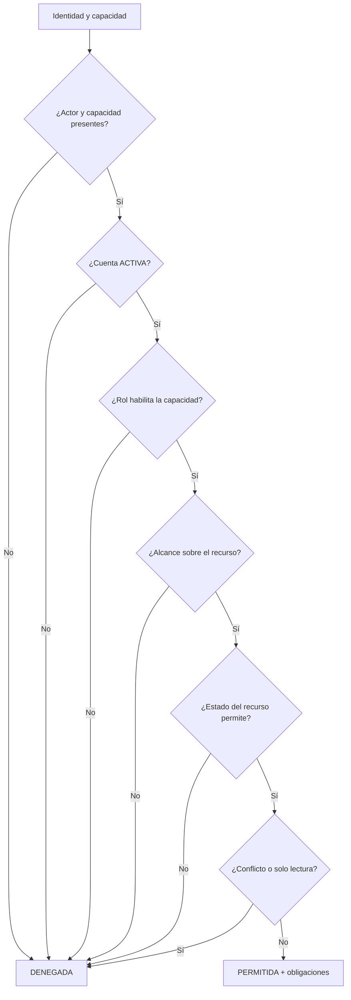

# DS-01 — `PoliticaAutorizacionDominio`

**Código documental:** `NM-SDD-DOM-DS-01`
**Tipo:** Domain Service (política de dominio)
**Versión:** 1.0
**Fecha:** 26 de octubre de 2026
**Estado del documento:** `COMPLETO`
**Estado de la definición de dominio:** Confirmado por fuente.

**Documentos relacionados:**

- Catálogo canónico: [`nexusmarket-domain-services.md`](../nexusmarket-domain-services.md) (`[DS]`), §3, §4.1, §5.1, §6 y §7.
- Modelo de dominio: [`nexusmarket-domain-model.md`](../nexusmarket-domain-model.md) (`[MOD]`), §6, §18, §19, §19.1 y §21.
- Objetos de valor: [`nexusmarket-domain-object-values.md`](../nexusmarket-domain-object-values.md) (`[VO]`), §8.1, §8.5, §8.6, §8.7, §8.8, §8.10 y §8.11.
- Arquitectura: [`nexusmarket-arquitectura.md`](../../Software%20Architecture/nexusmarket-arquitectura.md) (`[ARQ]`), §3, §11.2 y §16.
- Especificación funcional: [`enunciado.md`](../../enunciado.md) (`[ENU]`), §5, §10, §11 y §12.
- Servicios colaboradores: [`DS-02`](politica-publicacion-catalogo.md), [`DS-03`](servicio-reserva-inventario.md), [`DS-06`](politica-transicion-pedido.md), [`DS-07`](politica-elegibilidad-devolucion.md), [`DS-08`](politica-reembolso.md), [`DS-09`](servicio-auditoria.md).

---

## 1. Identificación

| Campo | Valor |
|---|---|
| Nombre canónico | `PoliticaAutorizacionDominio` |
| Identificador estable | `DS-01` |
| Código documental | `NM-SDD-DOM-DS-01` |
| Tipo | Domain Service — política de dominio de solo lectura |
| Propósito resumido | Decidir si un actor puede ejecutar una capacidad de negocio sobre un recurso concreto, considerando rol, vínculo, estado de la cuenta y estado del recurso. |
| Estado de definición | Confirmado por fuente; sin secciones bloqueadas. |
| Fuente primaria | `[MOD]` §18 y §19; `[ENU]` RG-01…RG-03. |

---

## 2. Propósito y responsabilidad

### 2.1 Problema de dominio que resuelve

NexusMarket tiene cinco roles con capacidades distintas y recursos que pertenecen a participantes concretos. Tener el rol correcto no basta: un vendedor solo puede operar sobre sus productos y bodegas, un comprador solo sobre sus pedidos y devoluciones, un operador logístico solo sobre la operación asignada y un supervisor solo consulta. Además, una cuenta inactiva o bloqueada no debe operar, y algunos estados del recurso impiden la acción aunque el vínculo sea correcto (producto descontinuado, bodega inactiva, pedido cerrado, comprador restringido).

La política resuelve esa decisión de forma única y reutilizable, en el dominio y no únicamente en el middleware HTTP.

### 2.2 Resultado de negocio buscado

Producir una decisión explícita —`PERMITIDA` o `DENEGADA`— con un motivo estable y, cuando corresponda, obligaciones asociadas (exigir motivo declarado, registrar auditoría, aplicar separación de funciones o limitar la operación a lectura). La decisión debe ser explicable y auditable.

### 2.3 Responsabilidades

- Verificar que la cuenta del actor esté `ACTIVO`.
- Verificar que el rol habilite la capacidad solicitada según la matriz de `[MOD]` §19.
- Verificar propiedad, asignación operativa o autoridad administrativa sobre el recurso.
- Verificar que el estado del recurso permita la operación.
- Impedir la autoaprobación y los conflictos de interés en devoluciones y reembolsos.
- Aplicar la restricción de solo lectura del Supervisor.
- Exigir motivo y auditoría en operaciones privilegiadas o excepcionales.

### 2.4 Fuera de responsabilidad

- Autenticar al actor, validar tokens, sesiones, firmas o credenciales.
- Leer encabezados HTTP, cookies, parámetros de transporte o contexto de framework.
- Consultar bases de datos o repositorios concretos.
- Definir la matriz de capacidades: la matriz es normativa en `[MOD]` §19 y esta política la aplica.
- Conceder permisos implícitos por conveniencia.
- Ejecutar la operación autorizada o modificar el recurso.
- Escribir el registro de auditoría; solo declara la obligación de registrarlo.

---

## 3. Justificación DDD

| Alternativa de modelado | Por qué no es suficiente |
|---|---|
| Método de `Usuario` | `Usuario` conoce su rol y estado, pero no la propiedad del recurso ni el estado de productos, bodegas, pedidos, pagos o devoluciones. La decisión cruza varios agregados. |
| Método de cada agregado protegido | Duplicaría la misma lógica en `Producto`, `Bodega`, `Pedido`, `Pago` y `Devolucion`, con riesgo de reglas divergentes y sin visión del rol ni del estado de cuenta. |
| Validación de un objeto de valor | `RolSistema` y los catálogos de estado validan sus códigos, no la relación entre actor, capacidad, recurso y estado. |
| Servicio de aplicación | La aplicación orquesta y recupera datos; la regla de negocio sobre quién puede hacer qué es estable frente al transporte, la base de datos y el framework. Además debe poder invocarse desde cualquier adaptador. |
| Middleware HTTP | El middleware puede autenticar e identificar, pero no debe ser la única protección: la regla debe verificarse aunque el caso de uso se invoque desde otro adaptador (`[MOD]` §19.1, regla 7; `[ARQ]` §11.2). |
| Operación de persistencia o adaptador | La decisión no depende del almacenamiento y no cambia datos. |

La política es un servicio de dominio porque compara varios conceptos del dominio con una regla de negocio estable (`[MOD]` §18; `[PM]` §5.3).

---

## 4. Contexto de negocio

- **Actores:** Comprador, Vendedor, Operador logístico, Administrador, Supervisor y actores de sistema autorizados (`[MOD]` §6.5; `[ENU]` §5).
- **Capacidades protegidas:** consultar catálogo, administrar perfil, incorporar vendedor, crear/editar/publicar/suspender producto, administrar bodega, ajustar inventario, gestionar carrito, crear pedido, consultar pedido, preparar/empacar/despachar, confirmar pago, emitir/consultar factura, solicitar devolución, aprobar devolución/reembolso, consultar reportes y modificar auditoría (`[MOD]` §19).
- **Situaciones representativas:** un vendedor publica un producto propio; un vendedor intenta publicar el producto de otro; un supervisor intenta suspender un producto; un comprador `RESTRINGIDO` intenta crear un pedido; un administrador intenta aprobar su propia devolución.
- **Principio rector:** el rol expresa capacidades generales, no acceso automático a todos los recursos de ese tipo (`[MOD]` §6.2).

---

## 5. Reglas de negocio

| ID | Enunciado | Condiciones de aplicación | Conceptos afectados | Resultado esperado | Excepciones o rechazos | Fuente | Estado |
|---|---|---|---|---|---|---|---|
| `RG-01` | Toda operación protegida requiere actor autenticado. | Cualquier capacidad protegida. | Actor, identidad | Sin identidad no hay decisión favorable. | `AUTH_ACTOR_REQUIRED`. | `[ENU]` RG-01; `[MOD]` §21 | Confirmado |
| `RG-02` | Cada cuenta tiene exactamente un rol. | Toda evaluación. | `Usuario`, `RolSistema` | La capacidad se evalúa contra ese único rol. | Rol ausente o múltiple: rechazo por dato inválido. | `[ENU]` RG-02; `[MOD]` §6.2, §21 | Confirmado |
| `RG-03` | Ningún actor opera fuera de su rol y del alcance del recurso. | Toda evaluación con recurso identificado. | Rol, vínculo, recurso | Solo se permite dentro del ámbito autorizado. | `AUTH_ROLE_NOT_ALLOWED`, `AUTH_OUT_OF_SCOPE`. | `[ENU]` RG-03; `[MOD]` §21 | Confirmado |
| `USR-03` | La cuenta tiene un rol obligatorio y único. | Toda evaluación. | `Usuario`, `RolSistema` | Sin rol único no se evalúa la capacidad. | Rechazo por dato inválido. | `[MOD]` §6.1, §21; `[VO]` §8.1 | Confirmado |
| `USR-04` | Una cuenta inactiva o bloqueada no inicia sesiones ni operaciones protegidas. | Al evaluar cualquier capacidad. | `EstadoUsuario` | `INACTIVO` o `BLOQUEADO` deniega. | `AUTH_ACCOUNT_NOT_ACTIVE`. | `[MOD]` §6.1; `[VO]` §8.5 | Confirmado |
| `SUP-01` | El Supervisor solo consulta; no modifica estado de negocio. | Capacidad de escritura solicitada por Supervisor. | `RolSistema`, recurso | Toda escritura se deniega. | `AUTH_READ_ONLY_ROLE`. | `[MOD]` §6.5, §19, §21 | Confirmado |
| `AUT-01` | El estado del recurso debe permitir la operación. | Recurso con ciclo de vida. | Estados de producto, variante, vendedor, bodega, pedido, pago, devolución, reembolso | Estado incompatible deniega aunque el vínculo sea válido. | `AUTH_RESOURCE_STATE_BLOCKS`. | `[MOD]` §19.1 regla 4 | Confirmado |
| `AUT-02` | Las operaciones privilegiadas o excepcionales exigen motivo declarado y auditoría. | Ajustes excepcionales, soporte de carrito, operaciones administrativas. | Motivo, `DS-09` | Decisión con obligación de motivo y auditoría. | `AUTH_MOTIVE_REQUIRED`. | `[MOD]` §19.1 regla 5 | Confirmado |
| `AUT-03` | Quien aprueba una devolución o un reembolso no puede ser quien lo solicitó ni tener conflicto directo. | Aprobación de devolución o reembolso. | Actor, `Devolucion`, `Reembolso` | Se deniega la autoaprobación. | `AUTH_SELF_APPROVAL_FORBIDDEN`. | `[MOD]` §14.1, §14.2, §19 | Confirmado |
| `AUT-04` | Un comprador `RESTRINGIDO` no crea pedidos nuevos. | Capacidad «crear pedido». | `EstadoComercial` | Se deniega la creación. | `AUTH_RESOURCE_STATE_BLOCKS` o motivo de estado comercial. | `[MOD]` §6.3; `[VO]` §8.6 | Confirmado |
| `AUT-05` | Un vendedor `SUSPENDIDO` no publica ni inicia ventas nuevas. | Publicación o venta. | `EstadoVendedor` | Se deniega la nueva operación; las obligaciones existentes se resuelven. | `AUTH_RESOURCE_STATE_BLOCKS`. | `[MOD]` §6.4; `[VO]` §8.7 | Confirmado |
| `AUT-06` | Una bodega `INACTIVA` no recibe reservas ni ingresos nuevos. | Reserva o ingreso. | `EstadoBodega` | Se deniega la operación logística. | `AUTH_RESOURCE_STATE_BLOCKS`. | `[MOD]` §8.1; `[VO]` §8.10 | Confirmado |
| `AUT-07` | Una decisión se evalúa con el rol y los estados vigentes en el momento; no se reutiliza entre operaciones. | Toda evaluación. | Actor, estados | Cada invocación produce una decisión nueva. | Decisión obsoleta no es válida como autorización. | `[DS]` §4.1 punto 15 | Decisión de diseño (`DS-D-01`) |

**Nota de códigos:** `AUT-01`…`AUT-07` son derivaciones locales de esta definición a partir de `[MOD]` §19.1; no amplían el catálogo normativo de reglas de `[MOD]` §21. `RG-01`…`RG-03`, `USR-03`, `USR-04` y `SUP-01` son códigos canónicos.

**Nota de numeración:** `[MOD]` §6.1 asigna `USR-03` a «rol obligatorio y único» y `USR-04` a «cuenta inactiva o bloqueada»; en cambio, `[MOD]` §19.1, §21 y `[DS]` §4.1 usan `USR-03` para la cuenta inactiva o bloqueada. Se adopta §6.1 por ser la sección normativa del agregado `Usuario`, con el mismo criterio que `C-11`, `C-12`, `C-13` y `C-14`. El contenido del catálogo se conserva; solo se corrige el código de la regla de acceso.

**Regla de referencia:** la matriz de capacidades no se reproduce aquí como fuente normativa; su definición canónica está en `[MOD]` §19.

---

## 6. Entradas conceptuales

| Entrada | Significado | Origen conceptual | Restricciones | Validaciones relevantes | Naturaleza |
|---|---|---|---|---|---|
| Identidad del actor | Sujeto que solicita la capacidad. | Caso de uso, tras autenticación. | Obligatoria, no vacía. | `INV-VO-ID-01`. | Identificador tipado (`UsuarioId` o identidad de sistema). |
| `RolSistema` del actor | Clase de capacidades generales. | `Usuario`. | Exactamente uno; código válido. | `INV-VO-ROL-01`, `INV-VO-ROL-02`. | Objeto de valor enumerado. |
| `EstadoUsuario` | Condición de acceso de la cuenta. | `Usuario`. | `ACTIVO`, `INACTIVO` o `BLOQUEADO`. | `INV-VO-EUSR-01`. | Objeto de valor enumerado. |
| Capacidad solicitada | Acción de negocio a evaluar. | Caso de uso. | Debe existir en la matriz de `[MOD]` §19. | Capacidad desconocida: denegar. | Concepto de dominio (capacidad nombrada). |
| Tipo y referencia del recurso | Objeto sobre el que se actúa. | Caso de uso y agregado correspondiente. | Identificador válido del tipo correcto. | `INV-VO-ID-04` (no intercambiable). | Identificador tipado + tipo lógico. |
| Vínculo con el recurso | Propietario, asignado, autoridad administrativa o ninguno. | Datos del recurso y del perfil. | Condicional a la capacidad. | Debe corresponder al actor evaluado. | Concepto de dominio derivado. |
| Estado del recurso | Condición que habilita o bloquea. | Agregado correspondiente. | Puede ser «desconocido» explícito. | Estado desconocido deniega. | Objeto(s) de valor de estado. |
| Motivo declarado | Justificación de una operación privilegiada. | Actor, caso de uso. | Obligatorio cuando la capacidad lo exige. | No vacío. | Texto de negocio controlado. |

No se definen firmas, parámetros técnicos ni DTOs. Las entradas son conceptuales (`[PM]` §5.4).

---

## 7. Resultado conceptual

| Resultado | Significado | Condiciones |
|---|---|---|
| `PERMITIDA` | El actor puede ejecutar la capacidad sobre el recurso en el contexto evaluado. | Se cumplen rol, estado de cuenta, vínculo y estado del recurso. |
| `PERMITIDA` con obligaciones | La operación se autoriza solo si se registra motivo y/o auditoría, o si se aplica doble control. | Operación privilegiada o excepcional. |
| `DENEGADA` | La operación no puede ejecutarse. | Falla al menos una regla; se devuelve código de motivo estable. |
| `DENEGADA` por dato faltante | No puede evaluarse una condición esencial. | La política deniega por defecto; no asume habilitación. |

La salida no es un token, una sesión ni una credencial. Los códigos de motivo son identificadores documentales para trazabilidad y pruebas, no mensajes de interfaz ni contrato de API (`[DS]` §1.5).

**Fallos técnicos:** si el colaborador que aporta el estado del recurso falla, la política no puede emitir `PERMITIDA`; el caso de uso debe tratar la ausencia como denegación segura o error de aplicación, sin inventar un estado.

---

## 8. Precondiciones e invariantes

### 8.1 Precondiciones

| ID | Regla | Momento de verificación | Conceptos afectados | Consecuencia de incumplimiento | Fuente |
|---|---|---|---|---|---|
| `PRE-DS01-01` | Existe identidad de actor. | Inicio de la evaluación. | Actor | `AUTH_ACTOR_REQUIRED`. | `[ENU]` RG-01 |
| `PRE-DS01-02` | El rol del actor es conocido y único. | Inicio de la evaluación. | `Usuario`, `RolSistema` | Rechazo por dato inválido. | `[MOD]` §6.2 |
| `PRE-DS01-03` | La capacidad solicitada está identificada. | Inicio de la evaluación. | Capacidad | Rechazo; no se evalúa una capacidad vacía. | `[DS]` §4.1 |
| `PRE-DS01-04` | El recurso está identificado o su ausencia es explícita. | Inicio de la evaluación. | Recurso | Rechazo por alcance. | `[MOD]` §19.1 regla 3 |
| `PRE-DS01-05` | El estado del recurso está disponible o declarado como desconocido. | Antes de decidir. | Estado del recurso | Denegación por defecto. | `[DS]` §4.1 punto 15 |

### 8.2 Invariantes que la política debe preservar

| ID | Regla | Momento de verificación | Conceptos afectados | Consecuencia de incumplimiento | Fuente |
|---|---|---|---|---|---|
| `INV-VO-ROL-01` | Un rol por cuenta. | Cada evaluación. | `Usuario`, `RolSistema` | Incidente de autorización. | `[VO]` §8.1 |
| `INV-VO-ROL-03` | El rol no concede acceso automático a todos los recursos. | Cada evaluación de alcance. | Rol, recurso | Acceso indebido. | `[VO]` §8.1 |
| `INV-VO-EUSR-02` | Una cuenta inactiva o bloqueada no opera. | Cada evaluación. | `EstadoUsuario` | Acceso indebido. | `[VO]` §8.5 |
| `INV-VO-ECOM-02` | Un comprador `RESTRINGIDO` no crea pedidos nuevos. | Creación de pedido. | `EstadoComercial` | Pedido no autorizado. | `[VO]` §8.6 |
| `INV-VO-EVEND-02` | Un vendedor suspendido no publica ni inicia ventas nuevas. | Publicación y venta. | `EstadoVendedor` | Oferta no autorizada. | `[VO]` §8.7 |
| `INV-VO-EPROD-02` | Un producto suspendido no se vende. | Venta y consulta de disponibilidad. | `EstadoProducto` | Venta inválida. | `[VO]` §8.8 |
| `INV-VO-EBOD-02` | Una bodega inactiva no recibe reservas. | Reserva. | `EstadoBodega` | Reserva inválida. | `[VO]` §8.10 |
| `INV-DS01-SOD` | Separación de funciones: el solicitante no aprueba su propia devolución o reembolso. | Aprobación. | Actor, `Devolucion`, `Reembolso` | Aprobación inválida. | `[MOD]` §14.1, §14.2 |

**Diferencia:** una precondición es un dato necesario para evaluar; una invariante es una verdad de negocio que la decisión no puede contradecir; una validación de entrada comprueba forma y tipo antes de invocar la política.

---

## 9. Entidades, agregados y objetos de valor relacionados

| Concepto | Función en el comportamiento | Información que aporta | Responsabilidad que conserva | Interacción conceptual | Invariantes que debe respetar |
|---|---|---|---|---|---|
| `Usuario` (agregado Cuenta) | Sujeto de la decisión. | Identidad, rol, estado de acceso. | Gestionar su propio ciclo de acceso y credenciales. | Aporta rol y estado; la política no lo modifica. | `USR-01`…`USR-06`; `INV-VO-ROL-01`; `INV-VO-EUSR-02`. |
| `PerfilComprador` | Alcance del comprador. | Propiedad de pedidos, carrito, direcciones, estado comercial. | Proteger sus reglas de perfil y estado comercial. | Aporta vínculo y `EstadoComercial`. | `INV-VO-ECOM-01…04`. |
| `PerfilVendedor` | Alcance del vendedor. | Propiedad de productos y bodegas, estado del vendedor. | Proteger la incorporación y el estado comercial. | Aporta vínculo y `EstadoVendedor`. | `INV-VO-EVEND-01…05`. |
| `Producto` / `Variante` | Recurso de catálogo. | Propietario, estado, tipo de entrega. | Aplicar sus transiciones de estado. | Aporta estado y propietario; la transición la aplica el agregado. | `INV-VO-EPROD-01…05`; `INV-VO-EVAR-01…03`. |
| `Bodega` | Recurso logístico. | Tipo, propietario, estado. | Proteger su clasificación y estado. | Aporta estado y propietario. | `INV-VO-TBOD-01…03`; `INV-VO-EBOD-01…04`. |
| `Pedido` | Recurso comercial. | Comprador propietario, estado, vendedor. | Proteger su ciclo y snapshots. | Aporta estado y vínculo. | `INV-VO-EPED-01…07`. |
| `Pago` / `Reembolso` | Recurso financiero. | Estado, importe, aprobador. | Proteger sus transiciones y saldos. | Aporta estado y aprobador. | `INV-VO-EPAG-01…07`; `INV-VO-EREE-01…06`. |
| `Devolucion` | Recurso de posventa. | Comprador propietario, estado. | Proteger su ciclo y no reapertura. | Aporta estado y vínculo. | `INV-VO-EDEV-01…07`. |
| `RolSistema`, `EstadoUsuario`, `EstadoComercial`, `EstadoVendedor`, `EstadoProducto`, `EstadoBodega`, `EstadoPedido` | Valores controlados que parametrizan la decisión. | Código válido y semántica. | Validar su propio valor. | Se consumen; la política no los redefine. | Las de `[VO]` §12. |

La política no es propietaria de estos agregados ni los persiste. La autoridad de cada invariante permanece en la entidad o agregado correspondiente (`[MOD]` §17).

---

## 10. Flujo conceptual de ejecución

1. Recibir identidad, rol, capacidad, recurso y contexto de vínculo.
2. Rechazar si falta identidad o capacidad.
3. Verificar `EstadoUsuario = ACTIVO`; si no, denegar por cuenta no operativa.
4. Verificar que el rol figure como habilitado para la capacidad en la matriz de `[MOD]` §19.
5. Verificar el vínculo con el recurso: propietario, asignado o autoridad administrativa.
6. Verificar que el estado del recurso permita la operación.
7. Aplicar reglas especiales: solo lectura del Supervisor, separación de funciones y operaciones de sistema.
8. Determinar obligaciones: motivo declarado, auditoría, doble control.
9. Devolver decisión, motivo y obligaciones.

La decisión se emite sobre datos vigentes. Si entre la decisión y la escritura media otra operación, el caso de uso debe revalidar dentro de la operación que muta estado (`[DS]` §4.1 punto 18).

---

## 11. Estado y efectos del dominio

- **Naturaleza:** cálculo/evaluación sin mutaciones. La política es de solo lectura (`DS-D-01`).
- **Estado que consulta:** cuenta, rol, perfiles, estados de recursos y vínculos.
- **Estado que modifica:** ninguno.
- **Eventos:** no emite eventos de negocio.
- **Efectos exigidos:** puede declarar la obligación de registrar auditoría; la escritura corresponde al caso de uso a través de `DS-09` y del adaptador de persistencia.
- **Persistencia:** no persiste nada. La durabilidad de la auditoría no es responsabilidad de la política (`[ARQ]` §9.4).

---

## 12. Colaboraciones y límites arquitectónicos

### 12.1 Colaboraciones

| Colaborador | Relación |
|---|---|
| Casos de uso protegidos | Invocan la política antes de ejecutar la operación y vuelven a verificar dentro de la mutación. |
| `DS-02` | Solo se evalúa la publicación después de que `DS-01` autoriza al actor. |
| `DS-03` | La reserva de inventario usa identidad de sistema o actor autorizado; `DS-01` no calcula disponibilidad. |
| `DS-06`, `DS-07`, `DS-08` | Requieren autorización previa y separación de funciones. |
| `DS-09` | Recibe la obligación de auditar la decisión y la operación. |

### 12.2 Responsabilidad de la capa de aplicación

- Autenticar al actor y establecer su identidad.
- Recuperar los datos de rol, estados y vínculos mediante puertos de salida.
- Invocar la política con datos vigentes.
- Revalidar la decisión dentro de la operación que muta estado.
- Ejecutar la auditoría exigida y gestionar la transacción.

### 12.3 Dependencias permitidas y prohibidas

| Permitidas | Prohibidas |
|---|---|
| Entidades, agregados y objetos de valor del dominio. | Frameworks HTTP, `Request`/`Response`, middleware. |
| Datos de estado y vínculo aportados como valores. | Drivers SQL, ORM, MongoDB, SDKs de proveedores. |
| Identificadores tipados y catálogos controlados. | Variables de entorno, configuración de despliegue, DTOs. |
| Contratos conceptuales de consulta definidos en la capa de aplicación. | Consultas directas a base de datos. |

`[ARQ]` §6.2 y §16 establecen estas prohibiciones. Los contratos formales de puertos y adaptadores pertenecen a una fase documental posterior y no se definen aquí (`[PM]` §5.4, §5.5).

### 12.4 Límites de consistencia

La decisión es consistente con los datos recibidos en el instante de la evaluación. No crea una transacción ni garantiza exclusividad. Para operaciones que cambian estado, la comprobación debe repetirse en la misma unidad de trabajo que la mutación (`[DS]` §4.1 punto 18; `[ARQ]` §12.2).

---

## 13. Escenarios de ejemplo

| # | Situación inicial | Datos conceptuales relevantes | Regla aplicada | Resultado esperado | Origen |
|---|---|---|---|---|---|
| E-01 | Vendedor `ACTIVO` publica un producto propio. | Rol `VENDEDOR`; vínculo propietario; producto en borrador. | `RG-03`, `AUT-01` | `PERMITIDA` con auditoría. | Derivado de `[MOD]` §22.2 |
| E-02 | Vendedor intenta publicar un producto de otro vendedor. | Rol `VENDEDOR`; vínculo ninguno. | `RG-03` | `DENEGADA` por `AUTH_OUT_OF_SCOPE`. | `[MOD]` §19 |
| E-03 | Supervisor intenta suspender un producto. | Rol `SUPERVISOR`; capacidad de escritura. | `SUP-01` | `DENEGADA` por `AUTH_READ_ONLY_ROLE`. | `[MOD]` §6.5, §19 |
| E-04 | Comprador `RESTRINGIDO` intenta crear un pedido. | `EstadoComercial = RESTRINGIDO`. | `AUT-04` | `DENEGADA`. | `[MOD]` §6.3 |
| E-05 | Administrador intenta aprobar su propia devolución. | Mismo actor como solicitante y aprobador. | `AUT-03` | `DENEGADA` por `AUTH_SELF_APPROVAL_FORBIDDEN`. | `[MOD]` §14.1 |
| E-06 | Cuenta `BLOQUEADA` intenta consultar un pedido propio. | `EstadoUsuario = BLOQUEADO`. | `USR-04` | `DENEGADA`; la consulta propia no reactiva la cuenta. | `[MOD]` §6.1 |
| E-07 | Operador logístico despacha un envío asignado. | Rol `OPERADOR_LOGISTICO`; recurso asignado; pedido `PAGADO`. | `RG-03`, `AUT-01` | `PERMITIDA` con auditoría. | `[MOD]` §19, §22.5 |

**Escenarios ilustrativos:** E-01 a E-07 derivan de la matriz y de los escenarios de `[MOD]`. No introducen reglas nuevas.

---

## 14. Dependencias y restricciones

**Necesita:**

- Identidad, rol y estado de cuenta.
- Capacidad solicitada y tipo/referencia del recurso.
- Vínculo y estado del recurso.
- Matriz de capacidades de `[MOD]` §19 y reglas de `[MOD]` §19.1.
- Motivo declarado cuando la capacidad lo exige.

**No debe conocer:**

- El mecanismo de autenticación ni el formato del token.
- HTTP, rutas, códigos de estado o DTOs.
- Repositorios concretos, SQL, MongoDB u ORMs.
- Proveedores externos, mensajería o frameworks.
- La forma en que se persiste o audita la decisión.

**Restricción de política:** la matriz no se amplía desde este documento. Cualquier capacidad nueva exige actualizar `[MOD]` §19 y, después, esta política.

---

## 15. Trazabilidad

| Elemento | Identificador o nombre | Fuente | Sección | Relación con el servicio | Estado de verificación |
|---|---|---|---|---|---|
| Servicio canónico | `PoliticaAutorizacionDominio` | `[MOD]` | §18 | Define su responsabilidad | Confirmado |
| Inventario | `DS-01` | `[DS]` | §3, §4.1 | Especificación canónica | Confirmado |
| Regla de autenticación | `RG-01` | `[ENU]`; `[MOD]` | §10; §21 | Exige actor autenticado | Confirmado |
| Regla de rol único | `RG-02` | `[ENU]`; `[MOD]` | §10; §6.2, §21 | Base de la evaluación | Confirmado |
| Regla de alcance | `RG-03` | `[ENU]`; `[MOD]` | §10; §21 | Exige vínculo y rol | Confirmado |
| Cuenta inactiva | `USR-04` | `[MOD]` | §6.1 | Deniega operaciones | Confirmado |
| Supervisor de solo lectura | `SUP-01` | `[MOD]` | §6.5, §19, §21 | Restringe escritura | Confirmado |
| Matriz de capacidades | — | `[MOD]` | §19 | Define qué rol puede qué | Confirmado |
| Reglas transversales | — | `[MOD]` | §19.1 | Orden de verificación | Confirmado |
| Rol único | `INV-VO-ROL-01` | `[VO]` | §8.1, §12 | Invariante preservada | Confirmado |
| Rol no concede todo | `INV-VO-ROL-03` | `[VO]` | §8.1, §12 | Invariante preservada | Confirmado |
| Cuenta inactiva | `INV-VO-EUSR-02` | `[VO]` | §8.5, §12 | Invariante preservada | Confirmado |
| Comprador restringido | `INV-VO-ECOM-02` | `[VO]` | §8.6, §12 | Invariante preservada | Confirmado |
| Vendedor suspendido | `INV-VO-EVEND-02` | `[VO]` | §8.7, §12 | Invariante preservada | Confirmado |
| Producto suspendido | `INV-VO-EPROD-02` | `[VO]` | §8.8, §12 | Invariante preservada | Confirmado |
| Bodega inactiva | `INV-VO-EBOD-02` | `[VO]` | §8.10, §12 | Invariante preservada | Confirmado |
| Separación de funciones | — | `[MOD]` | §14.1, §14.2 | Impide autoaprobación | Confirmado |
| Capas y dependencias | — | `[ARQ]` | §3, §6.2, §11.2, §16 | Límites arquitectónicos | Confirmado |
| Decisión de solo lectura | `DS-D-01` | `[DS]` | §10 | Naturaleza de la política | Decisión de diseño registrada |

---

## 16. Criterios de validación documental

- [x] La responsabilidad está delimitada y no invade autenticación, persistencia ni matriz de capacidades.
- [x] Las reglas están identificadas y referenciadas por código.
- [x] Las entradas y resultados son comprensibles sin firmas técnicas.
- [x] Las precondiciones y las invariantes están diferenciadas.
- [x] Las colaboraciones respetan DDD y la dirección de dependencias.
- [x] Los límites arquitectónicos son coherentes con `[ARQ]` §6 y §16.
- [x] La trazabilidad cubre requisitos, modelo, objetos de valor y catálogo.
- [x] No se introducen reglas de negocio nuevas ni se fija política comercial.
- [x] No se definen puertos, adaptadores, contratos ni código.
- [x] No existen contradicciones conocidas sin tratamiento.

---

## 17. Historial y estado

| Fecha | Cambio | Autor |
|---|---|---|
| 2026-10-26 | Creación de la definición individual a partir de `[DS]` §4.1, `[MOD]` §18–§19 y `[VO]` §8. | Agente documental |
| 2026-10-26 | Corrección de numeración `USR-03`/`USR-04` conforme a `[MOD]` §6.1 y registro de `C-14`. | Agente documental |

**Estado de definición:** `COMPLETO`.
**Limitaciones reales:** ninguna específica de este servicio. La matriz de permisos es normativa en `[MOD]` §19 y no se replica aquí. El proceso que cambia `EstadoComercial` sigue sin actor definido (`L-08`), lo que afecta a cuándo un comprador pasa a `RESTRINGIDO`, no a la evaluación de la política.
