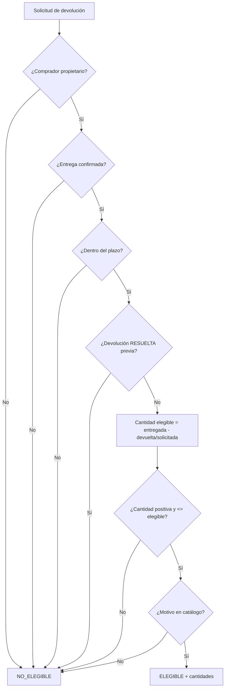

# DS-07 — `PoliticaElegibilidadDevolucion`

**Código documental:** `NM-SDD-DOM-DS-07`
**Tipo:** Domain Service (política de dominio)
**Versión:** 1.0
**Fecha:** 26 de octubre de 2026
**Estado del documento:** `COMPLETO`
**Estado de la definición de dominio:** Confirmado por fuente; plazo aprobado (`DEC-W1-002`); catálogo de motivos aún limitado (`L-10`).

**Documentos relacionados:**

- Catálogo canónico: [`nexusmarket-domain-services.md`](../nexusmarket-domain-services.md) (`[DS]`), §3, §4.7, §5.4, §6 y §7.
- Modelo de dominio: [`nexusmarket-domain-model.md`](../nexusmarket-domain-model.md) (`[MOD]`), §10.3, §14.1, §14.3, §18, §21 y §22.6.
- Objetos de valor: [`nexusmarket-domain-object-values.md`](../nexusmarket-domain-object-values.md) (`[VO]`), §6.7, §7.4, §8.11, §8.15, §9.2 y §12.
- Arquitectura: [`nexusmarket-arquitectura.md`](../../Software%20Architecture/nexusmarket-arquitectura.md) (`[ARQ]`), §6, §9.4 y §16.
- Especificación funcional: [`enunciado.md`](../../enunciado.md) (`[ENU]`), Dominio 11 y §12.
- Servicios colaboradores: [`DS-01`](politica-autorizacion-dominio.md), [`DS-06`](politica-transicion-pedido.md), [`DS-08`](politica-reembolso.md), [`DS-09`](servicio-auditoria.md).

---

## 1. Identificación

| Campo | Valor |
|---|---|
| Nombre canónico | `PoliticaElegibilidadDevolucion` |
| Identificador estable | `DS-07` |
| Código documental | `NM-SDD-DOM-DS-07` |
| Tipo | Domain Service — política de dominio de solo lectura |
| Propósito resumido | Decidir si un comprador puede solicitar la devolución de un pedido o de parte de sus líneas, y calcular las cantidades elegibles. |
| Estado de definición | Confirmado por fuente; plazo aprobado por `DEC-W1-002`; catálogo de motivos limitado por `DEC-BIZ-03`/`L-10`. |
| Fuente primaria | `[MOD]` §14.1 y §18; `[ENU]` Dominio 11. |

---

## 2. Propósito y responsabilidad

### 2.1 Problema de dominio que resuelve

Una devolución no puede aceptarse sobre un pedido no entregado, de un tercero, fuera del plazo vigente o por cantidades superiores a las entregadas y no devueltas. Tampoco puede reabrirse una devolución ya resuelta ni registrarse sin un motivo válido. La decisión compara el pedido, el comprador, las cantidades entregadas, las devoluciones previas y el plazo configurable; no pertenece a `Devolucion`, que todavía no existe al evaluar.

### 2.2 Resultado de negocio buscado

Producir una decisión `ELEGIBLE` o `NO_ELEGIBLE`, las cantidades devolvibles por línea, el motivo del rechazo y la indicación de si la solicitud requiere revisión o aprobación posterior. La creación de la devolución corresponde al caso de uso.

### 2.3 Responsabilidades

- Verificar que el actor sea el comprador propietario.
- Verificar que el pedido esté `ENTREGADO` o que la entrega digital esté confirmada.
- Verificar que la solicitud esté dentro del plazo configurable.
- Calcular la cantidad devolvible por línea.
- Verificar que el motivo pertenezca al catálogo.
- Distinguir producto físico de digital.
- Impedir reabrir una devolución `RESUELTA`.

### 2.4 Fuera de responsabilidad

- Procesar dinero o aprobar el reembolso; corresponde a `DS-08`.
- Llamar transportistas o gestionar logística inversa.
- Recibir o inspeccionar el producto.
- Cambiar el estado del pedido.
- Definir el valor de la política o el catálogo de motivos; el valor inicial del plazo ya está aprobado (`DEC-W1-002`), pero su configuración y vigencia pertenecen a la aplicación.
- Aprobar la devolución; la aprobación es un acto posterior de un actor autorizado.
- Crear la `Devolucion` o sus líneas.

---

## 3. Justificación DDD

| Alternativa de modelado | Por qué no es suficiente |
|---|---|
| Método de `Devolucion` | Al evaluar, la devolución aún no existe; además la decisión necesita el pedido, las cantidades entregadas y las devoluciones previas. |
| Método de `Pedido` | El pedido conoce sus líneas y snapshots, pero no el plazo vigente, las devoluciones sucesivas ni el catálogo de motivos. |
| Método de `PerfilComprador` | El comprador conoce su identidad y estado comercial, pero no la elegibilidad de cada pedido. |
| Validación de `MotivoDevolucion` | El VO valida que el motivo exista y sea válido; no decide propiedad, entrega, plazo ni cantidades. |
| Servicio de aplicación | La aplicación recupera datos y crea la devolución; la regla de elegibilidad es de negocio y debe ser independiente del transporte. |
| `DS-08` | El reembolso es un proceso financiero posterior; no decide si la devolución procede. |

La decisión combina pedido, comprador, cantidades, devoluciones previas y política temporal (`[MOD]` §18; `[PM]` §5.3).

---

## 4. Contexto de negocio

- **Actor inicial:** Comprador propietario. La resolución corresponde a un actor autorizado con separación de funciones (`[MOD]` §14.1, §19).
- **Precondición de entrega:** la política de línea base acepta la solicitud sobre una entrega confirmada dentro del período configurable (`[MOD]` §14.1).
- **Plazo:** se parametriza como política de negocio; el valor inicial aprobado es **30 días** desde la entrega confirmada, con una sola política de plataforma en V1 (`DEC-W1-002`). No se hardcodea y se conserva el valor aplicado a cada solicitud (`DD-12`, `L-06`).
- **Motivo:** obligatorio y perteneciente a un catálogo controlado; el catálogo no está enumerado en las fuentes (`DEC-BIZ-03`, `L-10`).
- **Producto físico:** la devolución aprobada requiere recepción e inspección antes del reingreso vendible (`[MOD]` §14.1; `INV-09`).
- **Producto digital:** puede implicar revocación de licencia o acceso; no genera inventario físico (`[MOD]` §14.1; `INV-VO-EDEV-07`).
- **No reapertura:** una devolución `RESUELTA` no se reabre; una controversia nueva genera un caso relacionado (`[MOD]` §14.3).

---

## 5. Reglas de negocio

| ID | Enunciado | Condiciones de aplicación | Conceptos afectados | Resultado esperado | Excepciones o rechazos | Fuente | Estado |
|---|---|---|---|---|---|---|---|
| `RET-01` | Solo el comprador propietario solicita la devolución de su pedido. | Toda solicitud. | `Pedido`, `PerfilComprador`, actor | Si el actor no es el propietario, no es elegible. | `RET_NOT_OWNER`. | `[MOD]` §14.1, §21 | Confirmado |
| `RET-02` | Las cantidades devueltas no exceden las entregadas ni las ya procesadas. | Cálculo por línea. | `Devolucion`, `Pedido`, `CantidadPositiva` | Cantidad elegible acotada. | `RET_QUANTITY_EXCEEDED`. | `[MOD]` §14.1, §21 | Confirmado |
| `RET-03` | La solicitud se acepta sobre una entrega confirmada dentro del período configurable. | Inicio. | `EstadoPedido`, `Instant`, plazo | Fuera de entrega o plazo, no elegible. | `RET_ORDER_NOT_DELIVERED`, `RET_OUTSIDE_WINDOW`. | `[MOD]` §14.1 | Confirmado |
| `RET-04` | La aprobación requiere motivo válido, elegibilidad temporal, cantidades disponibles y revisión de rol autorizado. | Evaluación y revisión. | `MotivoDevolucion`, actor, cantidades | Se indica si requiere revisión. | `RET_INVALID_REASON`. | `[MOD]` §14.1 | Confirmado |
| `RET-05` | El comprador no aprueba su propia solicitud. | Aprobación. | Actor solicitante, actor aprobador | La política no autoriza la autoaprobación. | `AUTH_SELF_APPROVAL_FORBIDDEN` (`DS-01`). | `[MOD]` §14.1; `[DS-01]` §5 `AUT-03` | Confirmado |
| `RET-06` | El plazo es configurable; el valor inicial aprobado es 30 días y se usa el valor vigente. | Comparación temporal. | Política, `Instant` | Se usa el plazo vigente y se registra el valor aplicado. | `RET_WINDOW_UNDEFINED` si la política no está configurada. | `DD-12`; `DEC-W1-002` | Confirmado; valor inicial aprobado |
| `RET-07` | Una devolución `RESUELTA` no se reabre. | Nueva solicitud sobre el mismo alcance. | `EstadoDevolucion` | Se rechaza la reapertura. | `RET_ALREADY_RESOLVED`. | `[MOD]` §14.3 | Confirmado |
| `RET-08` | En producto físico, la recepción e inspección preceden al reingreso vendible. | Devolución física aprobada. | `Devolucion`, `Inventario` | El reingreso no es automático. | Reingreso sin inspección: prohibido. | `[MOD]` §14.1; `INV-09` | Confirmado |
| `RET-09` | En producto digital, la devolución puede implicar revocación y no genera inventario físico. | Devolución digital. | `ProductoDigital`, acceso | Se indica el flujo digital. | — | `[MOD]` §14.1 | Confirmado |
| `RET-10` | Solo las líneas efectivamente entregadas son elegibles. | Entrega parcial. | Líneas, cantidades | Se excluyen líneas no entregadas. | `RET_QUANTITY_EXCEEDED`. | `[MOD]` §14.1; `[DS]` §4.7 | Confirmado |
| `RET-11` | La cantidad solicitada debe ser positiva. | Cálculo por línea. | `CantidadPositiva` | Cantidad cero o negativa se rechaza. | `RET_INVALID_QUANTITY`. | `[VO]` §6.7 | Confirmado |
| `RET-12` | Una entrega fallida no equivale a devolución aceptada. | Pedido no entregado o envío fallido. | `Envio`, `Devolucion` | No es elegible por la vía normal. | `RET_ORDER_NOT_DELIVERED`. | `[MOD]` §13.1 | Confirmado |

**Nota de códigos:** `RET-01` y `RET-02` son los códigos canónicos de `[MOD]` §14.1. `RET-03`…`RET-12` son derivaciones locales de esta definición a partir de §14.1, §13.1 y `[VO]` §8.15; no amplían el catálogo normativo de `[MOD]` §21.

---

## 6. Entradas conceptuales

| Entrada | Significado | Origen conceptual | Restricciones | Validaciones relevantes | Naturaleza |
|---|---|---|---|---|---|
| `pedidoId` | Pedido de origen. | Caso de uso. | Existente. | `INV-VO-ID-01`. | Identificador tipado. |
| `compradorId` | Propietario que solicita. | Contexto autenticado. | Coincide con el pedido. | `RET-01`. | `CompradorId`. |
| Estado del pedido y fecha de entrega | Elegibilidad temporal. | `Pedido`, `Envio`. | `ENTREGADO` o entrega digital confirmada. | `INV-VO-EPED-01`. | Objeto de valor + `Instant`. |
| Líneas entregadas | Base de cantidades. | Pedido y cumplimiento. | Cantidades conocidas. | `INV-VO-CANP-01`. | Líneas + cantidades. |
| Cantidades ya devueltas o solicitadas | Consumo de elegibilidad. | `Devolucion`. | No negativas. | `RET-02`. | `Cantidad`. |
| Motivo | Justificación. | Actor. | Obligatorio; pertenece al catálogo. | `INV-VO-MOTD-01`. | `MotivoDevolucion`. |
| `Instant` de solicitud | Momento de comparación. | Reloj. | UTC. | `INV-VO-INST-01…04`. | Objeto de valor. |
| Plazo vigente | Ventana de devolución. | Política. | Configurable; valor inicial 30 días (`DEC-W1-002`); ámbito único de plataforma. | Debe existir; se registra el valor aplicado. | Política configurable. |
| Tipo de entrega | Física o digital. | Línea/producto. | `FISICA` o `DIGITAL`. | `INV-VO-TENT-01`. | Objeto de valor. |

---

## 7. Resultado conceptual

| Resultado | Significado |
|---|---|
| `ELEGIBLE` | La solicitud cumple propiedad, entrega, plazo, cantidades y motivo. |
| `ELEGIBLE` parcial | Solo algunas líneas o cantidades son devolvibles. |
| `NO_ELEGIBLE` | Falla al menos una condición; se devuelve el motivo. |
| Cantidades elegibles por línea | Máximo devolvible, descontando lo ya solicitado o aprobado. |
| Requiere revisión/aprobación | La solicitud es elegible, pero su aprobación corresponde a un actor autorizado distinto del solicitante. |

No crea la devolución. Si la decisión es favorable, el caso de uso crea la `Devolucion` en estado `SOLICITADA` y puede emitir `DevolucionSolicitada` y auditoría (`[DS]` §4.7 punto 17).

**Fallos técnicos:** si no puede determinarse la entrega, las cantidades o el plazo, no se emite `ELEGIBLE`; el caso de uso trata la ausencia como error, no como habilitación.

---

## 8. Precondiciones e invariantes

### 8.1 Precondiciones

| ID | Regla | Momento de verificación | Conceptos afectados | Consecuencia de incumplimiento | Fuente |
|---|---|---|---|---|---|
| `PRE-DS07-01` | Pedido existente. | Inicio. | `Pedido` | No se evalúa. | `[DS]` §4.7 |
| `PRE-DS07-02` | Comprador identificado. | Inicio. | Actor | `RET_NOT_OWNER`. | `RET-01` |
| `PRE-DS07-03` | Estado de entrega conocido. | Inicio. | `Pedido`, `Envio` | No se emite elegibilidad. | `RET-03` |
| `PRE-DS07-04` | Cantidades entregadas disponibles. | Cálculo. | Líneas | No se calcula elegibilidad. | `RET-02` |
| `PRE-DS07-05` | Plazo vigente configurado. | Comparación temporal. | Política, `Instant` | `RET_WINDOW_UNDEFINED`. | `DD-12` |
| `PRE-DS07-06` | Catálogo de motivos disponible. | Validación del motivo. | `MotivoDevolucion` | `RET_INVALID_REASON`. | `DEC-BIZ-03` |

### 8.2 Invariantes

| ID | Regla | Momento de verificación | Conceptos afectados | Consecuencia de incumplimiento | Fuente |
|---|---|---|---|---|---|
| `INV-VO-EDEV-01` | Código de estado de devolución válido. | Creación y transición. | `EstadoDevolucion` | Rechazo. | `[VO]` §8.15 |
| `INV-VO-EDEV-02` | Solo el comprador propietario solicita. | Solicitud. | `Pedido`, comprador | `RET_NOT_OWNER`. | `[VO]` §8.15 |
| `INV-VO-EDEV-03` | Las cantidades no exceden las entregadas ni las ya solicitadas o aprobadas. | Cálculo. | `Devolucion`, líneas | `RET_QUANTITY_EXCEEDED`. | `[VO]` §8.15 |
| `INV-VO-EDEV-04` | El comprador no aprueba su propia solicitud. | Aprobación. | Actor | Violación de separación de funciones. | `[VO]` §8.15 |
| `INV-VO-EDEV-05` | Una devolución `RESUELTA` no se reabre. | Nueva solicitud. | `EstadoDevolucion` | `RET_ALREADY_RESOLVED`. | `[VO]` §8.15 |
| `INV-VO-EDEV-06` | En producto físico, recepción e inspección preceden al reingreso vendible. | Resolución. | `Devolucion`, `Inventario` | Reingreso inválido. | `[VO]` §8.15 |
| `INV-VO-EDEV-07` | En producto digital, la devolución no genera inventario físico. | Resolución. | `ProductoDigital` | Inventario inexistente creado. | `[VO]` §8.15 |
| `INV-VO-MOTD-01` | El motivo es obligatorio y pertenece al catálogo. | Solicitud. | `MotivoDevolucion` | `RET_INVALID_REASON`. | `[VO]` §9.2 |

---

## 9. Entidades, agregados y objetos de valor relacionados

| Concepto | Función en el comportamiento | Información que aporta | Responsabilidad que conserva | Interacción conceptual | Invariantes que debe respetar |
|---|---|---|---|---|---|
| `Pedido` | Origen de la devolución. | Comprador, líneas entregadas, estado. | Proteger su ciclo y snapshots. | Aporta propiedad y cantidades entregadas. | `INV-VO-EPED-01…07`. |
| `Devolucion` | Proceso de posventa resultante. | Líneas, motivo, estado, resolución. | Proteger su ciclo y no reapertura. | Se evalúa antes de crearla; luego se crea. | `INV-VO-EDEV-01…07`. |
| `PerfilComprador` | Propietario y alcance. | Identidad y vínculo con el pedido. | Proteger el perfil. | Aporta propiedad. | `INV-VO-ECOM-01…04`. |
| `Envio` | Evidencia de entrega física. | Estado y confirmación. | Proteger el ciclo logístico. | Aporta la entrega que habilita la devolución. | `INV-VO-EENV-01…06`. |
| `MotivoDevolucion` | Justificación controlada. | Código del catálogo. | Validar pertenencia y no vacío. | Se consume. | `INV-VO-MOTD-01…03`. |
| `EstadoPedido`, `EstadoDevolucion`, `CantidadPositiva`, `Instant` | Valores de control. | Código, cantidad y tiempo. | Validar su valor. | Se consumen. | Las de `[VO]` §12. |

---

## 10. Flujo conceptual de ejecución

1. Verificar que el actor sea el comprador propietario del pedido.
2. Verificar que el pedido esté `ENTREGADO` o la entrega digital confirmada.
3. Verificar que la solicitud esté dentro del plazo vigente.
4. Verificar que no exista una devolución `RESUELTA` para el mismo alcance.
5. Calcular, por línea, la cantidad entregada menos la ya devuelta o solicitada.
6. Verificar que la cantidad solicitada sea positiva y no exceda la elegible.
7. Verificar que el motivo pertenezca al catálogo.
8. Distinguir el flujo físico del digital.
9. Devolver elegibilidad, cantidades y motivo.

---

## 11. Estado y efectos del dominio

- **Naturaleza:** evaluación de solo lectura (`DS-D-01`). No crea ni modifica la devolución.
- **Estado que consulta:** pedido, entregas, devoluciones previas, cantidades, plazo y motivo.
- **Estado que modifica:** ninguno.
- **Efectos exigidos:** si la decisión es favorable, el caso de uso crea la `Devolucion` en `SOLICITADA`, exige revisión de un actor autorizado y puede emitir `DevolucionSolicitada` y auditoría.
- **Persistencia:** la creación de la devolución debe confirmar las cantidades en una operación consistente para evitar solicitudes concurrentes que excedan lo entregado (`[DS]` §4.7 punto 18).

---

## 12. Colaboraciones y límites arquitectónicos

### 12.1 Colaboraciones

| Colaborador | Relación |
|---|---|
| `DS-01` | Verifica propiedad y separación de funciones; impide la autoaprobación. |
| `DS-08` | Procesa el saldo reembolsable una vez aprobada la devolución. |
| `DS-06` | Aporta el estado de entrega del pedido. |
| `DS-09` | Audita la solicitud, la aprobación y el resultado. |
| Caso de uso | Recupera pedido, entregas y devoluciones previas; crea la devolución. |

### 12.2 Responsabilidad de la capa de aplicación

- Recuperar pedido, entregas, devoluciones previas y plazo vigente.
- Invocar `DS-01` y `DS-07`.
- Crear la `Devolucion` en estado `SOLICITADA` si la decisión es favorable.
- Asegurar la consistencia de cantidades ante solicitudes concurrentes.
- Emitir eventos y auditoría.

### 12.3 Dependencias permitidas y prohibidas

| Permitidas | Prohibidas |
|---|---|
| `Pedido`, `Devolucion`, `PerfilComprador`, `Envio` y VOs de estado y cantidad. | Dinero, pasarelas, transportistas o logística inversa. |
| Plazo y catálogo de motivos como políticas. | Persistencia, HTTP, ORMs, SDKs. |
| `Instant` de solicitud. | Cambiar el estado del pedido. |

### 12.4 Límites de consistencia

La evaluación es de solo lectura. La creación de la devolución debe ejecutarse en una operación consistente para que dos solicitudes concurrentes no excedan la cantidad entregada. La recepción física y la inspección pertenecen al proceso de posventa, no a esta política.

---

## 13. Escenarios de ejemplo

| # | Situación inicial | Datos conceptuales relevantes | Regla aplicada | Resultado esperado | Origen |
|---|---|---|---|---|---|
| E-01 | Comprador propietario solicita 1 de 2 unidades entregadas dentro del plazo. | Motivo válido; sin devoluciones previas. | `RET-01`, `RET-02`, `RET-03` | `ELEGIBLE` por 1. | `[DS]` §4.7 |
| E-02 | Tercero solicita la devolución. | Actor distinto del comprador. | `RET-01` | `NO_ELEGIBLE` por `RET_NOT_OWNER`. | `[MOD]` §14.1 |
| E-03 | Pedido en `DESPACHADO` sin entrega confirmada. | `EstadoPedido = DESPACHADO`. | `RET-03` | `NO_ELEGIBLE` por `RET_ORDER_NOT_DELIVERED`. | `[MOD]` §14.1 |
| E-04 | Solicitud de 3 unidades con 2 entregadas. | Cantidad > elegible. | `RET-02` | `NO_ELEGIBLE` por cantidad. | `[MOD]` §14.1 |
| E-05 | Segunda devolución de la misma unidad ya resuelta. | `EstadoDevolucion = RESUELTA`. | `RET-07` | `NO_ELEGIBLE` por `RET_ALREADY_RESOLVED`. | `[MOD]` §14.3 |
| E-06 | Solicitud fuera del plazo vigente. | Fecha de solicitud > entrega + plazo. | `RET-03`, `RET-06` | `NO_ELEGIBLE` por `RET_OUTSIDE_WINDOW`. | `DD-12` |
| E-07 | Devolución de producto digital aprobada. | `TipoEntrega = DIGITAL`. | `RET-09` | `ELEGIBLE`; no genera inventario físico. | `[MOD]` §14.1 |
| E-08 | Falta configurar el plazo. | Sin política temporal. | `RET-06` | `NO_ELEGIBLE` por `RET_WINDOW_UNDEFINED`. | `[DS]` §4.7 |

**Escenarios ilustrativos:** E-01 a E-08 derivan de `[MOD]` §14 y de la política; no fijan el catálogo de motivos. El plazo inicial aprobado es de 30 días configurables (`DEC-W1-002`).

---

## 14. Dependencias y restricciones

**Necesita:**

- Pedido, comprador propietario, estado de entrega y cantidades entregadas.
- Devoluciones previas y cantidades ya solicitadas o aprobadas.
- Plazo vigente y catálogo de motivos.
- Tipo de entrega de cada línea.
- `Instant` de solicitud.

**No debe conocer:**

- Importes, pagos o saldo reembolsable (`DS-08`).
- Transportistas, logística inversa o inspección física.
- Persistencia, HTTP, frameworks o SDKs.
- El proceso que cambia `EstadoComercial` o la política de retención legal.

---

## 15. Trazabilidad

| Elemento | Identificador o nombre | Fuente | Sección | Relación con el servicio | Estado de verificación |
|---|---|---|---|---|---|
| Servicio canónico | `PoliticaElegibilidadDevolucion` | `[MOD]` | §18 | Define su responsabilidad | Confirmado |
| Inventario | `DS-07` | `[DS]` | §3, §4.7 | Especificación canónica | Confirmado |
| Propiedad | `RET-01` | `[MOD]` | §14.1, §21 | Solo el comprador propietario | Confirmado |
| Cantidades | `RET-02` | `[MOD]` | §14.1, §21 | No exceden lo entregado | Confirmado |
| Entrega confirmada | `RET-03` | `[MOD]` | §14.1 | Precondición temporal | Confirmado |
| Aprobación | `RET-04`, `RET-05` | `[MOD]` | §14.1 | Revisión y separación de funciones | Confirmado |
| Plazo configurable | `RET-06`; `DD-12`; `DEC-W1-002` | `[MOD]` | §14.1 | Valor inicial 30 días, configurable | Confirmado |
| No reapertura | `RET-07` | `[MOD]` | §14.3 | Devolución resuelta | Confirmado |
| Reingreso físico | `RET-08`; `INV-09` | `[MOD]` | §14.1 | Inspección previa | Confirmado |
| Flujo digital | `RET-09` | `[MOD]` | §14.1 | Sin inventario físico | Confirmado |
| Estado de devolución | `INV-VO-EDEV-01…07` | `[VO]` | §8.15 | Invariantes de posventa | Confirmado |
| Motivo | `INV-VO-MOTD-01…03` | `[VO]` | §9.2 | Obligatorio y de catálogo | Parcialmente especificado |
| Cantidades | `INV-VO-CANP-01…03` | `[VO]` | §6.7 | Cantidad positiva | Confirmado |
| Plazo y motivos | `DEC-W1-002`, `DEC-BIZ-03`; `L-06`, `L-10` | `[DS]`; estado | §4.7; §7 | Plazo aprobado (30 días iniciales, configurable); catálogo de motivos aún limitado por `L-10` | Parcialmente especificado (solo motivos) |
| Solo lectura | `DS-D-01` | `[DS]` | §10 | No crea la devolución | Decisión de diseño registrada |

---

## 16. Criterios de validación documental

- [x] La responsabilidad está delimitada y no incluye reembolso ni inspección.
- [x] Las reglas están identificadas y las políticas no definidas se tratan como limitaciones.
- [x] Las entradas y resultados son comprensibles sin firmas técnicas.
- [x] Las precondiciones y las invariantes están diferenciadas.
- [x] Las colaboraciones respetan DDD y la separación de funciones.
- [x] Los límites de consistencia ante solicitudes concurrentes son explícitos.
- [x] La trazabilidad cubre modelo, objetos de valor y decisiones pendientes.
- [x] El valor inicial del plazo está aprobado (`DEC-W1-002`); el catálogo de motivos sigue limitado (`L-10`).
- [x] No se definen puertos, adaptadores, contratos ni código.
- [x] No existen contradicciones conocidas sin tratamiento.

---

## 17. Historial y estado

| Fecha | Cambio | Autor |
|---|---|---|
| 2026-10-26 | Creación de la definición individual a partir de `[DS]` §4.7, `[MOD]` §14 y `[VO]` §7, §8.15, §9.2. | Agente documental |

**Estado de definición:** `COMPLETO`.
**Limitaciones reales:** el plazo ya tiene valor inicial aprobado (`DEC-W1-002`, 30 días configurables); el catálogo de motivos sigue sin enumerar (`DEC-BIZ-03`, `L-10`). La política exige ambos como entradas y rechaza la evaluación si faltan. No se define aquí el proceso de aprobación ni la logística inversa.
