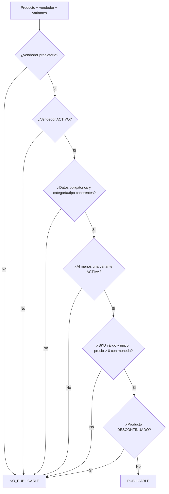

# DS-02 — `PoliticaPublicacionCatalogo`

**Código documental:** `NM-SDD-DOM-DS-02`
**Tipo:** Domain Service (política de dominio)
**Versión:** 1.0
**Fecha:** 26 de octubre de 2026
**Estado del documento:** `COMPLETO`
**Estado de la definición de dominio:** Confirmado por fuente.

**Documentos relacionados:**

- Catálogo canónico: [`nexusmarket-domain-services.md`](../nexusmarket-domain-services.md) (`[DS]`), §3, §4.2, §5.1, §6 y §7.
- Modelo de dominio: [`nexusmarket-domain-model.md`](../nexusmarket-domain-model.md) (`[MOD]`), §7, §18, §21 y §22.2.
- Objetos de valor: [`nexusmarket-domain-object-values.md`](../nexusmarket-domain-object-values.md) (`[VO]`), §6.1, §6.5, §8.2, §8.4, §8.7, §8.8, §8.9 y §12.
- Arquitectura: [`nexusmarket-arquitectura.md`](../../Software%20Architecture/nexusmarket-arquitectura.md) (`[ARQ]`), §6, §9 y §16.
- Especificación funcional: [`enunciado.md`](../../enunciado.md) (`[ENU]`), Dominio 5 y §12.
- Servicios colaboradores: [`DS-01`](politica-autorizacion-dominio.md), [`DS-05`](servicio-calculo-pedido.md), [`DS-09`](servicio-auditoria.md).

---

## 1. Identificación

| Campo | Valor |
|---|---|
| Nombre canónico | `PoliticaPublicacionCatalogo` |
| Identificador estable | `DS-02` |
| Código documental | `NM-SDD-DOM-DS-02` |
| Tipo | Domain Service — política de dominio de solo lectura |
| Propósito resumido | Decidir si un producto, su vendedor, sus variantes y sus precios cumplen las condiciones para estar publicado y ser vendible. |
| Estado de definición | Confirmado por fuente; sin secciones bloqueadas. |
| Fuente primaria | `[MOD]` §7 y §18; `[ENU]` Dominio 5. |

---

## 2. Propósito y responsabilidad

### 2.1 Problema de dominio que resuelve

Una oferta puede existir en el sistema y, aun así, no ser publicable: el vendedor puede estar suspendido, el producto puede carecer de variantes, una variante puede estar inactiva, el SKU puede estar vacío o duplicado, el precio puede ser cero o la moneda puede faltar. Publicar en ese estado produce ofertas incompletas, incoherentes o imposibles de comprar.

La política concentra esa decisión antes de que el agregado `Producto` ejecute la transición a `PUBLICADO`.

### 2.2 Resultado de negocio buscado

Producir una decisión `PUBLICABLE` o `NO_PUBLICABLE` con la lista de incumplimientos y, cuando aplique, la variante mínima que permitiría publicar. La publicación debe significar «oferta válida y visible», no «stock disponible».

### 2.3 Responsabilidades

- Verificar que el producto tenga un vendedor propietario.
- Verificar que el vendedor esté `ACTIVO`.
- Verificar los datos obligatorios del producto.
- Verificar que exista al menos una variante y que al menos una sea vendible.
- Verificar que el SKU no esté vacío y no se duplique en el conjunto evaluado.
- Verificar precio mayor que cero y moneda explícita.
- Verificar la coherencia entre `TipoEntrega`, subtipo de producto y categoría cuando la política del catálogo lo exija.
- Denegar la publicación o reanudación de un producto `DESCONTINUADO`.

### 2.4 Fuera de responsabilidad

- Persistir el producto, cambiar su estado o emitir eventos.
- Exigir stock positivo para publicar (`[MOD]` §22.2).
- Reservar inventario.
- Definir el catálogo de categorías; pertenece al VO `CategoriaProducto`.
- Validar la identidad o el permiso del actor; eso corresponde a `DS-01`.
- Definir la estructura del recurso de entrega digital.
- Comprobar la unicidad global de SKU como garantía transaccional; la política la detecta sobre los datos recibidos y la persistencia la refuerza.

---

## 3. Justificación DDD

| Alternativa de modelado | Por qué no es suficiente |
|---|---|
| Método de `Producto` | El producto conoce su estado, tipo y categoría, pero no el estado del vendedor ni la unicidad global del SKU; además la decisión debe evaluar el conjunto de variantes. |
| Método de `Variante` | La variante conoce su SKU y precio, pero no el estado del producto, del vendedor ni la existencia de otras variantes vendibles. |
| Método de `PerfilVendedor` | El vendedor conoce su estado, pero no la integridad del catálogo de cada producto. |
| Validación de `SKU` o `Dinero` | Los VOs validan su propio valor; no deciden si el conjunto producto-variante-vendedor es publicable. |
| Servicio de aplicación | La coordinación de persistencia y eventos es de aplicación; la regla de elegibilidad es de negocio y debe ser estable frente al transporte y al almacenamiento. |
| Adaptador o handler | No debe contener reglas de negocio; además la política debe poder invocarse desde cualquier caso de uso de publicación. |

La política compara producto, vendedor, variantes y precios: conceptos que no pertenecen a una sola entidad (`[MOD]` §18; `[PM]` §5.3).

---

## 4. Contexto de negocio

- **Actor originador:** Vendedor propietario o Administrador autorizado (`CAT-07`). La autorización previa la resuelve `DS-01`.
- **Proceso:** incorporación de vendedor → creación de producto y variantes → registro de existencias → publicación → visibilidad en catálogo (`[ENU]` §6.1; `[MOD]` §22.2).
- **Distinción clave:** un producto físico puede publicarse sin stock; la compra sí exige disponibilidad (`[MOD]` §22.2). Un producto digital no requiere bodega ni stock, pero sí un recurso de entrega válido (`[MOD]` §7.3).
- **Ciclo de estado:** borrador/no publicado → `PUBLICADO`; `PUBLICADO` → `SUSPENDIDO`; `SUSPENDIDO` → `PUBLICADO` con revalidación; `PUBLICADO` o `SUSPENDIDO` → `DESCONTINUADO`; desde `DESCONTINUADO` no se vuelve a publicar (`[MOD]` §7.1).

### 4.1 Nota de numeración de reglas

`[MOD]` §7.1 y §21 enumeran códigos `CAT-01…CAT-07` con contenidos parcialmente distintos. Esta definición adopta la numeración de §7.1, que es la sección normativa del agregado `Producto`, por el mismo criterio aplicado en `C-11` para inventario. La regla de §21 según la cual solo se venden productos publicados con variantes activas se conserva y se referencia por sección, no por código. La discrepancia se registra como `C-12` en `DOCUMENTATION_STATUS.md`.

---

## 5. Reglas de negocio

| ID | Enunciado | Condiciones de aplicación | Conceptos afectados | Resultado esperado | Excepciones o rechazos | Fuente | Estado |
|---|---|---|---|---|---|---|---|
| `CAT-01` | Cada producto pertenece a un único vendedor. | Toda evaluación. | `Producto`, `PerfilVendedor` | Si no hay vendedor propietario, no es publicable. | `CAT_NO_SELLER`. | `[MOD]` §7.1 | Confirmado |
| `CAT-02` | Todo producto tiene al menos una variante antes de publicarse. | Publicación o reanudación. | `Producto`, `Variante` | Sin variantes, `NO_PUBLICABLE`. | `CAT_NO_VARIANTS`. | `[MOD]` §7.1 | Confirmado |
| `CAT-03` | La publicación exige vendedor `ACTIVO`, datos obligatorios válidos, variantes vendibles y precio válido. | Publicación o reanudación. | Producto, vendedor, variantes, precio | Solo se publica si todas las condiciones se cumplen. | `CAT_SELLER_NOT_ACTIVE`, `CAT_MISSING_DATA`, `CAT_NO_ACTIVE_VARIANT`, `CAT_INVALID_PRICE`. | `[MOD]` §7.1 | Confirmado |
| `CAT-04` | Un producto `SUSPENDIDO` no se ofrece para nuevas compras, aunque se conserva para pedidos históricos. | Producto suspendido. | `EstadoProducto` | No se ofrece; puede reanudarse si revalida. | Reanudación sin revalidación: denegada. | `[MOD]` §7.1 | Confirmado |
| `CAT-05` | Un producto `DESCONTINUADO` no admite nuevas ventas ni retorno a `PUBLICADO`. | Producto descontinuado. | `EstadoProducto` | Publicación o reanudación denegada; se permite consulta histórica. | `CAT_DISCONTINUED`. | `[MOD]` §7.1 | Confirmado |
| `CAT-06` | Modificar el catálogo no altera snapshots de pedidos ya confirmados. | Cambio de nombre, SKU, precio o estado. | `ItemPedido`, snapshots | Los pedidos conservan sus valores. | No aplica a la decisión de publicación. | `[MOD]` §7.1 | Confirmado |
| `CAT-07` | Solo el vendedor propietario o un Administrador cambia el estado del producto. | Transición de estado. | `Producto`, actor | La política no autoriza; `DS-01` verifica. | `AUTH_OUT_OF_SCOPE`. | `[MOD]` §7.1 | Confirmado |
| `PUB-01` | Solo se venden productos `PUBLICADO` con variantes `ACTIVA` y vendedor `ACTIVO`. | Venta y consulta previa al checkout. | `Producto`, `Variante`, `PerfilVendedor` | Fuera de esa combinación, no es vendible. | Rechazo en carrito/checkout. | `[MOD]` §7.4; §21 `CAT-03` | Confirmado |
| `PUB-02` | El `SKU` es no vacío y único globalmente; no se reutiliza tras descontinuar. | Creación y publicación de variante. | `SKU`, `Variante` | SKU inválido o duplicado impide publicar. | `CAT_DUPLICATE_SKU`. | `[MOD]` §7.4; `[VO]` §6.1 | Confirmado |
| `PUB-03` | El precio de una variante es mayor que cero y tiene moneda explícita. | Publicación y venta. | `Dinero`, `Variante` | Precio no positivo o sin moneda impide publicar. | `CAT_INVALID_PRICE`. | `[MOD]` §7.4; `[VO]` §6.5 | Confirmado |
| `PUB-04` | `TipoEntrega` debe ser coherente con el subtipo de producto y con la categoría cuando la política lo exija. | Publicación. | `TipoEntrega`, `CategoriaProducto`, subtipo | Incoherencia impide publicar. | `CAT_TYPE_MISMATCH`. | `[MOD]` §7.1–§7.5 | Confirmado |
| `PUB-05` | La publicación no exige stock positivo; la compra sí exige disponibilidad. | Producto físico sin existencias. | `Producto`, `Inventario` | `PUBLICABLE` aunque no haya stock. | La compra se rechazará después. | `[MOD]` §22.2 | Confirmado |
| `PUB-06` | El producto digital requiere un recurso de entrega válido para publicarse. | Producto digital. | `Producto`, recurso de entrega | Sin recurso válido, no es publicable. | `CAT_MISSING_DATA` o incumplimiento equivalente. | `[MOD]` §7.3 | Confirmado; estructura no definida |
| `PUB-07` | La unicidad de SKU y la transición de estado se confirman en la operación de persistencia. | Publicación efectiva. | `SKU`, `Producto` | La política no sustituye la restricción transaccional. | Conflicto de unicidad en persistencia. | `[DS]` §4.2 punto 18 | Decisión de diseño (`DS-D-01`) |

**Nota de códigos:** `PUB-01`…`PUB-07` son derivaciones locales de esta definición a partir de `[MOD]` §7.4, §21 y §22.2; no amplían el catálogo normativo. Los códigos `CAT-01`…`CAT-07` se rigen por la nota de numeración de §4.1.

---

## 6. Entradas conceptuales

| Entrada | Significado | Origen conceptual | Restricciones | Validaciones relevantes | Naturaleza |
|---|---|---|---|---|---|
| Producto | Ficha comercial a evaluar. | Agregado `Producto`. | Identificado; estado y datos completos. | `INV-VO-EPROD-01`. | Entidad raíz de agregado. |
| Vendedor propietario | Titular de la oferta. | `PerfilVendedor`. | Debe ser el `vendedorId` del producto. | `INV-VO-EVEND-01`. | Entidad / agregado. |
| Variantes | Unidades vendibles del producto. | `Variante`. | Al menos una; SKU, precio y estado. | `INV-VO-SKU-01…02`; `INV-VO-MON-01`; `INV-VO-EVAR-01`. | Entidades dentro del agregado. |
| Moneda del precio | Unidad monetaria del importe. | `Dinero`. | Explícita y coincidente entre importes comparados. | `INV-VO-MON-01`, `INV-VO-MON-03`. | Objeto de valor. |
| Tipo de entrega y subtipo | Naturaleza física o digital de la oferta. | `Producto`. | `FISICA` o `DIGITAL`, coherente con el subtipo. | `INV-VO-TENT-02`. | Objeto de valor. |
| Categoría | Clasificación del producto. | `CategoriaProducto`. | Código del catálogo controlado. | `INV-VO-CAT-01`. | Objeto de valor enumerado. |
| Configuración de catálogo | Reglas de coherencia categoría-tipo y datos mínimos. | Política de plataforma. | Condicional; si existe, se aplica. | No definida numéricamente. | Política configurable. |

---

## 7. Resultado conceptual

| Resultado | Significado |
|---|---|
| `PUBLICABLE` | El conjunto evaluado cumple todas las condiciones; el agregado puede aplicar la transición a `PUBLICADO`. |
| `PUBLICABLE` con variante mínima | Existe al menos una variante válida que satisface las condiciones; la decisión puede indicarla. |
| `NO_PUBLICABLE` | Al menos una condición falla; se devuelve la lista de incumplimientos. |
| `NO_PUBLICABLE` por descontinuado | El producto no puede volver a `PUBLICADO`; se requiere crear una oferta nueva. |

La política no devuelve una entidad persistida ni aplica la transición. Si la decisión es favorable, el agregado `Producto` ejecuta el cambio y el caso de uso puede emitir `ProductoPublicado` y auditoría (`[DS]` §4.2 punto 17).

**Fallos técnicos:** si no pueden cargarse las variantes o el vendedor, no se emite `PUBLICABLE`; el caso de uso trata la ausencia como error de aplicación, no como habilitación.

---

## 8. Precondiciones e invariantes

### 8.1 Precondiciones

| ID | Regla | Momento de verificación | Conceptos afectados | Consecuencia de incumplimiento | Fuente |
|---|---|---|---|---|---|
| `PRE-DS02-01` | Producto identificado y recuperado. | Inicio. | `Producto` | No se evalúa. | `[DS]` §4.2 |
| `PRE-DS02-02` | Vendedor propietario conocido. | Inicio. | `PerfilVendedor` | `CAT_NO_SELLER`. | `[MOD]` §7.1 |
| `PRE-DS02-03` | Variantes cargadas (puede ser conjunto vacío). | Inicio. | `Variante` | Conjunto vacío produce decisión negativa. | `[DS]` §4.2 |
| `PRE-DS02-04` | Precios con moneda explícita. | Antes de evaluar precio. | `Dinero` | `CAT_INVALID_PRICE`. | `[MOD]` §16.1 |
| `PRE-DS02-05` | Autorización del actor ya resuelta por `DS-01`. | Antes de invocar la política. | Actor, producto | La política no autoriza. | `CAT-07` |

### 8.2 Invariantes

| ID | Regla | Momento de verificación | Conceptos afectados | Consecuencia de incumplimiento | Fuente |
|---|---|---|---|---|---|
| `INV-VO-EPROD-01` | Código de estado de producto válido. | Publicación y transición. | `EstadoProducto` | Rechazo. | `[VO]` §8.8 |
| `INV-VO-EPROD-03` | Un producto descontinuado no vuelve a publicarse. | Reanudación. | `EstadoProducto` | `CAT_DISCONTINUED`. | `[VO]` §8.8 |
| `INV-VO-EPROD-04` | Un producto publicado posee al menos una variante válida. | Publicación. | `Producto`, `Variante` | `CAT_NO_VARIANTS` / `CAT_NO_ACTIVE_VARIANT`. | `[VO]` §8.8 |
| `INV-VO-EPROD-05` | Los snapshots de pedidos no se alteran por cambios de catálogo. | Cambio de catálogo. | `ItemPedido` | Inconsistencia histórica. | `[VO]` §8.8 |
| `INV-VO-EVAR-01` | Código de estado de variante válido. | Publicación y venta. | `EstadoVariante` | Rechazo. | `[VO]` §8.9 |
| `INV-VO-EVAR-02` | Una variante inactiva no se vende. | Publicación y venta. | `Variante` | No cuenta como vendible. | `[VO]` §8.9 |
| `INV-VO-SKU-01` | SKU no vacío. | Creación y publicación. | `SKU` | `CAT_INVALID_PRICE` no aplica; rechazo por SKU. | `[VO]` §6.1 |
| `INV-VO-SKU-02` | SKU único globalmente. | Publicación y persistencia. | `SKU` | `CAT_DUPLICATE_SKU`. | `[VO]` §6.1 |
| `INV-VO-SKU-03` | SKU no se reutiliza tras descontinuar. | Creación de variante. | `SKU` | Conflicto de unicidad. | `[VO]` §6.1 |
| `INV-VO-MON-01` | Moneda explícita. | Precio y comparación. | `Dinero` | `CAT_INVALID_PRICE`. | `[VO]` §6.5 |
| `INV-VO-TENT-02` | `TipoEntrega` coherente con el subtipo. | Publicación. | `TipoEntrega`, producto | `CAT_TYPE_MISMATCH`. | `[VO]` §8.2 |
| `INV-VO-CAT-03` | `DIGITAL` no fuerza por sí sola que el producto sea digital. | Publicación. | `CategoriaProducto`, tipo | Se valida según política. | `[VO]` §8.4 |

---

## 9. Entidades, agregados y objetos de valor relacionados

| Concepto | Función en el comportamiento | Información que aporta | Responsabilidad que conserva | Interacción conceptual | Invariantes que debe respetar |
|---|---|---|---|---|---|
| `Producto` | Raíz del agregado evaluado. | Vendedor, nombre, descripción, categoría, estado, tipo de entrega. | Aplicar la transición de estado y proteger sus datos. | La política decide; el agregado transiciona. | `CAT-01`…`CAT-07`; `INV-VO-EPROD-01…05`. |
| `Variante` | Unidad vendible. | SKU, nombre, atributos, precio, estado. | Validar SKU, precio y estado. | Aporta condiciones de vendibilidad. | `INV-VO-SKU-01…04`; `INV-VO-MON-01…05`; `INV-VO-EVAR-01…03`. |
| `PerfilVendedor` | Titular de la oferta. | Estado del vendedor y propietario. | Proteger la incorporación y el estado comercial. | Aporta `EstadoVendedor`. | `INV-VO-EVEND-01…05`. |
| `CategoriaProducto` | Clasificación controlada. | Código válido. | Validar pertenencia al catálogo. | Se consume; no se redefine. | `INV-VO-CAT-01…03`. |
| `Dinero` | Importe del precio. | Importe y moneda. | Aritmética exacta y moneda única. | Se consume para validar precio. | `INV-VO-MON-01…05`. |
| `TipoEntrega` | Naturaleza física o digital. | `FISICA` o `DIGITAL`. | Validar coherencia con el subtipo. | Se consume. | `INV-VO-TENT-01…04`. |
| `SKU` | Identificador comercial de la variante. | Cadena normalizada. | No vacío, único y no reutilizable. | Se consume. | `INV-VO-SKU-01…04`. |

La política no redefine estos conceptos ni se convierte en propietaria de sus invariantes (`[VO]` §11.2).

---

## 10. Flujo conceptual de ejecución

1. Verificar que el producto tenga vendedor propietario.
2. Verificar que el vendedor esté `ACTIVO`.
3. Verificar los datos obligatorios del producto.
4. Verificar que exista al menos una variante.
5. Verificar que al menos una variante esté `ACTIVA` y sea vendible.
6. Verificar SKU no vacío y no duplicado en el conjunto evaluado.
7. Verificar precio mayor que cero y moneda explícita.
8. Verificar coherencia de `TipoEntrega`, subtipo y categoría.
9. Si el producto está `DESCONTINUADO`, denegar cualquier reanudación.
10. Devolver decisión, incumplimientos y variante mínima cuando aplique.

---

## 11. Estado y efectos del dominio

- **Naturaleza:** evaluación de solo lectura (`DS-D-01`). No cambia estado.
- **Estado que consulta:** producto, variantes, vendedor, precios, categoría y tipo de entrega.
- **Estado que modifica:** ninguno.
- **Efectos posibles:** si la decisión es favorable, el agregado `Producto` aplica la transición y el caso de uso puede emitir `ProductoPublicado`, `ProductoSuspendido` o auditoría. Esos efectos pertenecen al agregado y a la aplicación, no a la política.
- **Persistencia:** la unicidad de SKU y la transición se confirman en la operación de persistencia; la política no sustituye la restricción transaccional.

---

## 12. Colaboraciones y límites arquitectónicos

### 12.1 Colaboraciones

| Colaborador | Relación |
|---|---|
| `DS-01` | Autoriza al vendedor propietario o al Administrador antes de evaluar. |
| `DS-05` | Comparte la validación de precio y moneda; el cálculo del pedido no publica productos. |
| `DS-09` | Registra la publicación, la suspensión y los rechazos relevantes. |
| Agregado `Producto` | Aplica la transición luego de la decisión. |
| Caso de uso de publicación | Recupera producto, vendedor y variantes; persiste y emite eventos. |

### 12.2 Responsabilidad de la capa de aplicación

- Recuperar producto, vendedor y variantes mediante puertos de salida.
- Invocar `DS-01` antes de la política.
- Invocar `DS-02` con un conjunto coherente de datos.
- Aplicar la transición en el agregado y persistir.
- Resolver conflictos de unicidad y emitir eventos/auditoría.

### 12.3 Dependencias permitidas y prohibidas

| Permitidas | Prohibidas |
|---|---|
| `Producto`, `Variante`, `PerfilVendedor` y VOs de catálogo y dinero. | Persistencia, handlers HTTP, ORM, MongoDB. |
| Configuración de catálogo suministrada como política. | Stock, reservas y disponibilidad física. |
| Datos de estado y precio como valores. | SDKs, mensajería, variables de entorno. |

### 12.4 Límites de consistencia

La evaluación se hace sobre un conjunto coherente de datos. La unicidad global de SKU es una restricción de persistencia; entre la decisión y la escritura puede producirse un conflicto que debe resolverse como conflicto de unicidad, no como nueva decisión de la política (`[ARQ]` §9.4).

---

## 13. Escenarios de ejemplo

| # | Situación inicial | Datos conceptuales relevantes | Regla aplicada | Resultado esperado | Origen |
|---|---|---|---|---|---|
| E-01 | Producto con una variante activa, SKU único y precio válido; vendedor activo. | Todas las condiciones satisfechas. | `CAT-03`, `PUB-02`, `PUB-03` | `PUBLICABLE`. | `[MOD]` §22.2 |
| E-02 | Producto sin variantes. | Conjunto vacío. | `CAT-02` | `NO_PUBLICABLE` por `CAT_NO_VARIANTS`. | `[DS]` §4.2 |
| E-03 | Variante con precio cero. | `precio = 0`. | `PUB-03` | `NO_PUBLICABLE` por `CAT_INVALID_PRICE`. | `[MOD]` §7.4 |
| E-04 | Producto descontinuado que intenta reanudarse. | `EstadoProducto = DESCONTINUADO`. | `CAT-05` | `NO_PUBLICABLE` por `CAT_DISCONTINUED`. | `[MOD]` §7.1 |
| E-05 | Producto físico sin stock. | `onHand = 0`; variante activa; precio válido. | `PUB-05` | `PUBLICABLE`; la compra se rechazará hasta reabastecer. | `[MOD]` §22.2 |
| E-06 | Vendedor suspendido intenta publicar. | `EstadoVendedor = SUSPENDIDO`. | `CAT-03` | `NO_PUBLICABLE` por `CAT_SELLER_NOT_ACTIVE`. | `[MOD]` §6.4 |
| E-07 | Producto digital sin recurso de entrega válido. | `TipoEntrega = DIGITAL`; recurso ausente. | `PUB-06` | `NO_PUBLICABLE`. | `[MOD]` §7.3 |

**Escenarios ilustrativos:** E-01 a E-07 derivan de reglas y escenarios existentes; no añaden política comercial.

---

## 14. Dependencias y restricciones

**Necesita:**

- Producto, vendedor propietario, variantes, precios y moneda.
- Categoría, tipo de entrega y subtipo.
- Configuración de catálogo cuando exista.
- Autorización previa de `DS-01`.

**No debe conocer:**

- Stock, reservas o bodegas.
- Persistencia, unicidad transaccional, handlers o eventos publicados.
- Frameworks, ORMs, MongoDB o SDKs.
- Reglas de precios, impuestos o descuentos; pertenecen a `DS-05` y a la política comercial.

---

## 15. Trazabilidad

| Elemento | Identificador o nombre | Fuente | Sección | Relación con el servicio | Estado de verificación |
|---|---|---|---|---|---|
| Servicio canónico | `PoliticaPublicacionCatalogo` | `[MOD]` | §18 | Define su responsabilidad | Confirmado |
| Inventario | `DS-02` | `[DS]` | §3, §4.2 | Especificación canónica | Confirmado |
| Propiedad del producto | `CAT-01` | `[MOD]` | §7.1 | Vendedor único | Confirmado |
| Variante obligatoria | `CAT-02` | `[MOD]` | §7.1 | Condición de publicación | Confirmado |
| Condiciones de publicación | `CAT-03` | `[MOD]` | §7.1 | Núcleo de la política | Confirmado |
| Suspensión | `CAT-04` | `[MOD]` | §7.1 | No se ofrece para nuevas compras | Confirmado |
| Descontinuado | `CAT-05` | `[MOD]` | §7.1 | No se reanuda | Confirmado |
| Snapshots | `CAT-06` | `[MOD]` | §7.1 | Historial inmutable | Confirmado |
| Autoridad de cambio de estado | `CAT-07` | `[MOD]` | §7.1 | Solo propietario o Administrador | Confirmado |
| Vendibilidad | `PUB-01` | `[MOD]` | §7.4; §21 | Producto publicado + variante activa | Confirmado |
| SKU | `INV-VO-SKU-01…04` | `[VO]` | §6.1 | Unicidad y no reutilización | Confirmado |
| Precio y moneda | `INV-VO-MON-01…05` | `[VO]` | §6.5 | Precio válido | Confirmado |
| Estado del producto | `INV-VO-EPROD-01…05` | `[VO]` | §8.8 | Transiciones y snapshots | Confirmado |
| Estado de variante | `INV-VO-EVAR-01…03` | `[VO]` | §8.9 | Vendibilidad | Confirmado |
| Tipo de entrega | `INV-VO-TENT-01…04` | `[VO]` | §8.2 | Coherencia con subtipo | Confirmado |
| Publicación sin stock | — | `[MOD]` | §22.2 | Regla explícita | Confirmado |
| Recurso de entrega digital | — | `[MOD]` | §7.3 | Condición del producto digital | Confirmado; estructura no definida |
| Conflicto de numeración CAT | `C-12` | `[MOD]` | §7.1 vs §21 | Resuelto por sección normativa | Registrado |
| Decisión de solo lectura | `DS-D-01` | `[DS]` | §10 | Naturaleza de la política | Decisión de diseño registrada |

---

## 16. Criterios de validación documental

- [x] La responsabilidad está delimitada y no incluye persistencia, stock ni autorización.
- [x] Las reglas están identificadas por código o por referencia de sección cuando existe colisión.
- [x] Las entradas y resultados son comprensibles sin firmas técnicas.
- [x] Las precondiciones y las invariantes están diferenciadas.
- [x] Las colaboraciones respetan DDD y la dirección de dependencias.
- [x] Los límites arquitectónicos son coherentes con `[ARQ]`.
- [x] La trazabilidad cubre requisitos, modelo, objetos de valor y catálogo.
- [x] No se fijan stock mínimo, categorías nuevas ni precios.
- [x] No se definen puertos, adaptadores, contratos ni código.
- [x] La colisión `CAT-03`/`CAT-04` entre §7.1 y §21 está tratada y registrada como `C-12`.

---

## 17. Historial y estado

| Fecha | Cambio | Autor |
|---|---|---|
| 2026-10-26 | Creación de la definición individual a partir de `[DS]` §4.2, `[MOD]` §7 y `[VO]` §6, §8. | Agente documental |

**Estado de definición:** `COMPLETO`.
**Limitaciones reales:** la estructura del recurso de entrega digital no está definida (`[MOD]` §7.3), por lo que la política exige su validez sin fijar su composición. La coherencia exacta categoría-tipo depende de una política de catálogo no enumerada (`[DS]` §4.2 punto 15). La unicidad global de SKU se confirma en persistencia.
