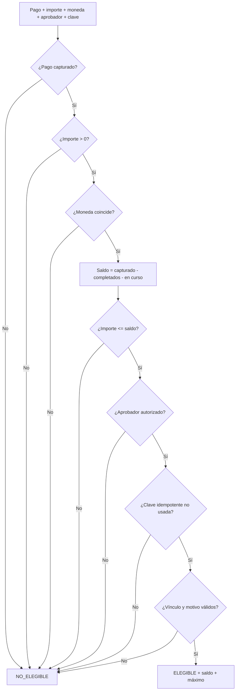

# DS-08 — `PoliticaReembolso`

**Código documental:** `NM-SDD-DOM-DS-08`
**Tipo:** Domain Service (política de dominio)
**Versión:** 1.0
**Fecha:** 26 de octubre de 2026
**Estado del documento:** `COMPLETO`
**Estado de la definición de dominio:** Confirmado por fuente; moneda, redondeo y aprobador financiero parcialmente especificados.

**Documentos relacionados:**

- Catálogo canónico: [`nexusmarket-domain-services.md`](../nexusmarket-domain-services.md) (`[DS]`), §3, §4.8, §5.4, §6 y §7.
- Modelo de dominio: [`nexusmarket-domain-model.md`](../nexusmarket-domain-model.md) (`[MOD]`), §11.1, §14.2, §18, §21 y §22.6.
- Objetos de valor: [`nexusmarket-domain-object-values.md`](../nexusmarket-domain-object-values.md) (`[VO]`), §6.5, §7.5, §8.12, §8.16 y §9.3.
- Arquitectura: [`nexusmarket-arquitectura.md`](../../Software%20Architecture/nexusmarket-arquitectura.md) (`[ARQ]`), §6, §9.4 y §16.
- Especificación funcional: [`enunciado.md`](../../enunciado.md) (`[ENU]`), Dominio 11 y §12.
- Servicios colaboradores: [`DS-01`](politica-autorizacion-dominio.md), [`DS-06`](politica-transicion-pedido.md), [`DS-07`](politica-elegibilidad-devolucion.md), [`DS-09`](servicio-auditoria.md).

---

## 1. Identificación

| Campo | Valor |
|---|---|
| Nombre canónico | `PoliticaReembolso` |
| Identificador estable | `DS-08` |
| Código documental | `NM-SDD-DOM-DS-08` |
| Tipo | Domain Service — política de dominio de solo lectura |
| Propósito resumido | Decidir si un reembolso es elegible y calcular el saldo reembolsable de un pago capturado, verificando aprobación, moneda e idempotencia. |
| Estado de definición | Confirmado por fuente; moneda (`DEC-BIZ-05`, `L-04`), motivos (`DEC-BIZ-03`, `L-10`) y aprobador financiero (`DEC-BIZ-07`) limitados. |
| Fuente primaria | `[MOD]` §14.2 y §21; `[ENU]` Dominio 11. |

---

## 2. Propósito y responsabilidad

### 2.1 Problema de dominio que resuelve

Un pago puede recibir varias devoluciones parciales y, además, solicitudes concurrentes. Sin una regla única se podría reembolsar más de lo capturado, reembolsar dos veces la misma solicitud por un reintento, ejecutar un reembolso sin aprobación autorizada o reembolsar una moneda distinta a la del pago. Ninguna de esas decisiones pertenece a `Reembolso` por separado, porque al evaluar el saldo es necesario comparar el pago, todos los reembolsos previos y los que están en curso.

### 2.2 Resultado de negocio buscado

Producir una decisión `ELEGIBLE` o `NO_ELEGIBLE` con el saldo reembolsable, el importe máximo aprobable y el motivo del rechazo. El resultado debe impedir el sobre-reembolso y dejar preparada la aprobación y la auditoría.

### 2.3 Responsabilidades

- Verificar que el pago exista y esté capturado.
- Calcular el saldo como importe capturado menos reembolsos completados y en curso.
- Verificar que el importe solicitado sea positivo y no exceda el saldo.
- Verificar que la moneda coincida con la del pago.
- Verificar que el aprobador sea un Administrador o un actor con autorización financiera vigente.
- Verificar la idempotencia de la solicitud.
- Verificar el vínculo con el pago y, cuando corresponda, con la devolución de origen.
- Exigir motivo y declarar las obligaciones de auditoría.

### 2.4 Fuera de responsabilidad

- Ejecutar la llamada al proveedor de pagos o a la red.
- Cambiar el estado del pago o del reembolso.
- Aprobar la devolución física; corresponde a `DS-07` y al actor autorizado.
- Recibir o inspeccionar el producto devuelto.
- Definir moneda, escala o política de redondeo.
- Calcular impuestos, facturas o el total del pedido.
- Reembolsar sin pago capturado.
- Crear el `Reembolso` o persistirlo.

---

## 3. Justificación DDD

| Alternativa de modelado | Por qué no es suficiente |
|---|---|
| Método de `Pago` | El pago conoce su importe capturado y su estado, pero no el conjunto de reembolsos ni el vínculo con una devolución. |
| Método de `Reembolso` | El reembolso conoce su propio importe, pero al evaluar todavía no existe; además debe compararse con los reembolsos completados y en curso. |
| Método de `Devolucion` | La devolución conoce su pedido y sus líneas, pero no el pago, el saldo ni la aprobación financiera. |
| Validación de `Dinero` | El VO garantiza importe positivo y moneda, pero no el saldo acumulado ni la autorización del aprobador. |
| Servicio de aplicación | La aplicación ejecuta el proveedor y persiste; la regla de saldo y elegibilidad es de negocio y debe ser independiente del transporte y del proveedor concreto. |
| Pasarela de pago | La pasarela ejecuta la devolución de fondos; no decide si el reembolso procede según las reglas del negocio. |

La política compara pago, reembolsos, devolución y aprobador; es un servicio de dominio de solo lectura (`[MOD]` §18; `[PM]` §5.3).

---

## 4. Contexto de negocio

- **Origen:** una devolución aprobada o un ajuste autorizado (`[MOD]` §14.2). La devolución y el reembolso son procesos relacionados, pero no equivalentes.
- **Ciclo del reembolso:** `SOLICITADO` → `APROBADO` → `EN_PROCESO` → `COMPLETADO`, con `FALLIDO` como resultado alternativo (`[VO]` §8.16).
- **Momento del dinero:** la recepción física del producto puede ocurrir antes o después del reembolso, según la política (`DD-12`). La política financiera no impone una secuencia física.
- **Acumulación:** cada reembolso consume saldo; los reembolsos en curso comprometen saldo aunque aún no estén completados (`INV-VO-EREE-06`).
- **Fallo externo:** un fallo del proveedor deja el reembolso en `FALLIDO`; no se marca `COMPLETADO` ni se libera el saldo sin una decisión explícita (`INV-VO-EREE-04`).
- **Separación de funciones:** quien solicita no aprueba; la autorización del aprobador la verifica `DS-01` y esta política comprueba la condición financiera.

---

## 5. Reglas de negocio

| ID | Enunciado | Condiciones de aplicación | Conceptos afectados | Resultado esperado | Excepciones o rechazos | Fuente | Estado |
|---|---|---|---|---|---|---|---|
| `REF-01` | El reembolso acumulado no supera los fondos capturados. | Toda evaluación. | `Pago`, `Reembolso`, `Dinero` | Acumulado `<= capturado`. | `REF_EXCEEDS_BALANCE`. | `[MOD]` §14.2, §21 | Confirmado |
| `PAY-05` | El total capturado y los reembolsos acumulados no exceden el importe capturado. | Toda evaluación y ejecución. | `Pago`, `Reembolso` | Saldo no negativo. | `REF_EXCEEDS_BALANCE`. | `[MOD]` §11.1, §21 | Confirmado |
| `REF-02` | El importe solicitado es mayor que cero. | Inicio. | `Dinero` | Importe positivo. | `REF_INVALID_AMOUNT`. | `[MOD]` §14.2 | Confirmado |
| `REF-03` | El reembolso se realiza en la misma moneda del pago. | Comparación. | `Dinero` | Moneda idéntica. | `REF_CURRENCY_MISMATCH`. | `[MOD]` §14.2, §16.1; `INV-VO-MON-03` | Confirmado |
| `REF-04` | La aprobación corresponde a un Administrador o a un rol de finanzas autorizado por política. | Aprobación. | Actor, `Reembolso` | Aprobador autorizado. | `REF_UNAUTHORIZED_APPROVER`. | `[MOD]` §14.2; `[VO]` §8.16 | Confirmado; rol no enumerado (`DEC-BIZ-07`) |
| `REF-05` | Solo se procesa una vez por clave de idempotencia. | Reintento o duplicado. | `IdempotencyKey` | Un solo efecto. | `REF_DUPLICATE_IDEMPOTENCY`. | `[MOD]` §14.2; `INV-VO-EREE-05` | Confirmado |
| `REF-06` | El reembolso se vincula al pago y, si se origina en devolución, a la devolución correspondiente. | Validación del vínculo. | `Pago`, `Devolucion`, `Reembolso` | Vínculo coherente. | `REF_INVALID_LINK`. | `[MOD]` §14.2 | Confirmado |
| `REF-07` | El motivo del reembolso es obligatorio y no vacío. | Toda solicitud. | `MotivoReembolso` | Motivo presente. | `REF_MISSING_MOTIVE`. | `[MOD]` §14.2; `[VO]` §9.3 | Confirmado |
| `REF-08` | Un fallo externo no marca el reembolso como `COMPLETADO`. | Ejecución externa. | `EstadoReembolso` | `FALLIDO`, no `COMPLETADO`. | `INV-VO-EREE-04`. | `[MOD]` §14.2 | Confirmado |
| `REF-09` | Los reembolsos en curso comprometen saldo. | Cálculo del saldo. | `Reembolso`, `Pago` | Saldo disponible descuenta lo en curso. | `REF_EXCEEDS_BALANCE`. | `[MOD]` §14.2; `[DS]` §4.8 | Confirmado |
| `REF-10` | Solo se reembolsa sobre un pago `CAPTURADO`, `REEMBOLSO_PARCIAL` o `REEMBOLSADO`. | Inicio. | `EstadoPago` | Pago con fondos capturados. | `REF_PAYMENT_NOT_CAPTURED`. | `[DS]` §4.8 | Confirmado |
| `REF-11` | La aprobación y el resultado externo se auditan. | Aprobación y ejecución. | `RegistroAuditoria` | Evidencia durable. | Operación sin evidencia: rechazo. | `[MOD]` §14.2; `AUD-03` | Confirmado |
| `REF-12` | La aprobación no se sustituye por el motivo ni por la solicitud. | Aprobación. | Actor, motivo | Decisión separada del texto. | `INV-VO-MOTR-03`. | `[VO]` §9.3 | Confirmado |

**Nota de códigos:** `REF-01` y `PAY-05` son los códigos canónicos de `[MOD]` §14.2 y §11.1. `REF-02`…`REF-12` son derivaciones locales de esta definición a partir de §14.2, §11.1, §22.6 y `[VO]` §8.16, §9.3; no amplían el catálogo normativo de `[MOD]` §21.

**Nota sobre el aprobador:** `[MOD]` §6.2 define cinco roles cerrados y no incluye un rol `FINANZAS`. Por ello, «rol de finanzas autorizado» se interpreta como una autorización funcional otorgada por política a un actor existente, no como un sexto `RolSistema`. La definición concreta queda registrada como `DEC-BIZ-07`.

---

## 6. Entradas conceptuales

| Entrada | Significado | Origen conceptual | Restricciones | Validaciones relevantes | Naturaleza |
|---|---|---|---|---|---|
| `pagoId` | Pago de origen. | `Pago`. | Existente y capturado. | `INV-VO-ID-01`. | Identificador tipado. |
| Importe capturado | Base del saldo. | `Pago`. | Positivo; moneda explícita. | `INV-VO-MON-01`. | `Dinero`. |
| Reembolsos completados y en curso | Consumo del saldo. | `Reembolso`. | Importes válidos; mismo pago y moneda. | `REF-09`. | Conjunto de `Reembolso`. |
| Importe solicitado | Monto a reembolsar. | Caso de uso. | Mayor que cero; no excede el saldo. | `REF-02`. | `Dinero`. |
| Moneda | Unidad monetaria. | `Pago`. | Igual a la del pago. | `REF-03`. | Objeto de valor. |
| `devolucionId` | Devolución de origen. | `Devolucion`. | Condicional; obligatorio si el reembolso se origina en devolución. | `REF-06`. | Identificador tipado. |
| Aprobador | Actor que aprueba. | `Usuario`. | Administrador o autorización financiera vigente. | `REF-04`; `DS-01`. | `UsuarioId` + rol/atribución. |
| `IdempotencyKey` | Deduplicación. | Caso de uso. | Presente y única en el ámbito. | `INV-VO-IDK-01`. | Objeto de valor. |
| `MotivoReembolso` | Justificación. | Actor/solicitud. | Obligatorio; no vacío. | `INV-VO-MOTR-01`, `INV-VO-MOTR-02`. | Objeto de valor. |
| `Instant` de solicitud | Momento de la solicitud. | Reloj. | UTC. | `INV-VO-INST-01…04`. | Objeto de valor. |

---

## 7. Resultado conceptual

| Resultado | Significado |
|---|---|
| `ELEGIBLE` | El importe es positivo, cabe en el saldo, la moneda coincide, el aprobador está autorizado y el vínculo es coherente. |
| `NO_ELEGIBLE` | Falla al menos una condición; se devuelve el motivo y, cuando aplica, el saldo disponible. |
| Saldo reembolsable | `capturado - reembolsos completados - reembolsos en curso`. |
| Importe máximo aprobable | Saldo disponible en el momento de la evaluación; no puede superarse por la aprobación. |
| Obligaciones | Aprobación por actor autorizado, motivo y auditoría de la aprobación y del resultado externo. |

La política no crea el `Reembolso` ni ejecuta la operación externa. Si la decisión es favorable, el caso de uso crea el reembolso, solicita aprobación, ejecuta al proveedor y solo marca `COMPLETADO` con confirmación (`[DS]` §4.8 punto 17).

**Fallo del proveedor:** se registra `FALLIDO`; no se declara completado ni se libera el saldo sin una decisión explícita. **Fallo técnico de lectura:** si no puede calcularse el saldo, no se emite `ELEGIBLE`.

---

## 8. Precondiciones e invariantes

### 8.1 Precondiciones

| ID | Regla | Momento de verificación | Conceptos afectados | Consecuencia de incumplimiento | Fuente |
|---|---|---|---|---|---|
| `PRE-DS08-01` | Pago existente y con fondos capturados. | Inicio. | `Pago` | `REF_PAYMENT_NOT_CAPTURED`. | `REF-10` |
| `PRE-DS08-02` | Importe solicitado conocido y positivo. | Inicio. | `Dinero` | `REF_INVALID_AMOUNT`. | `REF-02` |
| `PRE-DS08-03` | Moneda del pago conocida. | Inicio. | `Dinero` | No se evalúa. | `REF-03` |
| `PRE-DS08-04` | Aprobador identificado. | Evaluación de aprobación. | Actor | `REF_UNAUTHORIZED_APPROVER`. | `REF-04` |
| `PRE-DS08-05` | Clave de idempotencia presente. | Inicio. | `IdempotencyKey` | `REF_DUPLICATE_IDEMPOTENCY` o rechazo. | `REF-05` |
| `PRE-DS08-06` | Motivo presente. | Inicio. | `MotivoReembolso` | `REF_MISSING_MOTIVE`. | `REF-07` |
| `PRE-DS08-07` | Vínculo con devolución presente cuando el origen sea una devolución. | Validación del vínculo. | `Devolucion`, `Pago` | `REF_INVALID_LINK`. | `REF-06` |

### 8.2 Invariantes

| ID | Regla | Momento de verificación | Conceptos afectados | Consecuencia de incumplimiento | Fuente |
|---|---|---|---|---|---|
| `INV-VO-EREE-01` | Código de estado de reembolso válido. | Creación y transición. | `EstadoReembolso` | Rechazo. | `[VO]` §8.16 |
| `INV-VO-EREE-02` | Importe positivo y acotado al saldo. | Evaluación. | `Dinero` | `REF_INVALID_AMOUNT` / `REF_EXCEEDS_BALANCE`. | `[VO]` §8.16 |
| `INV-VO-EREE-03` | Aprobación por Administrador o rol financiero autorizado. | Aprobación. | Actor | `REF_UNAUTHORIZED_APPROVER`. | `[VO]` §8.16 |
| `INV-VO-EREE-04` | Un fallo externo no equivale a completado. | Ejecución. | `EstadoReembolso` | `FALLIDO`. | `[VO]` §8.16 |
| `INV-VO-EREE-05` | Una sola ejecución por clave de idempotencia. | Reintento. | `IdempotencyKey` | `REF_DUPLICATE_IDEMPOTENCY`. | `[VO]` §8.16 |
| `INV-VO-EREE-06` | No se supera el capturado menos reembolsos completados o en curso. | Cálculo. | `Pago`, `Reembolso` | `REF_EXCEEDS_BALANCE`. | `[VO]` §8.16 |
| `INV-VO-EPAG-05` | El reembolso no excede el importe capturado. | Cálculo y ejecución. | `Pago` | `REF_EXCEEDS_BALANCE`. | `[VO]` §8.12 |
| `INV-VO-MON-03` | Misma moneda en sumas y comparaciones. | Comparación. | `Dinero` | `REF_CURRENCY_MISMATCH`. | `[VO]` §6.5 |
| `INV-VO-MOTR-01` | Motivo obligatorio. | Solicitud. | `MotivoReembolso` | `REF_MISSING_MOTIVE`. | `[VO]` §9.3 |
| `INV-VO-MOTR-02` | Motivo no vacío. | Solicitud. | `MotivoReembolso` | `REF_MISSING_MOTIVE`. | `[VO]` §9.3 |
| `INV-VO-IDK-04` | La repetición del mismo comando no duplica efectos. | Reintento. | `IdempotencyKey` | Sin segundo efecto. | `[VO]` §7.5 |
| `INV-VO-IDK-05` | La repetición con contenido incompatible se rechaza. | Reintento. | `IdempotencyKey` | `REF_DUPLICATE_IDEMPOTENCY`. | `[VO]` §7.5 |

---

## 9. Entidades, agregados y objetos de valor relacionados

| Concepto | Función en el comportamiento | Información que aporta | Responsabilidad que conserva | Interacción conceptual | Invariantes que debe respetar |
|---|---|---|---|---|---|
| `Pago` | Fuente de fondos capturados. | Importe, estado, moneda, pedido. | Proteger captura, historial y saldo. | Aporta la base del saldo. | `INV-VO-EPAG-01…07`; `PAY-05`. |
| `Reembolso` | Proceso de devolución de dinero. | Importe, estado, aprobador, motivo, vínculo. | Proteger su ciclo y no exceder el saldo. | Se evalúa antes de crearlo; luego transiciona. | `INV-VO-EREE-01…06`. |
| `Devolucion` | Origen de posventa. | Pedido, comprador, líneas, estado. | Proteger su ciclo y la no reapertura. | Se vincula cuando corresponde. | `INV-VO-EDEV-01…07`. |
| `Dinero` | Tipo de los importes. | Importe y moneda. | Exactitud y moneda única. | Se consume y se compara. | `INV-VO-MON-01…05`. |
| `IdempotencyKey` | Deduplicación. | Clave y ámbito. | Evitar doble ejecución. | Se consume. | `INV-VO-IDK-01…05`. |
| `MotivoReembolso` | Justificación. | Texto o código no vacío. | No sustituir la aprobación. | Se consume. | `INV-VO-MOTR-01…03`. |
| `Usuario` y `RolSistema` | Aprobador y su rol. | Identidad y rol. | Autorizar la aprobación. | Se verifica mediante `DS-01`. | `INV-VO-ROL-01…02`. |
| `EstadoPago`, `EstadoReembolso` | Estados del proceso. | Código válido. | Validar su valor. | Se consumen. | Las de `[VO]` §8.12, §8.16. |
| `Instant` | Momento de solicitud y resultado. | Fecha UTC. | Ser inequívoco. | Se registra. | `INV-VO-INST-01…04`. |

---

## 10. Flujo conceptual de ejecución

1. Verificar que el pago exista y tenga fondos capturados.
2. Verificar que el importe solicitado sea positivo.
3. Verificar que la moneda coincida con la del pago.
4. Calcular el saldo: capturado menos reembolsos completados y en curso.
5. Comparar el importe solicitado con el saldo.
6. Verificar la aprobación del actor autorizado.
7. Verificar la idempotencia de la solicitud.
8. Verificar el vínculo con la devolución cuando corresponda.
9. Verificar el motivo.
10. Devolver decisión, saldo, importe máximo y obligaciones.

---

## 11. Estado y efectos del dominio

- **Naturaleza:** evaluación de solo lectura (`DS-D-01`). No modifica el pago ni el reembolso.
- **Estado que consulta:** pago, estado del pago, reembolsos completados y en curso, devolución, aprobador y moneda.
- **Estado que modifica:** ninguno.
- **Efectos exigidos:** aprobación registrada, motivo y auditoría. El caso de uso crea el reembolso, ejecuta al proveedor y actualiza el estado del pago cuando el reembolso se completa.
- **Eventos posibles:** `ReembolsoCompletado` solo con confirmación (`[MOD]` §20). La política no lo emite.
- **Persistencia:** ninguna. La operación que compromete saldo debe confirmarse de forma consistente para evitar sobre-reembolso concurrente (`[DS]` §4.8 punto 18).

---

## 12. Colaboraciones y límites arquitectónicos

### 12.1 Colaboraciones

| Colaborador | Relación |
|---|---|
| `DS-07` | Determina la elegibilidad de la devolución que origina el reembolso. |
| `DS-01` | Verifica rol, alcance y separación de funciones del aprobador. |
| `DS-06` | Aporta el estado del pedido cuando el reembolso depende de la posventa. |
| `DS-09` | Audita la aprobación, el resultado y los rechazos relevantes. |
| Caso de uso | Recupera pago y reembolsos, invoca la política, crea el reembolso y ejecuta al proveedor. |
| Proveedor de pagos | Ejecuta la devolución de fondos; queda fuera del dominio. |

### 12.2 Responsabilidad de la capa de aplicación

- Recuperar pago, reembolsos y devolución mediante puertos de salida.
- Invocar `DS-01` y `DS-08` antes de crear el reembolso.
- Solicitar la aprobación del actor autorizado.
- Ejecutar la operación externa y registrar la referencia.
- Actualizar el estado del reembolso y del pago con confirmación.
- Garantizar idempotencia y auditoría.

### 12.3 Dependencias permitidas y prohibidas

| Permitidas | Prohibidas |
|---|---|
| `Pago`, `Reembolso`, `Devolucion` y VOs monetarios. | SDKs de pasarelas, llamadas de red, webhooks. |
| Aprobador, motivo y clave como valores. | Persistencia, ORM, SQL, MongoDB, HTTP. |
| Autorización funcional provista por `DS-01`. | Definir moneda, escala o redondeo. |

### 12.4 Límites de consistencia

La evaluación debe ejecutarse dentro de la operación que compromete el saldo o con una reserva durable equivalente. Dos solicitudes concurrentes no pueden superar el capturado. La transacción SQL no cubre al proveedor externo; la confirmación de fondos y la actualización de estado requieren idempotencia y reconciliación (`[ARQ]` §9.4, §12.2).

---

## 13. Escenarios de ejemplo

| # | Situación inicial | Datos conceptuales relevantes | Regla aplicada | Resultado esperado | Origen |
|---|---|---|---|---|---|
| E-01 | Pago capturado de 100, sin reembolsos, solicitud de 40. | Moneda única; aprobador autorizado. | `REF-01`, `REF-02` | `ELEGIBLE`; saldo 100; máximo 100. | `[DS]` §4.8 |
| E-02 | Pago capturado de 100, reembolsado 80, solicitud de 30. | Saldo 20. | `REF-01`, `PAY-05` | `NO_ELEGIBLE` por `REF_EXCEEDS_BALANCE`; saldo 20. | `[DS]` §4.8 |
| E-03 | Segunda solicitud con la misma clave. | Misma clave e importe. | `REF-05` | `NO_ELEGIBLE` por duplicado; sin segundo efecto. | `[MOD]` §14.2 |
| E-04 | Aprobador sin rol financiero. | Actor no autorizado. | `REF-04` | `NO_ELEGIBLE` por `REF_UNAUTHORIZED_APPROVER`. | `[VO]` §8.16 |
| E-05 | Reembolso en curso de 50 y nueva solicitud de 60 sobre 100. | Saldo comprometido 50. | `REF-09` | `NO_ELEGIBLE`; saldo disponible 50. | `[DS]` §4.8 |
| E-06 | Importe solicitado cero o negativo. | Importe no positivo. | `REF-02` | `NO_ELEGIBLE` por `REF_INVALID_AMOUNT`. | `[MOD]` §14.2 |
| E-07 | Pago en moneda distinta a la solicitud. | Monedas incompatibles. | `REF-03` | `NO_ELEGIBLE` por `REF_CURRENCY_MISMATCH`. | `[MOD]` §16.1 |
| E-08 | Reembolso por ajuste autorizado sin devolución. | `devolucionId` nulo; motivo y aprobación presentes. | `REF-06` | `ELEGIBLE` si el resto se cumple. | `[MOD]` §14.2 |
| E-09 | Pago ya `REEMBOLSADO` y nueva solicitud. | Saldo cero. | `REF-01` | `NO_ELEGIBLE`; no hay saldo. | `[VO]` §8.12 |
| E-10 | Fallo del proveedor durante la ejecución. | Sin confirmación. | `REF-08` | El reembolso queda `FALLIDO`; no se marca `COMPLETADO`. | `[MOD]` §14.2 |

**Escenarios ilustrativos:** E-01 a E-10 derivan de `[MOD]` §14.2 y del catálogo; no fijan moneda, motivo ni política de aprobación concretos.

---

## 14. Dependencias y restricciones

**Necesita:**

- Pago con fondos capturados, importe y moneda.
- Reembolsos completados y en curso del mismo pago.
- Devolución de origen cuando corresponda.
- Aprobador con autorización financiera vigente.
- Clave de idempotencia, motivo y `Instant`.

**No debe conocer:**

- El protocolo ni el SDK del proveedor de pagos.
- La forma de persistir el reembolso o la auditoría.
- La política fiscal, de facturación o de cálculo del pedido.
- La inspección física del producto devuelto.
- La moneda, escala o redondeo del despliegue mientras no estén aprobados (`DEC-BIZ-05`).

---

## 15. Trazabilidad

| Elemento | Identificador o nombre | Fuente | Sección | Relación con el servicio | Estado de verificación |
|---|---|---|---|---|---|
| Servicio canónico | `PoliticaReembolso` | `[MOD]` | §18 | Define su responsabilidad | Confirmado |
| Inventario | `DS-08` | `[DS]` | §3, §4.8 | Especificación canónica | Confirmado |
| Saldo acumulado | `REF-01` | `[MOD]` | §14.2, §21 | Límite financiero | Confirmado |
| Capturado y reembolsos | `PAY-05` | `[MOD]` | §11.1, §21 | Límite del pago | Confirmado |
| Importe positivo y acotado | `REF-02`; `INV-VO-EREE-02` | `[MOD]`; `[VO]` | §14.2; §8.16 | Validación del importe | Confirmado |
| Moneda | `REF-03`; `INV-VO-MON-03` | `[MOD]`; `[VO]` | §16.1; §6.5 | Coherencia monetaria | Confirmado |
| Aprobación | `REF-04`; `INV-VO-EREE-03` | `[MOD]`; `[VO]` | §14.2; §8.16 | Actor autorizado | Confirmado; rol no enumerado (`DEC-BIZ-07`) |
| Idempotencia | `REF-05`; `INV-VO-EREE-05`; `INV-VO-IDK-04…05` | `[MOD]`; `[VO]` | §14.2; §8.16; §7.5 | Deduplicación | Confirmado |
| Vínculo pago-devolución | `REF-06` | `[MOD]` | §14.2 | Coherencia del origen | Confirmado |
| Motivo | `REF-07`; `INV-VO-MOTR-01…02` | `[MOD]`; `[VO]` | §14.2; §9.3 | Justificación | Confirmado |
| Fallo externo | `REF-08`; `INV-VO-EREE-04` | `[MOD]`; `[VO]` | §14.2; §8.16 | No completar sin confirmación | Confirmado |
| Reembolsos en curso | `REF-09`; `INV-VO-EREE-06` | `[MOD]`; `[VO]` | §14.2; §8.16 | Compromiso de saldo | Confirmado |
| Estado del pago | `INV-VO-EPAG-01…07` | `[VO]` | §8.12 | Fondos capturados | Confirmado |
| Estado del reembolso | `INV-VO-EREE-01…06` | `[VO]` | §8.16 | Ciclo y límites | Confirmado |
| Auditoría | `REF-11`; `AUD-03` | `[MOD]` | §14.2, §15.1 | Evidencia de aprobación y resultado | Confirmado |
| Recepción e inspección | `DD-12` | `[MOD]` | §14.2 | Secuencia física variable | Confirmado |
| Catálogo de motivos | `DEC-BIZ-03`; `L-10` | `[DS]`; estado | §4.8; §7 | Limitación | Parcialmente especificado |
| Moneda y redondeo | `DEC-BIZ-05`; `L-04` | `[DS]`; estado | §4.8; §7 | Limitación monetaria | Parcialmente especificado |
| Aprobador financiero | `DEC-BIZ-07` | Estado | §9 | Limitación de autorización | Pendiente de aprobación |
| Solo lectura | `DS-D-01` | `[DS]` | §10 | No modifica pagos | Decisión de diseño registrada |
| Consistencia | — | `[ARQ]` | §9.4, §12.2 | Saldo concurrente | Confirmado |

---

## 16. Criterios de validación documental

- [x] La responsabilidad está delimitada y no ejecuta el reembolso ni cambia estados.
- [x] Las reglas están identificadas y el saldo se define con precisión.
- [x] Las entradas y resultados son comprensibles sin firmas técnicas.
- [x] Las precondiciones y las invariantes están diferenciadas.
- [x] Las colaboraciones respetan DDD y la separación de funciones.
- [x] Los límites de consistencia ante solicitudes concurrentes son explícitos.
- [x] La trazabilidad cubre modelo, objetos de valor y decisiones pendientes.
- [x] No se fijan moneda, motivo ni política de aprobación concretos.
- [x] No se definen puertos, adaptadores, contratos ni código.
- [x] La falta de rol financiero explícito está registrada como `DEC-BIZ-07`.

---

## 17. Historial y estado

| Fecha | Cambio | Autor |
|---|---|---|
| 2026-10-26 | Creación de la definición individual a partir de `[DS]` §4.8, `[MOD]` §14.2 y `[VO]` §6.5, §7.5, §8.12, §8.16, §9.3. | Agente documental |

**Estado de definición:** `COMPLETO`.
**Limitaciones reales:** la moneda, la escala y el redondeo no están aprobados (`DEC-BIZ-05`, `L-04`); el catálogo de motivos no está enumerado (`DEC-BIZ-03`, `L-10`); y `[MOD]` §6.2 no define un rol de finanzas distinto de Administrador (`DEC-BIZ-07`). La política exige estas entradas y rechaza la evaluación cuando faltan, sin inventar valores.
