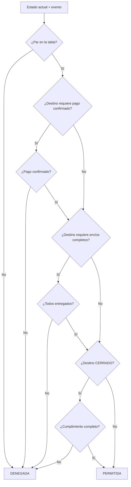

# DS-06 — `PoliticaTransicionPedido`

**Código documental:** `NM-SDD-DOM-DS-06`
**Tipo:** Domain Service (política de dominio)
**Versión:** 1.0
**Fecha:** 26 de octubre de 2026
**Estado del documento:** `COMPLETO`
**Estado de la definición de dominio:** Confirmado por fuente.

**Documentos relacionados:**

- Catálogo canónico: [`nexusmarket-domain-services.md`](../nexusmarket-domain-services.md) (`[DS]`), §3, §4.6, §5.2, §5.3, §6 y §7.
- Modelo de dominio: [`nexusmarket-domain-model.md`](../nexusmarket-domain-model.md) (`[MOD]`), §10.1, §10.3, §10.4, §11.1, §13, §18, §21 y §22.5.
- Objetos de valor: [`nexusmarket-domain-object-values.md`](../nexusmarket-domain-object-values.md) (`[VO]`), §7.3, §8.11, §8.12, §8.14 y §12.
- Arquitectura: [`nexusmarket-arquitectura.md`](../../Software%20Architecture/nexusmarket-arquitectura.md) (`[ARQ]`), §6, §12.1, §12.2 y §16.
- Especificación funcional: [`enunciado.md`](../../enunciado.md) (`[ENU]`), Dominio 7 y §11.
- Servicios colaboradores: [`DS-01`](politica-autorizacion-dominio.md), [`DS-03`](servicio-reserva-inventario.md), [`DS-05`](servicio-calculo-pedido.md), [`DS-07`](politica-elegibilidad-devolucion.md), [`DS-09`](servicio-auditoria.md).

---

## 1. Identificación

| Campo | Valor |
|---|---|
| Nombre canónico | `PoliticaTransicionPedido` |
| Identificador estable | `DS-06` |
| Código documental | `NM-SDD-DOM-DS-06` |
| Tipo | Domain Service — política de dominio de solo lectura |
| Propósito resumido | Decidir si un pedido puede pasar de su estado actual al siguiente, verificando pago, inventario, cumplimiento y cierre. |
| Estado de definición | Confirmado por fuente; sin secciones bloqueadas. |
| Fuente primaria | `[MOD]` §10.3 y §18; `[ENU]` Dominio 7. |

---

## 2. Propósito y responsabilidad

### 2.1 Problema de dominio que resuelve

El pedido es el compromiso comercial central. Su ciclo involucra pago, reserva, preparación, despacho, entrega y cierre, y cada paso tiene precondiciones distintas. Sin una política única podrían producirse saltos de estado, preparación antes del pago, entregas parciales declaradas completas, reapertura de pedidos cerrados o cancelaciones directas después de pagar, que dejarían el pago y el inventario en situaciones inconsistentes.

### 2.2 Resultado de negocio buscado

Autorizar o denegar una transición concreta, declarar el estado resultante y las precondiciones incumplidas, y señalar las obligaciones asociadas (liberar reserva, consumir reserva, registrar auditoría o conservar motivo). La transición la aplica el agregado `Pedido`.

### 2.3 Responsabilidades

- Validar pares estado-evento contra la tabla confirmada.
- Verificar pago confirmado antes de preparar.
- Verificar reservas vigentes cuando la preparación lo exija.
- Verificar que todos los envíos requeridos estén entregados antes de `ENTREGADO`.
- Verificar el cierre operativo antes de `CERRADO`.
- Impedir modificaciones posteriores al cierre.
- Impedir la cancelación directa después de `PAGADO`.
- Exigir motivo y actor en cancelaciones autorizadas.
- Admitir el flujo digital con evidencia de entrega.

### 2.4 Fuera de responsabilidad

- Modificar pagos o inventario directamente.
- Ejecutar la reserva o el consumo; corresponde a `DS-03`.
- Calcular importes; corresponde a `DS-05`.
- Emitir facturas.
- Asignar transportista.
- Reescribir líneas o snapshots.
- Publicar eventos; los publica el caso de uso.

---

## 3. Justificación DDD

| Alternativa de modelado | Por qué no es suficiente |
|---|---|
| Método de `Pedido` | El pedido conoce su estado y líneas, pero no el estado del pago ni el de cada envío, que son agregados separados. |
| Método de `Pago` | El pago conoce su confirmación, pero no el cumplimiento ni el cierre del pedido. |
| Método de `Envio` | El envío conoce su estado, pero no la totalidad de envíos requeridos ni el estado comercial del pedido. |
| Validación de `EstadoPedido` | El VO valida el código y la tabla de estados, no las precondiciones de pago, inventario y entrega. |
| Servicio de aplicación | La aplicación coordina y persiste; la regla de transición válida es de negocio y debe ser estable frente al transporte. |
| Saga o proceso técnico | La coordinación distribuida es de aplicación; la política solo decide. |

La decisión compara el pedido con el pago y los envíos; no pertenece a un solo agregado (`[MOD]` §18; `[PM]` §5.3).

---

## 4. Contexto de negocio

- **Ciclo base:** `PENDIENTE_DE_PAGO` → `PAGADO` → `EN_PREPARACION` → `DESPACHADO` → `ENTREGADO` → `CERRADO`; `CANCELADO` desde `PENDIENTE_DE_PAGO` (`[MOD]` §10.3).
- **Pago:** el pedido no pasa a `PAGADO` por la sola solicitud; requiere confirmación verificable e idempotente (`ORD-02`, `PAY-01`, `PAY-07`).
- **Preparación:** no comienza antes de confirmar el pago y exige reservas vigentes (`ORD-03`).
- **Entrega:** el estado global `ENTREGADO` exige todos los envíos/entregas confirmados (`ORD-08`).
- **Cierre:** `ENTREGADO` y `CERRADO` son distintos; el cierre exige cumplimiento completo (`ORD-04`).
- **Cancelación:** después de `PAGADO` no se cancela directamente; se tramita como devolución, reembolso o anulación financiera autorizada (`[MOD]` §10.4).
- **Producto digital:** puede pasar de `PAGADO` a `ENTREGADO` con evidencia de entrega digital, sin preparación ni despacho (`[MOD]` §10.3, §13.3).

### 4.1 Nota de numeración de reglas

`[MOD]` §10.3 y §21 enumeran códigos `ORD-01…ORD-08`/`ORD-01…ORD-06` con contenidos distintos. Esta definición adopta la numeración de §10.3, sección normativa de las transiciones del agregado `Pedido`. Las reglas resumidas de §21 se conservan por referencia de sección. La discrepancia se registra como `C-13` en `DOCUMENTATION_STATUS.md`.

---

## 5. Reglas de negocio

| ID | Enunciado | Condiciones de aplicación | Conceptos afectados | Resultado esperado | Excepciones o rechazos | Fuente | Estado |
|---|---|---|---|---|---|---|---|
| `ORD-01` | Solo las transiciones de la tabla son válidas. | Toda solicitud de cambio. | `EstadoPedido` | Par válido o denegación. | `ORD_INVALID_TRANSITION`. | `[MOD]` §10.3 | Confirmado |
| `ORD-02` | El pedido no pasa a `PAGADO` por la sola solicitud de pago. | Destino `PAGADO`. | `Pago`, `EstadoPago` | Exige confirmación verificable. | `ORD_PAYMENT_NOT_CONFIRMED`. | `[MOD]` §10.3 | Confirmado |
| `ORD-03` | El alistamiento no comienza antes de confirmar el pago. | Destino `EN_PREPARACION`. | `Pedido`, `Pago` | Exige pago confirmado. | `ORD_PAYMENT_NOT_CONFIRMED`. | `[MOD]` §10.3 | Confirmado |
| `ORD-04` | `ENTREGADO` y `CERRADO` son distintos; un pedido entregado o cerrado no se modifica retroactivamente. | Destino `ENTREGADO`/`CERRADO` o modificación posterior. | `EstadoPedido` | Cierre separado; historia inmutable. | `ORD_ORDER_CLOSED`. | `[MOD]` §10.3 | Confirmado |
| `ORD-05` | Los cambios registran actor, timestamp, estado previo, estado nuevo y referencia causal. | Toda transición aplicada. | `Pedido`, auditoría | Trazabilidad completa. | Transición sin evidencia: rechazo. | `[MOD]` §10.3 | Confirmado |
| `ORD-06` | Una notificación duplicada de pago o envío no duplica la transición ni el movimiento. | Reintento o duplicado. | `Pedido`, `Pago`, `Envio` | Una sola transición. | `ORD_DUPLICATE_EVENT`. | `[MOD]` §10.3 | Confirmado |
| `ORD-07` | Un pedido con productos físicos requiere dirección válida y cumplimiento logístico; uno digital no crea envío físico. | Creación y cumplimiento. | `Pedido`, `DireccionSnapshot`, `Envio` | Físico exige dirección; digital no crea envío. | `ORD_MISSING_EVIDENCE` o rechazo de datos. | `[MOD]` §10.3 | Confirmado |
| `ORD-08` | El estado global `ENTREGADO` se establece cuando todos los envíos/entregas han sido confirmados. | Destino `ENTREGADO`. | `Envio`, `Entrega digital` | Sin envíos pendientes. | `ORD_SHIPMENTS_INCOMPLETE`. | `[MOD]` §10.3 | Confirmado |
| `ORD-09` | Después de `PAGADO` no se cancela directamente; se tramita como devolución, reembolso o anulación autorizada. | Cancelación posterior al pago. | `Pedido`, `Devolucion`, `Reembolso` | Se deniega la vía directa. | `ORD_CANCELLATION_REQUIRES_POSTSALE`. | `[MOD]` §10.4 | Confirmado |
| `ORD-10` | La preparación exige reservas vigentes cuando correspondan. | Destino `EN_PREPARACION` con líneas físicas. | `ReservaInventario` | Reserva activa o rechazo. | `ORD_RESERVATION_NOT_ACTIVE`. | `[MOD]` §13.2; `[DS]` §4.6 | Confirmado |
| `ORD-11` | El despacho exige salida de inventario registrada. | Destino `DESPACHADO`. | `Inventario`, `MovimientoInventario` | Salida registrada antes del estado. | `ORD_MISSING_EVIDENCE`. | `[MOD]` §13.2 | Confirmado |
| `ORD-12` | La entrega exige evidencia válida. | Destino `ENTREGADO`. | `Envio`, entrega digital | Evidencia física o digital. | `ORD_MISSING_EVIDENCE`. | `[MOD]` §13.1, §13.3 | Confirmado |
| `ORD-13` | El cierre exige cumplimiento completo y ausencia de tareas operativas de entrega pendientes. | Destino `CERRADO`. | `Pedido`, `Envio` | Cierre solo con cumplimiento. | Cierre sin entrega: denegado. | `[MOD]` §10.3 | Confirmado |

**Nota de códigos:** `ORD-01`…`ORD-08` son los códigos normativos de `[MOD]` §10.3. `ORD-09`…`ORD-13` son derivaciones locales que referencian §10.4 y §13.2; no amplían el catálogo normativo ni la tabla de transiciones.

**Tabla de transiciones** (`[MOD]` §10.3, resumida):

| Actual | Evento | Nuevo | Condición |
|---|---|---|---|
| — | Crear pedido | `PENDIENTE_DE_PAGO` | Checkout válido; reservas activas si aplica. |
| `PENDIENTE_DE_PAGO` | Pago confirmado | `PAGADO` | Confirmación válida e idempotente. |
| `PENDIENTE_DE_PAGO` | Pago rechazado/expirado | `CANCELADO` | Liberar reserva; conservar motivo. |
| `PENDIENTE_DE_PAGO` | Cancelación autorizada | `CANCELADO` | Antes de confirmar pago; liberar reserva. |
| `PAGADO` | Iniciar preparación | `EN_PREPARACION` | Pago confirmado; reservas vigentes. |
| `EN_PREPARACION` | Despachar | `DESPACHADO` | Empacado y salida de inventario registrada. |
| `DESPACHADO` | Confirmar entrega | `ENTREGADO` | Evidencia válida de todos los envíos. |
| `PAGADO` | Entrega digital confirmada | `ENTREGADO` | Pago confirmado y evidencia digital. |
| `ENTREGADO` | Cerrar operación | `CERRADO` | Cumplimiento completo. |
| `CERRADO` | Modificar líneas/total/estado | No permitido | Solo posventa separada. |
| `CANCELADO` | Reanudar | No permitido | Crear un pedido nuevo. |

---

## 6. Entradas conceptuales

| Entrada | Significado | Origen conceptual | Restricciones | Validaciones relevantes | Naturaleza |
|---|---|---|---|---|---|
| Estado actual del pedido | Origen de la transición. | `Pedido`. | Código válido. | `INV-VO-EPED-01`. | Objeto de valor enumerado. |
| Evento solicitado | Destino pretendido. | Caso de uso. | Debe existir en la tabla. | `INV-VO-EPED-02`. | Concepto de dominio. |
| `EstadoPago` | Condición financiera. | `Pago`. | Condicional a `PAGADO` y preparación. | `INV-VO-EPAG-01`. | Objeto de valor enumerado. |
| Estados de los envíos | Condición logística. | `Envio`. | Condicional a `ENTREGADO`. | `INV-VO-EENV-01`. | Objetos de valor. |
| Evidencia de entrega digital | Resultado verificable. | Caso de uso / entrega digital. | Condicional a pedido digital. | Debe existir y corresponder al pedido. | Concepto de dominio. |
| Actor y motivo | Autoría y justificación. | Contexto de ejecución. | Condicional en cancelaciones y operaciones privilegiadas. | Identidad válida; motivo no vacío. | Concepto de dominio. |
| Versión del pedido | Control de concurrencia. | `Pedido`. | Obligatoria. | Coincidencia con la versión vigente. | Dato de control. |
| Dirección de entrega | Requisito del pedido físico. | `DireccionSnapshot`. | Obligatoria para físico. | `INV-VO-DIRS-04`. | Objeto de valor. |

---

## 7. Resultado conceptual

| Resultado | Significado |
|---|---|
| `PERMITIDA` | La transición es válida y sus precondiciones se cumplen. |
| `PERMITIDA` con obligaciones | Se autoriza si el caso de uso libera/consume reserva, registra auditoría o conserva motivo. |
| `DENEGADA` | La transición no es válida o falta una precondición; se indica cuál. |
| Estado resultante | Estado destino que el agregado aplicará, no aplicado por la política. |

**Fallos técnicos:** si no puede confirmarse el estado del pago o de los envíos, no se autoriza la transición. La política no asume confirmación por ausencia de dato (`[DS]` §4.6 punto 15).

---

## 8. Precondiciones e invariantes

### 8.1 Precondiciones

| ID | Regla | Momento de verificación | Conceptos afectados | Consecuencia de incumplimiento | Fuente |
|---|---|---|---|---|---|
| `PRE-DS06-01` | Estado actual y evento conocidos. | Inicio. | `Pedido` | No se evalúa. | `[DS]` §4.6 |
| `PRE-DS06-02` | Datos de pago disponibles cuando la transición los requiere. | Destinos `PAGADO` y `EN_PREPARACION`. | `Pago` | `ORD_PAYMENT_NOT_CONFIRMED`. | `ORD-02`, `ORD-03` |
| `PRE-DS06-03` | Estados de los envíos disponibles cuando la transición los requiere. | Destino `ENTREGADO`. | `Envio` | `ORD_SHIPMENTS_INCOMPLETE`. | `ORD-08` |
| `PRE-DS06-04` | El pedido no está eliminado ni cerrado para la operación solicitada. | Inicio. | `Pedido` | `ORD_ORDER_CLOSED`. | `ORD-04` |
| `PRE-DS06-05` | La versión del pedido está disponible. | Inicio. | `Pedido` | No se aplica la transición. | `[DS]` §4.6 |

### 8.2 Invariantes

| ID | Regla | Momento de verificación | Conceptos afectados | Consecuencia de incumplimiento | Fuente |
|---|---|---|---|---|---|
| `INV-VO-EPED-01` | Código de estado válido. | Cada transición. | `EstadoPedido` | Rechazo. | `[VO]` §8.11 |
| `INV-VO-EPED-02` | Solo transiciones válidas. | Cada transición. | `EstadoPedido` | `ORD_INVALID_TRANSITION`. | `[VO]` §8.11 |
| `INV-VO-EPED-03` | `CARRITO` no es estado de pedido. | Validación de estado. | `EstadoPedido` | Rechazo. | `[VO]` §8.11 |
| `INV-VO-EPED-04` | `ENTREGADO` y `CERRADO` son distintos. | Destinos de entrega y cierre. | `EstadoPedido` | Rechazo de equivalencia. | `[VO]` §8.11 |
| `INV-VO-EPED-05` | Un pedido `ENTREGADO` o `CERRADO` no se modifica retroactivamente. | Modificación posterior. | `Pedido` | `ORD_ORDER_CLOSED`. | `[VO]` §8.11 |
| `INV-VO-EPED-06` | `ENTREGADO` exige todos los envíos requeridos. | Destino `ENTREGADO`. | `Envio` | `ORD_SHIPMENTS_INCOMPLETE`. | `[VO]` §8.11 |
| `INV-VO-EPAG-02` | No se declara captura sin confirmación. | Destino `PAGADO`. | `Pago` | `ORD_PAYMENT_NOT_CONFIRMED`. | `[VO]` §8.12 |
| `INV-VO-EPAG-06` | Una confirmación de pago activa la transición una sola vez. | Pago duplicado. | `Pedido`, `Pago` | `ORD_DUPLICATE_EVENT`. | `[VO]` §8.12 |
| `INV-VO-EENV-02` | Solo un pedido pagado puede prepararse o despacharse. | Destinos de preparación y despacho. | `Pedido`, `Envio` | Rechazo. | `[VO]` §8.14 |
| `INV-VO-EENV-04` | La entrega requiere evidencia válida. | Destino `ENTREGADO`. | `Envio` | `ORD_MISSING_EVIDENCE`. | `[VO]` §8.14 |
| `INV-VO-DIRS-04` | La dirección es obligatoria en pedido físico. | Creación de pedido físico. | `Pedido` | Rechazo. | `[VO]` §7.3 |

---

## 9. Entidades, agregados y objetos de valor relacionados

| Concepto | Función en el comportamiento | Información que aporta | Responsabilidad que conserva | Interacción conceptual | Invariantes que debe respetar |
|---|---|---|---|---|---|
| `Pedido` | Agregado cuyo estado se evalúa. | Estado, versión, líneas, dirección, importes. | Aplicar la transición y proteger snapshots. | Recibe la decisión; aplica el cambio. | `INV-VO-EPED-01…07`; `ORD-04`. |
| `Pago` | Precondición financiera. | Estado, confirmación, importe. | Proteger captura y trazabilidad. | Aporta `EstadoPago`. | `INV-VO-EPAG-01…07`. |
| `Envio` | Precondición logística. | Estado, evidencia, bodega de origen. | Proteger su ciclo logístico. | Aporta estados de envío. | `INV-VO-EENV-01…06`. |
| `ReservaInventario` | Precondición de preparación. | Estado y cantidades. | Proteger su ciclo. | Aporta vigencia. | `INV-VO-ERES-01…05`. |
| `DireccionSnapshot` | Requisito del pedido físico. | Copia inmutable de dirección. | No alterarse retroactivamente. | Se verifica su presencia. | `INV-VO-DIRS-01…05`. |
| `EstadoPedido`, `EstadoPago`, `EstadoEnvio` | Valores controlados. | Código y semántica. | Validar su valor. | Se consumen. | Las de `[VO]` §8.11, §8.12, §8.14. |
| `Instant` | Momento de la transición. | Fecha UTC. | Ser inequívoco. | Se registra en la evidencia. | `INV-VO-INST-01…04`. |

---

## 10. Flujo conceptual de ejecución

1. Verificar que el par estado-evento exista en la tabla.
2. Si el destino es `PAGADO`, exigir pago confirmado e idempotente.
3. Si el destino es `EN_PREPARACION`, exigir pago confirmado y reservas vigentes cuando apliquen.
4. Si el destino es `DESPACHADO`, exigir salida de inventario registrada.
5. Si el destino es `ENTREGADO`, exigir evidencia de todos los envíos o de la entrega digital.
6. Si el destino es `CERRADO`, exigir cumplimiento completo y ausencia de tareas pendientes.
7. Si el origen es `CERRADO`, denegar cualquier modificación.
8. Si el evento es cancelación y el pedido está `PAGADO`, denegar la vía directa y señalar posventa.
9. Devolver decisión, estado resultante y obligaciones.

---

## 11. Estado y efectos del dominio

- **Naturaleza:** evaluación de solo lectura (`DS-D-01` y `DS-D-04`). No aplica la transición.
- **Estado que consulta:** pedido, pago, envíos, reservas y dirección.
- **Estado que modifica:** ninguno.
- **Efectos exigidos:** puede obligar a liberar o consumir reservas, registrar auditoría o conservar el motivo. El agregado `Pedido` aplica la transición y el caso de uso coordina los demás agregados.
- **Eventos posibles:** `PedidoCreado`, `PagoConfirmado`, `PedidoDespachado`, `EntregaConfirmada`; los publica el caso de uso (`[MOD]` §20).
- **Persistencia:** no persiste; la transición se confirma con control de versión en el agregado.

---

## 12. Colaboraciones y límites arquitectónicos

### 12.1 Colaboraciones

| Colaborador | Relación |
|---|---|
| `DS-01` | Autoriza al actor que solicita la transición. |
| `DS-03` | Ejecuta la reserva y el consumo que la política exige como precondición. |
| `DS-05` | Calcula los importes que el pedido conserva. |
| `DS-07` | Recibe los casos de posventa que sustituyen la cancelación directa. |
| `DS-09` | Audita cada transición y sus rechazos relevantes. |
| Caso de uso | Coordina pago, inventario, envíos y transacción. |

### 12.2 Responsabilidad de la capa de aplicación

- Recuperar pedido, pago, envíos y reservas.
- Invocar `DS-01` y `DS-06`.
- Aplicar la transición en el agregado con control de versión.
- Ejecutar liberación/consumo de reservas y auditoría.
- Coordinar la transacción y compensar fallos.

### 12.3 Dependencias permitidas y prohibidas

| Permitidas | Prohibidas |
|---|---|
| `Pedido`, `Pago`, `Envio`, `ReservaInventario` y VOs de estado. | Modificar pagos o inventario directamente. |
| Datos de evidencia y actor como valores. | Persistencia, HTTP, ORMs, MongoDB. |
| Política de transiciones de `[MOD]` §10.3. | Transportistas, pasarelas o SDKs. |

### 12.4 Límites de consistencia

La evaluación es de solo lectura sobre el estado vigente. La transición se aplica con control de versión en el agregado. La coordinación entre pedido, pago e inventario pertenece al caso de uso y no promete atomicidad distribuida (`[DS]` §4.6 punto 18; `[ARQ]` §9.4, §12.1).

---

## 13. Escenarios de ejemplo

| # | Situación inicial | Datos conceptuales relevantes | Regla aplicada | Resultado esperado | Origen |
|---|---|---|---|---|---|
| E-01 | `PENDIENTE_DE_PAGO` con pago confirmado. | `EstadoPago = CAPTURADO` verificado. | `ORD-02` | Permitido; `PAGADO`. | `[MOD]` §10.3 |
| E-02 | `PENDIENTE_DE_PAGO` con solicitud de pago sin confirmación. | Sin confirmación verificable. | `ORD-02` | Denegado por `ORD_PAYMENT_NOT_CONFIRMED`. | `[MOD]` §10.3 |
| E-03 | `PAGADO` con reserva activa. | Reserva vigente. | `ORD-03`, `ORD-10` | Permitido; `EN_PREPARACION`. | `[MOD]` §22.5 |
| E-04 | `DESPACHADO` con un envío pendiente. | Dos envíos; uno `ENTREGADO`, otro `EN_TRANSITO`. | `ORD-08` | Denegado por `ORD_SHIPMENTS_INCOMPLETE`. | `[MOD]` §10.3 |
| E-05 | `PAGADO` con cancelación directa. | Pago confirmado. | `ORD-09` | Denegado; se deriva a posventa. | `[MOD]` §10.4 |
| E-06 | `CERRADO` con cambio de líneas. | Estado terminal. | `ORD-04` | Denegado por `ORD_ORDER_CLOSED`. | `[MOD]` §10.3 |
| E-07 | Pedido digital `PAGADO` con evidencia de entrega. | Sin envío físico. | `ORD-08`, `ORD-12` | Permitido; `ENTREGADO`. | `[MOD]` §13.3 |
| E-08 | Pago duplicado notificado dos veces. | Misma referencia de pago. | `ORD-06` | Una sola transición. | `[MOD]` §10.3 |

**Escenarios ilustrativos:** E-01 a E-08 derivan de la tabla de transiciones y de los escenarios integrales; no añaden estados ni reglas.

---

## 14. Dependencias y restricciones

**Necesita:**

- Estado actual, evento y versión del pedido.
- Estado del pago cuando la transición lo requiera.
- Estados de los envíos o evidencia digital.
- Vigencia de reservas cuando corresponda.
- Actor y motivo en cancelaciones y operaciones privilegiadas.

**No debe conocer:**

- Cálculo de importes, reserva efectiva o reembolsos.
- Transportistas, facturación o pasarelas.
- Persistencia, HTTP, frameworks o SDKs.
- La política de negocio que decide el momento de la anulación financiera; solo la deriva a posventa.

---

## 15. Trazabilidad

| Elemento | Identificador o nombre | Fuente | Sección | Relación con el servicio | Estado de verificación |
|---|---|---|---|---|---|
| Servicio canónico | `PoliticaTransicionPedido` | `[MOD]` | §18 | Define su responsabilidad | Confirmado |
| Inventario | `DS-06` | `[DS]` | §3, §4.6 | Especificación canónica | Confirmado |
| Transiciones | — | `[MOD]` | §10.3 | Tabla normativa | Confirmado |
| Reglas de transición | `ORD-01`…`ORD-08` | `[MOD]` | §10.3 | Núcleo de la política | Confirmado |
| Cancelación tras pago | `ORD-09` | `[MOD]` | §10.4 | Deriva a posventa | Confirmado |
| Preparación y despacho | `ORD-10`, `ORD-11` | `[MOD]` | §13.2 | Precondiciones logísticas | Confirmado |
| Evidencia de entrega | `ORD-12` | `[MOD]` | §13.1, §13.3 | Física o digital | Confirmado |
| Cierre operativo | `ORD-13` | `[MOD]` | §10.3 | Distinto de entrega | Confirmado |
| Estado del pedido | `INV-VO-EPED-01…07` | `[VO]` | §8.11 | Invariantes de transición | Confirmado |
| Estado del pago | `INV-VO-EPAG-02`, `INV-VO-EPAG-06` | `[VO]` | §8.12 | Confirmación única | Confirmado |
| Estado del envío | `INV-VO-EENV-02`, `INV-VO-EENV-04` | `[VO]` | §8.14 | Preparación y evidencia | Confirmado |
| Dirección snapshot | `INV-VO-DIRS-04` | `[VO]` | §7.3 | Obligatoria en físico | Confirmado |
| Conflicto de numeración ORD | `C-13` | `[MOD]` | §10.3 vs §21 | Resuelto por sección normativa | Registrado |
| Solo lectura | `DS-D-01`, `DS-D-04` | `[DS]` | §10 | No modifica pagos ni inventario | Decisión de diseño registrada |
| Consistencia | — | `[ARQ]` | §9.4, §12.1 | Límites transaccionales | Confirmado |

---

## 16. Criterios de validación documental

- [x] La responsabilidad está delimitada y no modifica pagos ni inventario.
- [x] Las reglas están identificadas y la tabla de transiciones es explícita.
- [x] Las entradas y resultados son comprensibles sin firmas técnicas.
- [x] Las precondiciones y las invariantes están diferenciadas.
- [x] Las colaboraciones respetan DDD y los límites de agregado.
- [x] Los límites de consistencia y control de versión son explícitos.
- [x] La trazabilidad cubre modelo, objetos de valor y catálogo.
- [x] No se añaden estados ni transiciones no confirmadas.
- [x] No se definen puertos, adaptadores, contratos ni código.
- [x] La colisión de códigos `ORD` está tratada mediante `C-13`.

---

## 17. Historial y estado

| Fecha | Cambio | Autor |
|---|---|---|
| 2026-10-26 | Creación de la definición individual a partir de `[DS]` §4.6, `[MOD]` §10 y §13 y `[VO]` §7, §8. | Agente documental |

**Estado de definición:** `COMPLETO`.
**Limitaciones reales:** `[MOD]` no define todas las transiciones de estados excepcionales ni la política exacta de anulación financiera después del pago (`L-09`; `[ARQ]` §18). Las transiciones no listadas se rechazan por defecto; no se inventan estados ni caminos alternativos.
