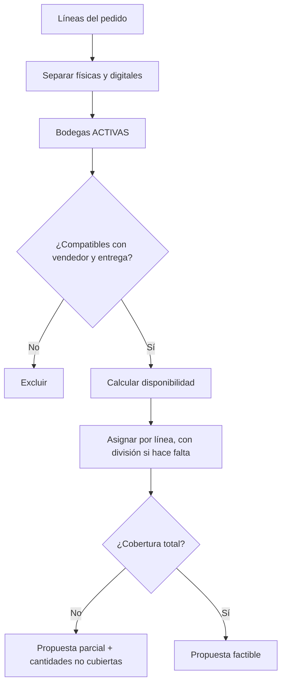

# DS-04 — `ServicioAsignacionBodega`

**Código documental:** `NM-SDD-DOM-DS-04`
**Tipo:** Domain Service (servicio de solo lectura)
**Versión:** 1.0
**Fecha:** 26 de octubre de 2026
**Estado del documento:** `COMPLETO`
**Estado de la definición de dominio:** Confirmado por fuente; preferencia entre bodegas parcialmente especificada.

**Documentos relacionados:**

- Catálogo canónico: [`nexusmarket-domain-services.md`](../nexusmarket-domain-services.md) (`[DS]`), §3, §4.4, §5.1, §5.3, §6 y §7.
- Modelo de dominio: [`nexusmarket-domain-model.md`](../nexusmarket-domain-model.md) (`[MOD]`), §7.2, §8.1, §8.2, §13.1, §18, §21 y §22.3.
- Objetos de valor: [`nexusmarket-domain-object-values.md`](../nexusmarket-domain-object-values.md) (`[VO]`), §6.7, §7.1, §7.2, §8.2, §8.3 y §8.10.
- Arquitectura: [`nexusmarket-arquitectura.md`](../../Software%20Architecture/nexusmarket-arquitectura.md) (`[ARQ]`), §6, §9.4 y §16.
- Especificación funcional: [`enunciado.md`](../../enunciado.md) (`[ENU]`), Dominios 4, 6 y 10.
- Servicios colaboradores: [`DS-03`](servicio-reserva-inventario.md), [`DS-06`](politica-transicion-pedido.md), [`DS-09`](servicio-auditoria.md).

---

## 1. Identificación

| Campo | Valor |
|---|---|
| Nombre canónico | `ServicioAsignacionBodega` |
| Identificador estable | `DS-04` |
| Código documental | `NM-SDD-DOM-DS-04` |
| Tipo | Domain Service — servicio de solo lectura |
| Propósito resumido | Proponer una asignación factible de las líneas físicas de un pedido a bodegas elegibles, sin comprometer stock. |
| Estado de definición | Confirmado por fuente; preferencia entre bodegas limitada (`DEC-BIZ-04`, `L-07`). |
| Fuente primaria | `[MOD]` §8 y §13; `[ENU]` Dominios 4, 6 y 10. |

---

## 2. Propósito y responsabilidad

### 2.1 Problema de dominio que resuelve

Un pedido puede contener líneas de distintos productos y cantidades, y el stock puede estar distribuido entre varias bodegas. Antes de reservar, el checkout necesita saber si existe cobertura suficiente, qué bodegas son compatibles con el vendedor y el tipo de entrega, y cómo repartir las cantidades cuando ninguna bodega cubre una línea completa.

La decisión compara varias posiciones de inventario y varias bodegas; no pertenece a `Bodega` ni a `Inventario` por separado.

### 2.2 Resultado de negocio buscado

Producir una propuesta de asignación por línea —`varianteId`, `bodegaId`, `cantidad`— con un indicador de factibilidad y las cantidades no cubiertas. La propuesta debe ser verificable y reservable después por `DS-03`; no es una promesa de stock.

### 2.3 Responsabilidades

- Separar las líneas físicas de las digitales; las digitales no participan.
- Filtrar bodegas `ACTIVAS`.
- Verificar compatibilidad entre tipo de bodega, vendedor y líneas.
- Calcular disponibilidad por posición.
- Asignar cantidades por línea, permitiendo división entre bodegas cuando sea necesario.
- Informar cantidades no cubiertas.
- Ordenar las bodegas según la política vigente, si existe.
- Devolver una propuesta que `DS-03` pueda reservar.

### 2.4 Fuera de responsabilidad

- Reservar, bloquear o descontar stock.
- Crear `Envio` o asignar transportista.
- Elegir la «mejor» bodega por costo, cercanía o prioridad comercial: esa preferencia no está definida (`DEC-BIZ-04`, `L-07`).
- Validar la dirección de entrega.
- Cambiar el estado del pedido.
- Persistir la asignación.
- Decidir el resultado final del checkout.

---

## 3. Justificación DDD

| Alternativa de modelado | Por qué no es suficiente |
|---|---|
| Método de `Bodega` | La bodega conoce su estado, tipo y propietario, pero no la disponibilidad de cada variante ni las líneas del pedido. |
| Método de `Inventario` | La posición conoce cantidades de una combinación variante-bodega, pero no la compatibilidad con el vendedor ni la cobertura global de la línea. |
| Método de `Pedido` | El pedido puede conocer sus líneas, pero no el stock distribuido ni las bodegas candidatas; además se evalúa antes de crear el pedido. |
| Validación de `TipoBodega` o `EstadoBodega` | Los VOs validan códigos y su semántica, no la factibilidad de una asignación. |
| Servicio de aplicación | La aplicación recupera bodegas y posiciones; la regla de elegibilidad y cobertura es de negocio y debe ser independiente del transporte. |
| `DS-03` | `DS-03` aplica la reserva con concurrencia; mezclar la propuesta con la mutación impediría separar decisión de efecto y dificultaría la compensación. |

La propuesta es un servicio de dominio de solo lectura porque compara varios agregados y produce una decisión de negocio (`DS-D-02`).

---

## 4. Contexto de negocio

- **Proceso:** checkout de productos físicos (`[MOD]` §22.3). La asignación precede a la reserva efectiva.
- **Compatibilidad:** cada envío se asigna a una bodega de origen compatible con las líneas (`[MOD]` §13.1). Una bodega de vendedor exige propietario; una bodega marketplace no tiene propietario vendedor.
- **Distribución:** un pedido puede requerir varios envíos por disponibilidad distribuida o separación de bodega (`[MOD]` §13.1). La división de una línea entre bodegas es admisible cuando ninguna cubre la línea completa.
- **Productos digitales:** no requieren bodega, stock, empaque ni envío físico (`[MOD]` §7.3; `LOG-01`).
- **Preferencia:** no existe regla aprobada para desempatar entre varias bodegas elegibles (`DEC-BIZ-04`). La propuesta debe ser factible, no «óptima».

---

## 5. Reglas de negocio

| ID | Enunciado | Condiciones de aplicación | Conceptos afectados | Resultado esperado | Excepciones o rechazos | Fuente | Estado |
|---|---|---|---|---|---|---|---|
| `INV-02` | `reserved + unavailable <= onHand`; el stock dañado no forma parte de la disponibilidad. | Cálculo de disponibilidad. | `Inventario` | Solo se considera `onHand - reserved - unavailable`. | Posición inválida: no se usa. | `[MOD]` §8.2.1 | Confirmado |
| `INV-03` | La asignación no supera la disponibilidad de la posición. | Asignación por bodega. | `Inventario`, `CantidadPositiva` | La suma asignada por posición no excede lo disponible. | `WH_INSUFFICIENT_TOTAL`. | `[MOD]` §8.2.1 | Confirmado |
| `INV-04` | Solo bodegas `ACTIVAS` y variantes vendibles. | Filtrado de candidatas. | `Bodega`, `Variante`, `Producto` | Bodegas inactivas y variantes no vendibles se excluyen. | `WH_NO_ELIGIBLE`. | `[MOD]` §8.2.1 | Confirmado |
| `ORD-07` | Un pedido con productos físicos requiere dirección válida y cumplimiento logístico; uno digital no crea envío físico. | Clasificación de líneas. | `Pedido`, `TipoEntrega` | Las líneas físicas requieren asignación; las digitales no. | Línea física sin dirección: el checkout falla. | `[MOD]` §10.3 | Confirmado |
| `LOG-01` | Un pedido digital no requiere envío físico. | Línea digital. | `TipoEntrega` | No se asigna bodega. | — | `[MOD]` §21 | Confirmado |
| `WH-01` | Una bodega `INACTIVA` no acepta reservas ni ingresos nuevos. | Filtrado. | `EstadoBodega` | Se excluye de la propuesta. | `WH_NO_ELIGIBLE`. | `[MOD]` §8.1 | Confirmado |
| `WH-02` | Cada envío se asigna a una bodega de origen compatible con las líneas. | Asignación. | `Envio`, `Bodega` | La bodega elegida debe ser compatible. | `WH_INCOMPATIBLE_TYPE`. | `[MOD]` §13.1 | Confirmado |
| `WH-03` | Una bodega de vendedor exige propietario; una bodega marketplace no tiene propietario vendedor. | Compatibilidad. | `TipoBodega`, `VendedorId` | Se respeta la titularidad. | `WH_SELLER_MISMATCH`. | `[VO]` §8.3; `[MOD]` §8.1 | Confirmado |
| `WH-04` | No se asigna stock de un vendedor a otro sin regla expresa. | Bodega de vendedor frente a pedido de otro vendedor. | Propiedad, pedido | Se excluye o se rechaza. | `WH_SELLER_MISMATCH`. | `[MOD]` §8.1; `[DS]` §4.4 | Confirmado |
| `WH-05` | La suma asignada por línea no excede la cantidad solicitada. | Asignación. | `CantidadPositiva` | No se sobreasigna. | `WH_INVALID_QUANTITY`. | `[DS]` §4.4 | Confirmado |
| `WH-06` | Si no hay cobertura total, el checkout falla de forma controlada y no crea un pedido pagable parcialmente. | Cobertura insuficiente. | `Pedido`, líneas | Se informan las cantidades no cubiertas. | `WH_INSUFFICIENT_TOTAL`. | `[MOD]` §22.3 | Confirmado |
| `WH-07` | La preferencia entre varias bodegas elegibles solo se aplica si una política aprobada la define. | Varias propuestas factibles. | Bodegas candidatas | Sin política, se devuelve una propuesta factible; no se declara óptima. | `WH_PREFERENCE_UNDEFINED` solo si se exige una única elección. | `[DS]` §4.4; `DEC-BIZ-04` | Parcialmente especificado |

**Nota de códigos:** `WH-01`…`WH-07` son derivaciones locales de esta definición; no amplían el catálogo normativo de `[MOD]` §21. Los códigos `INV-02`…`INV-04`, `ORD-07` y `LOG-01` sí son canónicos.

---

## 6. Entradas conceptuales

| Entrada | Significado | Origen conceptual | Restricciones | Validaciones relevantes | Naturaleza |
|---|---|---|---|---|---|
| Líneas físicas | Variante y cantidad solicitada. | Carrito/pedido en construcción. | Al menos una; cantidades positivas. | `INV-VO-CANP-01`. | `VarianteId` + `CantidadPositiva`. |
| Vendedor del pedido | Restricción de pertenencia. | `Pedido` en construcción. | Identificado. | `INV-VO-ID-01`. | `VendedorId`. |
| Bodegas candidatas | Universo de bodegas evaluables. | Consulta de bodegas. | Tipo, estado y propietario. | `INV-VO-EBOD-01`; `INV-VO-TBOD-01`. | Entidades/agregados. |
| Posiciones de inventario | Disponibilidad por variante-bodega. | `Inventario`. | `onHand`, `reserved`, `unavailable` no negativos. | `INV-01`, `INV-02`. | Agregados. |
| Tipo de entrega | Física o digital. | Producto/variante. | `FISICA` o `DIGITAL`. | `INV-VO-TENT-01`. | Objeto de valor. |
| Regla de compatibilidad | Tipo de bodega, propietario y entrega. | `[MOD]` §8.1, §13.1. | Condicional a la existencia de bodegas de vendedor. | Coherencia con `TipoBodega`. | Política de dominio. |
| Preferencia operativa | Criterio de desempate. | Política de plataforma. | Opcional; no definida. | Solo si está aprobada. | Política configurable. |
| Dirección de entrega | Contexto de factibilidad logística. | Comprador/pedido. | Obligatoria en compra física. | `INV-VO-DIR-01…05`. | Objeto de valor. |

---

## 7. Resultado conceptual

| Resultado | Significado |
|---|---|
| Propuesta factible | Cada línea física queda cubierta total o parcialmente por una o varias bodegas elegibles. |
| Propuesta dividida | Una línea se reparte entre bodegas; puede generar varios envíos. |
| Propuesta parcial | Existen cantidades no cubiertas; el checkout no debe crear un pedido pagable por lo no disponible. |
| `NO_FACTIBLE` | No hay bodega elegible o la disponibilidad total no cubre la línea; se devuelve el motivo. |

La propuesta incluye, por asignación, `varianteId`, `bodegaId` y `cantidad`; y como resultado global, indicador de factibilidad, cantidades no cubiertas y motivo cuando no sea factible. No reserva ni persiste.

**Fallos técnicos:** si no pueden consultarse las posiciones, no se emite una propuesta factible. El caso de uso debe tratar la ausencia como error, no como disponibilidad cero ni como cobertura total.

---

## 8. Precondiciones e invariantes

### 8.1 Precondiciones

| ID | Regla | Momento de verificación | Conceptos afectados | Consecuencia de incumplimiento | Fuente |
|---|---|---|---|---|---|
| `PRE-DS04-01` | Existe al menos una línea física; las digitales no participan. | Inicio. | Líneas, `TipoEntrega` | Sin líneas físicas no hay asignación. | `LOG-01` |
| `PRE-DS04-02` | Existe al menos una bodega candidata. | Inicio. | `Bodega` | `WH_NO_ELIGIBLE`. | `[DS]` §4.4 |
| `PRE-DS04-03` | Las posiciones de inventario están disponibles para consulta. | Antes de calcular. | `Inventario` | No se propone asignación. | `INV-03` |
| `PRE-DS04-04` | El vendedor del pedido está identificado. | Inicio. | `VendedorId` | `WH_SELLER_MISMATCH` o rechazo. | `CAT-01` |
| `PRE-DS04-05` | Las cantidades son enteras y positivas. | Inicio. | `CantidadPositiva` | `WH_INVALID_QUANTITY`. | `INV-VO-CANP-01` |

### 8.2 Invariantes

| ID | Regla | Momento de verificación | Conceptos afectados | Consecuencia de incumplimiento | Fuente |
|---|---|---|---|---|---|
| `INV-VO-EBOD-01` | Código de estado de bodega válido. | Filtrado. | `EstadoBodega` | Rechazo. | `[VO]` §8.10 |
| `INV-VO-EBOD-02` | Una bodega inactiva no recibe reservas. | Filtrado y asignación. | `EstadoBodega` | Se excluye. | `[VO]` §8.10 |
| `INV-VO-EBOD-03` | El stock de una bodega inactiva debe resolverse antes de cerrarla. | Contexto de bodega inactiva. | `Inventario`, `Bodega` | No se ignora el stock existente. | `[VO]` §8.10 |
| `INV-VO-TBOD-02` | Una bodega de vendedor exige propietario. | Compatibilidad. | `TipoBodega`, `VendedorId` | Rechazo. | `[VO]` §8.3 |
| `INV-VO-TBOD-03` | Una bodega marketplace no tiene propietario vendedor. | Compatibilidad. | `TipoBodega` | Rechazo. | `[VO]` §8.3 |
| `INV-VO-CANP-01` | Cantidades asignadas estrictamente positivas. | Asignación. | `CantidadPositiva` | Rechazo. | `[VO]` §6.7 |
| `INV-DS04-SUMA` | La suma asignada por línea no excede la cantidad solicitada ni la disponibilidad de cada posición. | Asignación. | Línea, posición | Sobrecobertura inválida. | `[DS]` §4.4 |

---

## 9. Entidades, agregados y objetos de valor relacionados

| Concepto | Función en el comportamiento | Información que aporta | Responsabilidad que conserva | Interacción conceptual | Invariantes que debe respetar |
|---|---|---|---|---|---|
| `Bodega` | Candidata de origen. | Tipo, estado, propietario, ubicación. | Proteger su clasificación y estado. | Se filtra y ordena; no se modifica. | `INV-VO-TBOD-01…03`; `INV-VO-EBOD-01…04`. |
| `Inventario` | Fuente de disponibilidad. | `onHand`, `reserved`, `unavailable`, versión. | Proteger el saldo y la atomicidad. | Se consulta; no se muta. | `INV-01`, `INV-02`, `INV-10`. |
| `Pedido` | Contexto de líneas y vendedor. | Líneas, comprador, vendedor, dirección. | Proteger su ciclo y snapshots. | Aporta líneas y pertenencia. | `INV-VO-EPED-01…07`; `ORD-07`. |
| `Envio` | Destino operativo de la asignación. | Bodega de origen, líneas, dirección. | Proteger su ciclo logístico. | Se anticipa su creación; no se crea aquí. | `INV-VO-EENV-01…06`. |
| `Variante` / `Producto` | Elegibilidad de la unidad. | Estado, tipo de entrega. | Proteger vendibilidad. | Aporta condición de venta. | `INV-VO-EVAR-02`; `INV-VO-EPROD-02`; `INV-VO-TENT-02`. |
| `TipoBodega`, `EstadoBodega`, `CantidadPositiva`, `TipoEntrega` | Valores de filtrado y magnitud. | Código válido y semántica. | Validar su valor. | Se consumen. | Las de `[VO]` §12. |
| `Direccion` | Contexto de entrega física. | Dirección válida del comprador. | Pertenecer al comprador y ser válida. | Se usa como contexto; no se define aquí. | `INV-VO-DIR-01…05`. |

---

## 10. Flujo conceptual de ejecución

1. Separar líneas físicas de digitales; las digitales no participan.
2. Filtrar bodegas `ACTIVAS`.
3. Filtrar bodegas compatibles con el vendedor y el tipo de entrega.
4. Calcular disponibilidad por posición.
5. Ordenar las bodegas según la política vigente, si existe.
6. Asignar cantidades hasta cubrir cada línea, permitiendo división.
7. Verificar que no se exceda la disponibilidad ni la cantidad solicitada.
8. Devolver la propuesta y las cantidades no cubiertas.

---

## 11. Estado y efectos del dominio

- **Naturaleza:** solo lectura (`DS-D-02`). No reserva ni bloquea stock.
- **Estado que consulta:** bodegas, posiciones, líneas, vendedor y tipo de entrega.
- **Estado que modifica:** ninguno.
- **Eventos:** no emite eventos.
- **Efecto habilitado:** su resultado permite invocar `DS-03` para la reserva efectiva.
- **Persistencia:** no persiste la asignación. La creación de envíos y la persistencia pertenecen al caso de uso y a los agregados correspondientes.

---

## 12. Colaboraciones y límites arquitectónicos

### 12.1 Colaboraciones

| Colaborador | Relación |
|---|---|
| `DS-03` | Recibe la propuesta y aplica la reserva; puede rechazarla si el stock cambió. |
| `DS-06` | Usa la asignación como contexto para preparación y despacho. |
| `DS-09` | Puede auditar la asignación y su rechazo. |
| Caso de uso de checkout | Recupera bodegas y posiciones, invoca la propuesta, reserva y compensa. |

### 12.2 Responsabilidad de la capa de aplicación

- Recuperar líneas, vendedor, bodegas y posiciones.
- Invocar `DS-04` con datos coherentes.
- Decidir si el checkout continúa; si no hay cobertura, informar y no crear pedido pagable parcial.
- Invocar `DS-03` y compensar si falla.
- Persistir la asignación y crear los envíos cuando corresponda.

### 12.3 Dependencias permitidas y prohibidas

| Permitidas | Prohibidas |
|---|---|
| `Bodega`, `Inventario`, `Pedido`, `Envio` y VOs asociados. | Transportistas, costos, geolocalización o tarifas. |
| Política de preferencia suministrada como dato. | Persistencia, ORM, SQL, MongoDB, HTTP. |
| Dirección como contexto. | SDKs, mensajería, variables de entorno. |

### 12.4 Límites de consistencia

Es una lectura consistente de posiciones. No garantiza exclusividad: entre la propuesta y la reserva el stock puede cambiar. `DS-03` decide y puede rechazar; la propuesta debe revalidarse si media una escritura (`[DS]` §4.4 punto 18).

---

## 13. Escenarios de ejemplo

| # | Situación inicial | Datos conceptuales relevantes | Regla aplicada | Resultado esperado | Origen |
|---|---|---|---|---|---|
| E-01 | Una bodega cubre toda la línea. | Disponibilidad suficiente en una bodega activa compatible. | `INV-03`, `WH-02` | Propuesta con una asignación. | `[DS]` §4.4 |
| E-02 | Dos bodegas cubren la línea en partes. | Disponibilidad parcial en cada una. | `WH-05` | Propuesta dividida; puede generar dos envíos. | `[MOD]` §13.1 |
| E-03 | Bodega inactiva con stock. | `EstadoBodega = INACTIVA`. | `WH-01` | Excluida de la propuesta. | `[MOD]` §8.1 |
| E-04 | Producto digital. | `TipoEntrega = DIGITAL`. | `LOG-01` | No participa; no se asigna bodega. | `[MOD]` §7.3 |
| E-05 | Stock cambia antes de reservar. | Propuesta obsoleta. | `PRE-DS04-03`; `DS-03` | `DS-03` rechaza; la propuesta no era una promesa. | `[DS]` §4.4 |
| E-06 | Bodega de vendedor con stock para un pedido de otro vendedor. | Propietario distinto. | `WH-03`, `WH-04` | Excluida o rechazo por `WH_SELLER_MISMATCH`. | `[MOD]` §8.1 |
| E-07 | Dos bodegas elegibles y ninguna política de desempate. | Varias propuestas factibles. | `WH-07` | Se devuelve una propuesta factible; no se declara óptima. | `DEC-BIZ-04`, `L-07` |

**Escenarios ilustrativos:** E-01 a E-07 derivan de `[MOD]` §8 y §13; no fijan una preferencia comercial.

---

## 14. Dependencias y restricciones

**Necesita:**

- Líneas físicas con variante y cantidad.
- Vendedor del pedido y tipo de entrega.
- Bodegas activas y compatibles.
- Posiciones de inventario con cantidades.
- Política de preferencia, solo si existe.

**No debe conocer:**

- Transportistas, costos de envío, geolocalización o tiempos de entrega.
- Reservas y transacciones; pertenecen a `DS-03` y a la aplicación.
- Estados del pedido; pertenecen a `DS-06`.
- Persistencia, HTTP o proveedores externos.

---

## 15. Trazabilidad

| Elemento | Identificador o nombre | Fuente | Sección | Relación con el servicio | Estado de verificación |
|---|---|---|---|---|---|
| Servicio canónico | `ServicioAsignacionBodega` | `[MOD]` | §18 | Define su responsabilidad | Confirmado |
| Inventario | `DS-04` | `[DS]` | §3, §4.4 | Especificación canónica | Confirmado |
| Disponibilidad | `INV-02`, `INV-03` | `[MOD]` | §8.2.1 | Límite de asignación | Confirmado |
| Elegibilidad | `INV-04` | `[MOD]` | §8.2.1 | Bodega activa y variante vendible | Confirmado |
| Cumplimiento físico | `ORD-07` | `[MOD]` | §10.3 | Líneas físicas requieren logística | Confirmado |
| Entrega digital | `LOG-01` | `[MOD]` | §21 | No requiere envío físico | Confirmado |
| Bodega inactiva | `WH-01` | `[MOD]` | §8.1 | Exclusión | Confirmado |
| Bodega de origen | `WH-02` | `[MOD]` | §13.1 | Compatibilidad del envío | Confirmado |
| Propiedad de bodega | `WH-03`, `WH-04` | `[VO]`; `[MOD]` | §8.3; §8.1 | Restricción de pertenencia | Confirmado |
| Tipo de bodega | `INV-VO-TBOD-02…03` | `[VO]` | §8.3 | Propietario exigido o ausente | Confirmado |
| Estado de bodega | `INV-VO-EBOD-01…04` | `[VO]` | §8.10 | Exclusión y cierre | Confirmado |
| Cantidades | `INV-VO-CANP-01…03` | `[VO]` | §6.7 | Magnitud positiva | Confirmado |
| Preferencia | `DEC-BIZ-04`; `L-07` | `[DS]`; estado | §4.4; §7 | Limitación de optimalidad | Parcialmente especificado |
| Solo lectura | `DS-D-02` | `[DS]` | §10 | No reserva | Decisión de diseño registrada |
| Concurrencia | — | `[ARQ]` | §9.4 | Revalidación antes de reservar | Confirmado |

---

## 16. Criterios de validación documental

- [x] La responsabilidad está delimitada y no reserva stock.
- [x] Las reglas están identificadas y la preferencia no definida se trata como limitación.
- [x] Las entradas y resultados son comprensibles sin firmas técnicas.
- [x] Las precondiciones y las invariantes están diferenciadas.
- [x] Las colaboraciones respetan DDD y los límites de agregado.
- [x] Los límites de consistencia entre propuesta y reserva son explícitos.
- [x] La trazabilidad cubre modelo, objetos de valor, catálogo y decisión pendiente.
- [x] No se fija una política de desempate ni una optimización comercial.
- [x] No se definen puertos, adaptadores, contratos ni código.
- [x] No existen contradicciones conocidas sin tratamiento.

---

## 17. Historial y estado

| Fecha | Cambio | Autor |
|---|---|---|
| 2026-10-26 | Creación de la definición individual a partir de `[DS]` §4.4, `[MOD]` §8 y §13 y `[VO]` §6, §7, §8. | Agente documental |

**Estado de definición:** `COMPLETO`.
**Limitaciones reales:** no existe política aprobada para elegir entre varias bodegas elegibles (`DEC-BIZ-04`, `L-07`). Por ello la salida se define como propuesta factible, no como asignación óptima, y `WH_PREFERENCE_UNDEFINED` solo aplica si el consumidor exige una única elección. La composición exacta de `Direccion` y `DireccionFisica` no está definida (`L-01`) y no se usa aquí para decidir compatibilidad.
