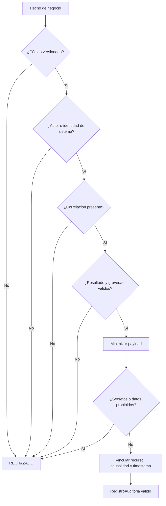

# DS-09 — `ServicioAuditoria`

**Código documental:** `NM-SDD-DOM-DS-09`
**Tipo:** Domain Service (servicio de construcción, sin mutación del agregado auditado)
**Versión:** 1.0
**Fecha:** 26 de octubre de 2026
**Estado del documento:** `COMPLETO`
**Estado de la definición de dominio:** Confirmado por fuente; catálogo de eventos, payload y asignación de gravedad parcialmente especificados.

**Documentos relacionados:**

- Catálogo canónico: [`nexusmarket-domain-services.md`](../nexusmarket-domain-services.md) (`[DS]`), §3, §4.9, §6, §7 y §8.
- Modelo de dominio: [`nexusmarket-domain-model.md`](../nexusmarket-domain-model.md) (`[MOD]`), §15.1, §18, §20, §21, DD-10 y §24.
- Objetos de valor: [`nexusmarket-domain-object-values.md`](../nexusmarket-domain-object-values.md) (`[VO]`), §7.4, §7.6, §8.18, §8.19, §8.20 y §9.6.
- Arquitectura: [`nexusmarket-arquitectura.md`](../../Software%20Architecture/nexusmarket-arquitectura.md) (`[ARQ]`), §6, §9.2, §9.4, §12.2 y §16.
- Especificación funcional: [`enunciado.md`](../../enunciado.md) (`[ENU]`), OBJ-12.
- Servicios colaboradores: [`DS-01`](politica-autorizacion-dominio.md), [`DS-03`](servicio-reserva-inventario.md), [`DS-06`](politica-transicion-pedido.md), [`DS-07`](politica-elegibilidad-devolucion.md), [`DS-08`](politica-reembolso.md).

---

## 1. Identificación

| Campo | Valor |
|---|---|
| Nombre canónico | `ServicioAuditoria` |
| Identificador estable | `DS-09` |
| Código documental | `NM-SDD-DOM-DS-09` |
| Tipo | Domain Service — construcción y validación de registro; sin efecto sobre el agregado auditado |
| Propósito resumido | Construir un `RegistroAuditoria` válido, minimizado y correlacionado a partir de un hecho de negocio relevante. |
| Estado de definición | Confirmado por fuente; catálogo de eventos (`L-14`), payload (`L-11`) y gravedad (`L-15`) limitados. |
| Fuente primaria | `[MOD]` §15.1 y §20; `[ENU]` OBJ-12. |

---

## 2. Propósito y responsabilidad

### 2.1 Problema de dominio que resuelve

Las operaciones críticas de NexusMarket deben poder explicarse: quién actuó, qué hizo, sobre qué recurso, cuándo, con qué resultado y bajo qué flujo. Si cada módulo inventara su propio formato, la evidencia sería incomparable; si se registrara el objeto completo, se filtrarían secretos y datos personales; si la auditoría se confundiera con el registro de negocio, se perdería la fuente de verdad transaccional.

El servicio aplica reglas transversales de normalización, minimización y coherencia para producir evidencia útil y segura.

### 2.2 Resultado de negocio buscado

Producir un `RegistroAuditoria` completo y válido, o rechazar la construcción cuando falta un dato esencial o se detecta información prohibida. El registro debe permitir reconstruir el hecho sin sustituir el estado del negocio.

### 2.3 Responsabilidades

- Validar que el código de evento exista en un catálogo versionado.
- Exigir actor humano o identidad de sistema.
- Exigir correlación y conservar la causalidad cuando exista.
- Asignar y verificar resultado y gravedad coherentes.
- Minimizar el payload y excluir secretos.
- Vincular el recurso, la referencia y el timestamp.
- Preparar el registro para una escritura append-only.
- Auditar también rechazos y errores relevantes.

### 2.4 Fuera de responsabilidad

- Persistir el registro, abrir transacciones o implementar outbox.
- Definir el catálogo completo de eventos.
- Modificar o eliminar registros existentes.
- Reemplazar los registros de negocio.
- Decidir la autorización de la operación auditada.
- Almacenar contraseñas, tokens, datos completos de tarjetas o secretos.
- Definir la política de retención o consulta de auditoría.
- Publicar eventos externos.

---

## 3. Justificación DDD

| Alternativa de modelado | Por qué no es suficiente |
|---|---|
| Método de cada agregado | Cada agregado conoce su propio cambio, pero no el formato común, la correlación del flujo ni las reglas de minimización. Duplicar la construcción produciría registros incompatibles. |
| Entidad `RegistroAuditoria` | La entidad conserva el registro una vez construido; no decide qué datos son admisibles ni cómo se normaliza un hecho de otro módulo. |
| Validación de `AuditPayload` | El VO valida su propio contenido, pero no exige actor, correlación, código versionado ni coherencia entre resultado y gravedad. |
| Servicio de aplicación | La aplicación orquesta y persiste; las reglas de qué es evidencia suficiente y qué dato debe excluirse son de negocio y transversales. |
| Adaptador de logs o de MongoDB | El adaptador escribe; no define el contenido de negocio ni puede garantizar la minimización por sí solo. |
| Log técnico | El log operativo no es evidencia de negocio ni tiene la estructura, correlación e inmutabilidad requeridas. |

La construcción aplica reglas transversales que no pertenecen a un agregado concreto y que deben ser estables frente al almacenamiento (`[MOD]` §18; `[PM]` §5.3). Es un servicio de dominio que construye un objeto; la durabilidad es de la aplicación y la infraestructura.

---

## 4. Contexto de negocio

- **Hechos auditables:** cambios de estado de usuario, producto, pedido, pago, envío, devolución y reembolso; incorporación de vendedor; ajustes de inventario; y acciones administrativas privilegiadas (`AUD-03`).
- **Movimientos de inventario:** todo movimiento produce evidencia correlacionada (`AUD-02`).
- **Rechazos y errores:** los relevantes también pueden auditarse, sin información sensible innecesaria (`AUD-06`).
- **Fuente de verdad:** la auditoría no reemplaza los registros de negocio; el saldo de inventario se obtiene de su agregado y sus movimientos (`AUD-05`).
- **Durabilidad:** la escritura de auditoría crítica debe acompañarse de outbox transaccional o mecanismo equivalente para no confirmar una mutación sin evidencia durable (`[MOD]` §15.1; `DD-10`).
- **Persistencia documental:** MongoDB es adecuada para documentos de auditoría estructurados; SQL conserva la verdad transaccional (`[MOD]` §15.1; `[ARQ]` §9.2).
- **Privacidad:** se minimizan datos personales y se excluyen secretos (`[ENU]` OBJ-12; `[MOD]` §23).

---

## 5. Reglas de negocio

| ID | Enunciado | Condiciones de aplicación | Conceptos afectados | Resultado esperado | Excepciones o rechazos | Fuente | Estado |
|---|---|---|---|---|---|---|---|
| `AUD-01` | Los registros son append-only; no se actualizan ni eliminan mediante operaciones ordinarias. | Toda escritura o intento de modificación. | `RegistroAuditoria` | Solo inserción; la corrección se hace con un nuevo registro. | `AUD_APPEND_ONLY`. | `[MOD]` §15.1, §21 | Confirmado |
| `AUD-02` | Todo movimiento de inventario produce evidencia correlacionada. | Movimiento de inventario. | `MovimientoInventario`, `RegistroAuditoria` | Evidencia con referencia al movimiento. | Movimiento sin evidencia: rechazo. | `[MOD]` §15.1 | Confirmado |
| `AUD-03` | Se auditan cambios de estado relevantes, incorporación de vendedor, ajustes de inventario y acciones privilegiadas. | Hechos enumerados. | Agregados y acciones | Registro obligatorio. | Hecho crítico sin registro: rechazo de la operación. | `[MOD]` §15.1, §21 | Confirmado |
| `AUD-04` | No se almacenan contraseñas, tokens, datos completos de tarjetas ni secretos. | Construcción del payload. | `AuditPayload` | Payload sin datos prohibidos. | `AUD_SENSITIVE_DATA`. | `[MOD]` §15.1, §21 | Confirmado |
| `AUD-05` | La auditoría no reemplaza los registros de negocio. | Consulta o reconstrucción de estado. | `RegistroAuditoria`, agregados | El estado se obtiene del agregado. | Reconstruir saldos solo desde auditoría: prohibido. | `[MOD]` §15.1 | Confirmado |
| `AUD-06` | Los errores y rechazos relevantes también pueden auditarse. | Rechazo o error de negocio. | `ResultadoAuditoria` | Registro con resultado y gravedad. | Datos sensibles: mismo rechazo de `AUD-04`. | `[MOD]` §15.1 | Confirmado |
| `AUD-07` | El registro incluye evento, recurso, actor, timestamp UTC, correlación, causalidad y referencias; los eventos incluyen versión de esquema. | Todo registro. | `RegistroAuditoria` | Estructura completa. | Falta un campo esencial: rechazo. | `[MOD]` §15.1, §20 | Confirmado |
| `AUD-08` | Un evento crítico exige actor y correlación. | Gravedad `CRITICO` o hecho crítico. | Actor, `CorrelationId` | Evidencia completa. | `AUD_MISSING_ACTOR`, `AUD_MISSING_CORRELATION`. | `[VO]` §8.18 | Confirmado |
| `AUD-09` | Resultado y gravedad son dimensiones distintas; la gravedad no sustituye el resultado. | Todo registro. | `ResultadoAuditoria`, `GravedadAuditoria` | Ambas presentes y coherentes. | `AUD_INCONSISTENT_EVENT`. | `[VO]` §8.18, §8.19 | Confirmado; mapeo limitado (`L-15`) |
| `AUD-10` | El código de evento es estable, versionado y no es texto libre. | Todo registro. | `CodigoEvento` | Código de catálogo. | `AUD_INVALID_EVENT_CODE`. | `[VO]` §8.20 | Confirmado |
| `AUD-11` | El payload contiene solo lo necesario para reconstruir el hecho. | Construcción. | `AuditPayload` | Payload mínimo. | `AUD_SENSITIVE_DATA` o rechazo por exceso. | `[VO]` §9.6 | Confirmado |
| `AUD-12` | Un reintento de la misma operación no duplica la evidencia durable. | Reintento de escritura. | `RegistroAuditoria`, outbox | Una sola evidencia por hecho. | Duplicado: se resuelve por idempotencia de aplicación. | `[MOD]` §20; `[ARQ]` §9.4 | Derivada de arquitectura |

**Nota de códigos:** `AUD-01`…`AUD-06` son los códigos del catálogo `[DS]` §4.9. `AUD-07`…`AUD-12` son derivaciones locales de esta definición a partir de `[MOD]` §15.1, §20 y `[ARQ]` §9.4; no amplían el catálogo normativo de `[MOD]` §21. `AUD-02` se interpreta conforme a §15.1 (evidencia correlacionada de movimientos de inventario); la formulación más general de §21 se recoge en `AUD-12` y en `DD-10`.

**Nota sobre resultado y gravedad:** el catálogo de valores está confirmado, pero no existe una tabla aprobada que asigne gravedad a cada evento (`L-15`). La política solo verifica que ambas dimensiones estén presentes y que no se contradigan; no inventa una escala.

---

## 6. Entradas conceptuales

| Entrada | Significado | Origen conceptual | Restricciones | Validaciones relevantes | Naturaleza |
|---|---|---|---|---|---|
| `CodigoEvento` | Tipo de hecho auditado. | Caso de uso o servicio. | Del catálogo versionado; no vacío. | `INV-VO-CODEV-01…03`. | Objeto de valor. |
| Tipo y referencia del recurso | Objeto afectado. | Agregado o caso de uso. | Identificador válido y tipo lógico. | `INV-VO-ID-01`, `INV-VO-ID-04`. | Tipo lógico + identificador. |
| Actor o identidad de sistema | Autoría. | Contexto de ejecución. | Obligatorio. | `AUD-08`. | `UsuarioId` o identidad de sistema. |
| `RolSistema` del actor | Contexto de autorización. | `Usuario`. | Condicional. | `INV-VO-ROL-01`. | Objeto de valor enumerado. |
| `Instant` | Momento UTC del hecho. | Reloj. | Obligatorio. | `INV-VO-INST-01…04`. | Objeto de valor. |
| `CorrelationId` | Flujo de negocio. | Inicio del flujo. | Obligatorio; no vacío. | `INV-VO-CORR-01`. | Objeto de valor. |
| `causationId` | Evento o registro causante. | Flujo o evento previo. | Condicional. | Debe identificar un hecho existente. | Identificador de evento. |
| `ResultadoAuditoria` | Éxito, rechazo o error. | Resultado real de la operación. | Obligatorio; del catálogo. | `INV-VO-RES-01…03`. | Objeto de valor enumerado. |
| `GravedadAuditoria` | Importancia del evento. | Política de auditoría. | Obligatorio; del catálogo. | `INV-VO-GRAV-01…03`. | Objeto de valor enumerado. |
| Detalles | Datos mínimos del hecho. | Caso de uso o servicio. | Estructurados, sin secretos. | `INV-VO-AUDP-01…04`. | `AuditPayload`. |

---

## 7. Resultado conceptual

| Resultado | Significado |
|---|---|
| `RegistroAuditoria` válido | Contiene todos los campos obligatorios, el payload está minimizado y no se detectan datos prohibidos. |
| `RECHAZADO` | Falta un dato esencial, el código no pertenece al catálogo, el resultado o la gravedad son inválidos, o el payload contiene información prohibida. |
| Obligación de escritura durable | El caso de uso debe persistir el registro de forma append-only; si el hecho es crítico, dentro del outbox o mecanismo equivalente. |

El servicio no declara que la persistencia ocurrió. Un registro construido no es evidencia durable hasta que la aplicación confirma la escritura (`[DS]` §4.9 punto 17; `[ARQ]` §9.4).

**Fallo de persistencia:** si la escritura crítica falla, la mutación de negocio no debe confirmarse sin evidencia. El servicio no puede resolver esa garantía por sí mismo; la aplicación aplica `DD-10`.

---

## 8. Precondiciones e invariantes

### 8.1 Precondiciones

| ID | Regla | Momento de verificación | Conceptos afectados | Consecuencia de incumplimiento | Fuente |
|---|---|---|---|---|---|
| `PRE-DS09-01` | Código de evento presente y registrado. | Inicio. | `CodigoEvento` | `AUD_INVALID_EVENT_CODE`. | `AUD-10` |
| `PRE-DS09-02` | Actor o identidad de sistema presente. | Inicio. | Actor | `AUD_MISSING_ACTOR`. | `AUD-08` |
| `PRE-DS09-03` | Correlación presente. | Inicio. | `CorrelationId` | `AUD_MISSING_CORRELATION`. | `AUD-08` |
| `PRE-DS09-04` | Resultado y gravedad conocidos y válidos. | Inicio. | `ResultadoAuditoria`, `GravedadAuditoria` | `AUD_INVALID_RESULT`, `AUD_INVALID_SEVERITY`. | `AUD-09` |
| `PRE-DS09-05` | Payload disponible para minimización. | Construcción. | `AuditPayload` | No se construye el registro. | `AUD-11` |
| `PRE-DS09-06` | Recurso y timestamp identificados. | Construcción. | Recurso, `Instant` | Rechazo por registro incompleto. | `AUD-07` |

### 8.2 Invariantes

| ID | Regla | Momento de verificación | Conceptos afectados | Consecuencia de incumplimiento | Fuente |
|---|---|---|---|---|---|
| `INV-VO-CODEV-01` | Código no vacío. | Inicio. | `CodigoEvento` | `AUD_INVALID_EVENT_CODE`. | `[VO]` §8.20 |
| `INV-VO-CODEV-02` | Código de catálogo versionado. | Inicio. | `CodigoEvento` | `AUD_INVALID_EVENT_CODE`. | `[VO]` §8.20 |
| `INV-VO-CODEV-03` | El significado no cambia sin versión. | Evolución del catálogo. | `CodigoEvento` | Registro ambiguo. | `[VO]` §8.20 |
| `INV-VO-AUDP-01` | Sin secretos. | Construcción. | `AuditPayload` | `AUD_SENSITIVE_DATA`. | `[VO]` §9.6 |
| `INV-VO-AUDP-02` | Payload mínimo. | Construcción. | `AuditPayload` | Rechazo o minimización previa. | `[VO]` §9.6 |
| `INV-VO-AUDP-03` | Inmutable. | Escritura y consulta. | `AuditPayload` | Intento de mutación: prohibido. | `[VO]` §9.6 |
| `INV-VO-AUDP-04` | No sustituye el estado transaccional. | Consulta. | `AuditPayload`, agregados | Reconstrucción inválida. | `[VO]` §9.6 |
| `INV-VO-CORR-01` | Correlación no vacía. | Inicio. | `CorrelationId` | `AUD_MISSING_CORRELATION`. | `[VO]` §7.6 |
| `INV-VO-CORR-04` | Correlación inmutable una vez asignada. | Flujo. | `CorrelationId` | Reutilización indebida. | `[VO]` §7.6 |
| `INV-VO-GRAV-02` | La gravedad no sustituye el resultado. | Construcción. | `GravedadAuditoria` | `AUD_INCONSISTENT_EVENT`. | `[VO]` §8.18 |
| `INV-VO-GRAV-03` | Un evento crítico conserva actor y correlación. | Evento crítico. | Actor, `CorrelationId` | Rechazo. | `[VO]` §8.18 |
| `INV-VO-RES-02` | Un rechazo de negocio no se registra como error técnico. | Construcción. | `ResultadoAuditoria` | `AUD_INCONSISTENT_EVENT`. | `[VO]` §8.19 |
| `INV-VO-RES-03` | Un error no se registra como éxito. | Construcción. | `ResultadoAuditoria` | `AUD_INCONSISTENT_EVENT`. | `[VO]` §8.19 |
| `INV-DS09-APPEND` | Un registro existente no se modifica ni elimina. | Cualquier intento. | `RegistroAuditoria` | `AUD_APPEND_ONLY`. | `AUD-01` |

---

## 9. Entidades, agregados y objetos de valor relacionados

| Concepto | Función en el comportamiento | Información que aporta | Responsabilidad que conserva | Interacción conceptual | Invariantes que debe respetar |
|---|---|---|---|---|---|
| `RegistroAuditoria` | Resultado construido y entidad de evidencia. | Evento, recurso, actor, tiempo, correlación, resultado, gravedad, detalles. | Ser inmutable y append-only. | Se construye; no se modifica. | `AUD-01…07`; `INV-VO-AUDP-03`. |
| `CodigoEvento` | Identifica el tipo de hecho. | Código y versión. | Pertenecer a un catálogo versionado. | Se consume. | `INV-VO-CODEV-01…03`. |
| `CorrelationId` | Agrupa el flujo. | Valor opaco. | No vacío e inmutable. | Se propaga. | `INV-VO-CORR-01…04`. |
| `AuditPayload` | Detalle mínimo. | Datos estructurados. | No contener secretos y ser inmutable. | Se construye y minimiza. | `INV-VO-AUDP-01…04`. |
| `ResultadoAuditoria` | Resultado real. | `ÉXITO`, `RECHAZO` o `ERROR`. | No confundirse con gravedad. | Se consume. | `INV-VO-RES-01…03`. |
| `GravedadAuditoria` | Importancia. | `INFORMACION`, `ADVERTENCIA`, `ERROR` o `CRITICO`. | No sustituir el resultado. | Se consume. | `INV-VO-GRAV-01…03`. |
| `RolSistema` | Contexto de autorización. | Código de rol. | Validar su valor. | Se registra cuando aplica. | `INV-VO-ROL-01…02`. |
| `Instant` | Momento del hecho. | Fecha UTC. | Ser inequívoco. | Se registra. | `INV-VO-INST-01…04`. |
| `Usuario` o identidad de sistema | Autoría. | Identidad. | Distinguir actor humano de automático. | Se registra. | `INV-VO-ID-01…04`. |

La auditoría no es propietaria de los agregados auditados ni altera su estado (`[MOD]` §15.1; `AUD-05`).

---

## 10. Flujo conceptual de ejecución

1. Verificar que el código de evento exista y esté versionado.
2. Verificar que el actor o la identidad de sistema estén presentes.
3. Verificar que la correlación esté presente.
4. Verificar la validez de resultado y gravedad y su coherencia mínima.
5. Construir el payload mínimo a partir de los datos autorizados.
6. Excluir secretos y datos personales innecesarios.
7. Vincular recurso, causalidad y timestamp.
8. Devolver el registro validado para su escritura append-only.

---

## 11. Estado y efectos del dominio

- **Naturaleza:** construcción y validación; no modifica el agregado auditado (`DS-D-06`).
- **Estado que consulta:** hecho de negocio, actor, recurso, resultado, gravedad, correlación y detalles.
- **Estado que modifica:** ninguno; produce un objeto de valor/entidad de auditoría para escritura.
- **Efectos exigidos:** la aplicación persiste el registro de forma append-only. En hechos críticos, la escritura debe quedar cubierta por outbox o mecanismo equivalente (`DD-10`; `[ARQ]` §9.4).
- **Eventos:** el registro no es un evento de dominio; puede acompañar la publicación de eventos, pero no la sustituye.
- **Persistencia:** fuera del servicio. MongoDB puede almacenar documentos de auditoría; la verdad transaccional permanece en SQL (`[MOD]` §15.1; `[ARQ]` §9.2).

---

## 12. Colaboraciones y límites arquitectónicos

### 12.1 Colaboraciones

| Colaborador | Relación |
|---|---|
| Todos los servicios y casos de uso | Aportan hechos auditables y reciben la obligación de registrar evidencia. |
| `DS-03` | Exige evidencia correlacionada de cada movimiento de inventario (`AUD-02`). |
| `DS-06` | Exige evidencia de cada transición de pedido. |
| `DS-07` y `DS-08` | Exigen evidencia de aprobaciones, rechazos y resultados financieros. |
| `DS-01` | Autoriza las acciones privilegiadas que luego se auditan. |
| Caso de uso | Persiste el registro, gestiona el outbox y confirma la durabilidad. |

### 12.2 Responsabilidad de la capa de aplicación

- Reunir los datos del hecho y el contexto de correlación.
- Invocar `DS-09` antes o junto con la mutación que se audita.
- Persistir el registro de forma append-only.
- Garantizar la escritura durable de la auditoría crítica mediante outbox o equivalente.
- Resolver la idempotencia de la escritura.
- Traducir los rechazos de auditoría.

### 12.3 Dependencias permitidas y prohibidas

| Permitidas | Prohibidas |
|---|---|
| `RegistroAuditoria`, VOs de auditoría y contexto del hecho. | Drivers de MongoDB, SQL, HTTP, SDKs, mensajería. |
| Catálogo versionado de eventos como política. | Modificar o eliminar registros existentes. |
| Datos minimizados autorizados. | Almacenar secretos o el objeto de negocio completo. |

### 12.4 Límites de consistencia

La auditoría crítica debe confirmarse junto con la mutación de negocio mediante outbox transaccional o mecanismo equivalente. Una transacción SQL no cubre por sí sola MongoDB ni un proveedor externo. La auditoría no participa en la transacción como sustituto de la verdad del negocio (`[MOD]` §15.1; `[ARQ]` §9.4). La entrega o escritura puede reintentarse; la idempotencia evita duplicar la evidencia (`AUD-12`).

---

## 13. Escenarios de ejemplo

| # | Situación inicial | Datos conceptuales relevantes | Regla aplicada | Resultado esperado | Origen |
|---|---|---|---|---|---|
| E-01 | Cambio de estado de pedido con actor y correlación. | Código versionado; resultado `ÉXITO`. | `AUD-03`, `AUD-07` | Registro válido. | `[DS]` §4.9 |
| E-02 | Rechazo de reserva por falta de stock. | Resultado `RECHAZO`; gravedad informativa o advertencia. | `AUD-06`, `AUD-09` | Registro válido; no se marca `ERROR`. | `[DS]` §4.9 |
| E-03 | Payload con número completo de tarjeta. | Dato prohibido. | `AUD-04` | Rechazo por `AUD_SENSITIVE_DATA`. | `[MOD]` §15.1 |
| E-04 | Evento crítico sin correlación. | `GravedadAuditoria = CRITICO`; sin `CorrelationId`. | `AUD-08` | Rechazo por `AUD_MISSING_CORRELATION`. | `[VO]` §8.18 |
| E-05 | Intento de editar un registro existente. | Operación de actualización. | `AUD-01` | Prohibido por append-only. | `[MOD]` §15.1 |
| E-06 | Operación automática de reserva. | Identidad de sistema; sin usuario humano. | `AUD-08` | Registro con identidad de sistema. | `[DS]` §4.9 |
| E-07 | Código de evento no registrado. | Texto libre o código desconocido. | `AUD-10` | Rechazo por `AUD_INVALID_EVENT_CODE`. | `[VO]` §8.20 |
| E-08 | Registro sin actor. | Actor ausente. | `AUD-08` | Rechazo por `AUD_MISSING_ACTOR`. | `[DS]` §4.9 |
| E-09 | Payload con el objeto de negocio completo. | Datos innecesarios. | `AUD-11` | Se minimiza antes de construir; si no, se rechaza. | `[VO]` §9.6 |

**Escenarios ilustrativos:** E-01 a E-09 derivan de `[MOD]` §15 y del catálogo; no enumeran el catálogo completo de eventos ni fijan una política de gravedad.

---

## 14. Dependencias y restricciones

**Necesita:**

- Código de evento versionado.
- Actor o identidad de sistema.
- Correlación y causalidad cuando exista.
- Resultado y gravedad.
- Recurso, timestamp y detalles minimizados.
- Catálogo de eventos y política de gravedad, cuando estén aprobados.

**No debe conocer:**

- El mecanismo de persistencia, el driver o el esquema documental.
- HTTP, mensajería, frameworks o SDKs.
- Secretos, credenciales o datos completos de pago.
- La lógica de autorización de la operación auditada.
- La política de retención o de consulta.

---

## 15. Trazabilidad

| Elemento | Identificador o nombre | Fuente | Sección | Relación con el servicio | Estado de verificación |
|---|---|---|---|---|---|
| Servicio canónico | `ServicioAuditoria` | `[MOD]` | §18 | Define su responsabilidad | Confirmado |
| Inventario | `DS-09` | `[DS]` | §3, §4.9 | Especificación canónica | Confirmado |
| Append-only | `AUD-01` | `[MOD]` | §15.1, §21 | Inmutabilidad | Confirmado |
| Evidencia de inventario | `AUD-02` | `[MOD]` | §15.1 | Correlación de movimientos | Confirmado |
| Hechos auditables | `AUD-03` | `[MOD]` | §15.1, §21 | Alcance de la evidencia | Confirmado |
| Sin secretos | `AUD-04` | `[MOD]` | §15.1, §21 | Minimización | Confirmado |
| No sustituye registros | `AUD-05` | `[MOD]` | §15.1 | Fuente de verdad | Confirmado |
| Rechazos auditables | `AUD-06` | `[MOD]` | §15.1 | Cobertura | Confirmado |
| Estructura del registro | `AUD-07` | `[MOD]` | §15.1, §20 | Campos y versión de esquema | Confirmado |
| Evento crítico | `AUD-08`; `INV-VO-GRAV-03` | `[MOD]`; `[VO]` | §15.1; §8.18 | Actor y correlación | Confirmado |
| Resultado y gravedad | `AUD-09`; `INV-VO-GRAV-02` | `[MOD]`; `[VO]` | §15.1; §8.18, §8.19 | Dimensiones distintas | Confirmado; mapeo limitado (`L-15`) |
| Código de evento | `AUD-10`; `INV-VO-CODEV-01…03` | `[VO]` | §8.20 | Catálogo versionado | Parcialmente especificado (`L-14`) |
| Payload | `AUD-11`; `INV-VO-AUDP-01…04` | `[VO]` | §9.6 | Minimización | Parcialmente especificado (`L-11`) |
| Correlación | `INV-VO-CORR-01…04` | `[VO]` | §7.6 | Flujo de negocio | Confirmado |
| Resultado | `INV-VO-RES-01…03` | `[VO]` | §8.19 | Éxito, rechazo o error | Confirmado |
| Registro de auditoría | `RegistroAuditoria` | `[MOD]` | §15.1 | Entidad de evidencia | Confirmado |
| Durabilidad crítica | `DD-10` | `[MOD]` | §15.1 | Outbox o equivalente | Confirmado |
| Persistencia documental | — | `[MOD]`; `[ARQ]` | §15.1; §9.2, §9.4 | MongoDB complementaria | Confirmado |
| Catálogo de eventos | `L-14` | Estado | §7 | Limitación | Parcialmente especificado |
| Payload | `L-11` | Estado | §7 | Limitación | Parcialmente especificado |
| Gravedad por evento | `L-15` | Estado | §7 | Limitación | Pendiente de política |
| Construcción sin mutación | `DS-D-06` | `[DS]` | §10 | Naturaleza del servicio | Decisión de diseño registrada |

---

## 16. Criterios de validación documental

- [x] La responsabilidad está delimitada y no persiste ni modifica el agregado auditado.
- [x] Las reglas están identificadas y la minimización es explícita.
- [x] Las entradas y resultados son comprensibles sin firmas técnicas.
- [x] Las precondiciones y las invariantes están diferenciadas.
- [x] Las colaboraciones respetan DDD y la dirección de dependencias.
- [x] Los límites de durabilidad y outbox son explícitos.
- [x] La trazabilidad cubre modelo, objetos de valor, arquitectura y limitaciones.
- [x] No se inventa el catálogo de eventos ni una escala de gravedad.
- [x] No se definen puertos, adaptadores, contratos ni código.
- [x] No existen contradicciones conocidas sin tratamiento.

---

## 17. Historial y estado

| Fecha | Cambio | Autor |
|---|---|---|
| 2026-10-26 | Creación de la definición individual a partir de `[DS]` §4.9, `[MOD]` §15 y `[VO]` §7.6, §8.18, §8.19, §8.20, §9.6. | Agente documental |
| 2026-10-26 | Corrección de la referencia a `DS-D-06`; precisión del alcance de `AUD-02` y de la limitación `L-15`. | Agente documental |

**Estado de definición:** `COMPLETO`.
**Limitaciones reales:** el catálogo completo de `CodigoEvento` no está enumerado (`L-14`), la composición de `AuditPayload` no está fijada (`L-11`) y no existe una tabla aprobada que asigne gravedad a cada evento (`L-15`). El servicio exige código versionado y minimización, pero no inventa el catálogo ni la escala. La escritura durable y el outbox corresponden a la aplicación y a la infraestructura (`DD-10`).
