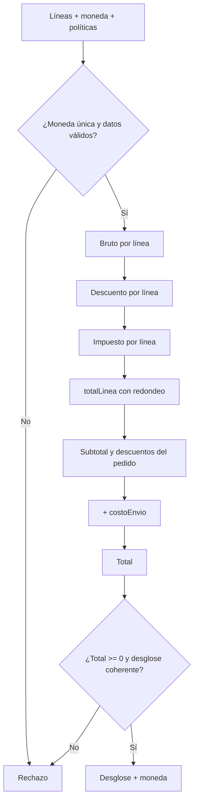

# DS-05 — `ServicioCalculoPedido`

**Código documental:** `NM-SDD-DOM-DS-05`
**Tipo:** Domain Service (servicio puro)
**Versión:** 1.0
**Fecha:** 26 de octubre de 2026
**Estado del documento:** `COMPLETO`
**Estado de la definición de dominio:** Confirmado por fuente; tasas, descuentos y moneda efectiva parcialmente especificados.

**Documentos relacionados:**

- Catálogo canónico: [`nexusmarket-domain-services.md`](../nexusmarket-domain-services.md) (`[DS]`), §3, §4.5, §5.1, §5.4, §6 y §7.
- Modelo de dominio: [`nexusmarket-domain-model.md`](../nexusmarket-domain-model.md) (`[MOD]`), §9.4, §10.1, §10.2, §16.1, §18 y §22.3.
- Objetos de valor: [`nexusmarket-domain-object-values.md`](../nexusmarket-domain-object-values.md) (`[VO]`), §6.5, §6.7 y §12.
- Arquitectura: [`nexusmarket-arquitectura.md`](../../Software%20Architecture/nexusmarket-arquitectura.md) (`[ARQ]`), §6, §12.1 y §16.
- Especificación funcional: [`enunciado.md`](../../enunciado.md) (`[ENU]`), Dominio 7 y §11.
- Servicios colaboradores: [`DS-02`](politica-publicacion-catalogo.md), [`DS-06`](politica-transicion-pedido.md), [`DS-09`](servicio-auditoria.md).

---

## 1. Identificación

| Campo | Valor |
|---|---|
| Nombre canónico | `ServicioCalculoPedido` |
| Identificador estable | `DS-05` |
| Código documental | `NM-SDD-DOM-DS-05` |
| Tipo | Domain Service — cálculo puro y determinista |
| Propósito resumido | Calcular subtotal, descuentos, impuestos, costo de envío y total de un pedido con reglas monetarias explícitas y reproducibles. |
| Estado de definición | Confirmado por fuente; moneda y redondeo limitados (`DEC-BIZ-05`, `L-04`) y tasas/descuentos limitados (`L-05`). |
| Fuente primaria | `[MOD]` §10.1, §10.2 y §16.1. |

---

## 2. Propósito y responsabilidad

### 2.1 Problema de dominio que resuelve

El importe de un pedido se compone de varias líneas, descuentos, impuestos y envío. Si cada entidad sumara números por separado, se producirían totales inconsistentes, redondeos divergentes y cobros distintos al mostrado. El uso de aritmética binaria de punto flotante agravaría el problema.

El servicio aplica una única política monetaria sobre todas las líneas y devuelve un desglose auditable antes de confirmar la compra.

### 2.2 Resultado de negocio buscado

Producir `subtotal`, `descuentos`, `costoEnvio`, `impuestos` y `total`, con desglose por línea, moneda única y redondeo reproducible. El total debe ser coherente con las líneas y nunca negativo.

### 2.3 Responsabilidades

- Calcular el subtotal por línea y del pedido.
- Aplicar descuentos por línea o por pedido cuando la política los defina.
- Calcular impuestos según la política fiscal suministrada.
- Calcular o recibir el costo de envío.
- Calcular el total con la fórmula confirmada.
- Verificar que todos los importes compartan moneda.
- Aplicar una regla de redondeo reproducible.
- Devolver el desglose completo.

### 2.4 Fuera de responsabilidad

- Invocar al proveedor de pagos.
- Emitir facturas o numerar documentos fiscales.
- Definir tasas de impuestos, porcentajes de descuento o tarifas de envío.
- Reservar stock.
- Cambiar el estado del pedido.
- Persistir los importes; el agregado los conserva como snapshot.
- Convertir monedas sin una política de tipo de cambio aprobada.

---

## 3. Justificación DDD

| Alternativa de modelado | Por qué no es suficiente |
|---|---|
| Método de `ItemPedido` | La línea conoce su cantidad y precio, pero no los descuentos del pedido, los impuestos globales ni el envío. |
| Método de `Pedido` | El pedido puede agregar líneas, pero la regla monetaria debe aplicarse también al carrito y antes de crear el pedido; además el cálculo debe ser reutilizable y determinista. |
| Método de `Dinero` | El VO garantiza exactitud y moneda, pero no decide qué componentes se suman ni en qué orden. |
| Servicio de aplicación | La aplicación orquesta la compra; la fórmula y el redondeo son reglas de negocio estables. |
| Adaptador o proveedor de pagos | El proveedor cobra; no define el importe de negocio. |

El cálculo combina varias líneas y componentes con una política monetaria común; es un servicio puro que no muta estado (`[MOD]` §18; `[PM]` §5.3).

---

## 4. Contexto de negocio

- **Fórmulas normativas:** `total = subtotal - descuentos + costoEnvio + impuestos` (`[MOD]` §10.1) y `totalLinea = cantidad × precioUnitario - descuento + impuesto`, según redondeo definido (`[MOD]` §10.2).
- **Reglas monetarias:** moneda explícita, decimal exacto o unidad menor, sumas solo entre monedas iguales, redondeo central reproducible y total calculado desde líneas (`[MOD]` §16.1).
- **Recálculo:** el checkout vuelve a validar precios; si el precio cambió, se recalcula el total y se exige confirmación del comprador antes de continuar (`CAR-07`). El carrito no garantiza el precio (`CAR-02`).
- **Snapshot:** un pedido confirmado conserva sus importes; el recálculo solo aplica antes de confirmar o en un proceso autorizado con evidencia.
- **Producto digital:** `costoEnvio = 0`; no se inventa una tarifa.

---

## 5. Reglas de negocio

| ID | Enunciado | Condiciones de aplicación | Conceptos afectados | Resultado esperado | Excepciones o rechazos | Fuente | Estado |
|---|---|---|---|---|---|---|---|
| `MON-01` | `total = subtotal - descuentos + costoEnvio + impuestos`. | Cálculo del pedido. | `Pedido`, `Dinero` | Total coherente con componentes. | `CALC_LINE_INCONSISTENT`. | `[MOD]` §10.1 | Confirmado |
| `MON-02` | `totalLinea = cantidad × precioUnitario - descuento + impuesto`, según redondeo definido. | Cálculo por línea. | `ItemPedido`, `Dinero` | Total de línea reproducible. | `CALC_LINE_INCONSISTENT`. | `[MOD]` §10.2 | Confirmado |
| `MON-03` | La moneda se declara explícitamente en cada importe. | Toda operación. | `Dinero` | Ningún importe sin moneda. | `CALC_CURRENCY_MISMATCH`. | `[MOD]` §16.1; `INV-VO-MON-01` | Confirmado |
| `MON-04` | Las sumas y comparaciones requieren moneda igual; no se convierte sin política de tipo de cambio. | Cálculo. | `Dinero` | Moneda única en el resultado. | `CALC_CURRENCY_MISMATCH`. | `[MOD]` §16.1; `INV-VO-MON-03` | Confirmado |
| `MON-05` | El importe se representa con decimal exacto o unidad menor; no se usa punto flotante binario sin política. | Toda operación. | `Dinero` | Exactitud decimal. | `CALC_LINE_INCONSISTENT`. | `[MOD]` §16.1; `INV-VO-MON-02` | Confirmado |
| `MON-06` | El redondeo se aplica según una regla central consistente y es reproducible. | Impuestos y descuentos. | `Dinero` | Resultado reproducible. | `CALC_MISSING_ROUNDING_POLICY`. | `[MOD]` §16.1; `INV-VO-MON-04` | Confirmado |
| `MON-07` | El total no es negativo. | Cálculo final. | `Dinero` | Total `>= 0`. | `CALC_NEGATIVE_TOTAL`. | `INV-VO-MON-05` | Confirmado |
| `MON-08` | El total se calcula desde las líneas y componentes; no se modifica manualmente sin recalcular y dejar evidencia. | Checkout y recálculo. | `Pedido`, `Dinero` | Total trazable. | Recálculo autorizado con evidencia. | `[MOD]` §16.1 | Confirmado |
| `MON-09` | Los descuentos nunca son negativos y el costo de envío es cero para entrega digital o envío gratuito. | Cálculo. | `Descuentos`, `CostoEnvio` | Componentes válidos. | `CALC_INVALID_PRICE` o rechazo de componente. | `[MOD]` §10.1 | Confirmado |
| `MON-10` | Un descuento del 100 % puede producir total cero, pero no negativo, si la política lo autoriza. | Descuento total. | `Dinero`, total | Total `= 0` permitido. | Total negativo rechazado. | `[DS]` §4.5 | Confirmado |
| `MON-11` | La exención de impuestos se representa con tasa o importe cero; no se omite el componente. | Exención. | `Impuestos` | Componente presente con valor cero. | Omisión: desglose incompleto. | `[DS]` §4.5 | Confirmado |
| `MON-12` | Si falta la política fiscal o de redondeo, el cálculo se rechaza. | Inicio del cálculo. | Política, resultado | No se produce total. | `CALC_MISSING_TAX_POLICY`, `CALC_MISSING_ROUNDING_POLICY`. | `[DS]` §4.5 | Confirmado |

**Nota de códigos:** `MON-01`…`MON-12` son derivaciones locales de esta definición a partir de `[MOD]` §10.1, §10.2 y §16.1; no amplían el catálogo normativo de `[MOD]` §21.

---

## 6. Entradas conceptuales

| Entrada | Significado | Origen conceptual | Restricciones | Validaciones relevantes | Naturaleza |
|---|---|---|---|---|---|
| Líneas | Cantidad, precio unitario y descuento unitario. | Carrito o pedido en construcción. | Al menos una; cantidad positiva; precio positivo. | `INV-VO-CANP-01`; `MON-03`. | `CantidadPositiva` + `Dinero`. |
| Moneda | Unidad monetaria del cálculo. | Líneas y política. | Explícita y única. | `INV-VO-MON-01`, `INV-VO-MON-03`. | Objeto de valor. |
| Política de impuestos | Tasa o importe aplicable por línea. | Configuración fiscal. | Obligatoria. | Coherencia con la moneda. | Política configurable. |
| Política de descuentos | Reglas de aplicación. | Configuración comercial. | Condicional. | Descuento no negativo. | Política configurable. |
| Política de redondeo | Regla central reproducible. | Configuración monetaria. | Obligatoria. | Aplicable a todos los componentes. | Política configurable. |
| Costo de envío | Importe logístico. | Cálculo logístico o política. | Condicional; cero para digital o envío gratuito. | Moneda igual; no negativo. | `Dinero`. |
| Tipo de entrega | Física o digital. | Línea/producto. | `FISICA` o `DIGITAL`. | `INV-VO-TENT-01`. | Objeto de valor. |

---

## 7. Resultado conceptual

| Resultado | Significado |
|---|---|
| `subtotal` | Suma de importes brutos de línea antes de descuentos e impuestos. |
| `descuentos` | Suma de descuentos aplicados; nunca negativa. |
| `costoEnvio` | Importe logístico; cero si no aplica. |
| `impuestos` | Suma de impuestos según la política. |
| `total` | `subtotal - descuentos + costoEnvio + impuestos`; no negativo. |
| Desglose por línea | `totalLinea` y componentes aplicados. |
| Moneda | Moneda única del resultado. |
| Advertencias de redondeo | Diferencias concentradas en el componente definido por la política. |

**Fallos técnicos:** el cálculo es determinista dadas las entradas y la política. Un fallo de la política suministrada o un dato ausente impide emitir un resultado; no se sustituye por valores por defecto inventados.

---

## 8. Precondiciones e invariantes

### 8.1 Precondiciones

| ID | Regla | Momento de verificación | Conceptos afectados | Consecuencia de incumplimiento | Fuente |
|---|---|---|---|---|---|
| `PRE-DS05-01` | Al menos una línea. | Inicio. | Líneas | Sin líneas no hay cálculo. | `[DS]` §4.5 |
| `PRE-DS05-02` | Cantidades positivas. | Inicio. | `CantidadPositiva` | `CALC_INVALID_QUANTITY`. | `INV-VO-CANP-01` |
| `PRE-DS05-03` | Precios mayores que cero. | Inicio. | `Dinero` | `CALC_INVALID_PRICE`. | `[MOD]` §7.4 |
| `PRE-DS05-04` | Moneda explícita y única. | Inicio. | `Dinero` | `CALC_CURRENCY_MISMATCH`. | `[MOD]` §16.1 |
| `PRE-DS05-05` | Política de impuestos y de redondeo disponible. | Inicio. | Políticas | `CALC_MISSING_TAX_POLICY`, `CALC_MISSING_ROUNDING_POLICY`. | `[DS]` §4.5 |

### 8.2 Invariantes

| ID | Regla | Momento de verificación | Conceptos afectados | Consecuencia de incumplimiento | Fuente |
|---|---|---|---|---|---|
| `INV-VO-MON-01` | Moneda presente en cada importe. | Creación y cálculo. | `Dinero` | Rechazo. | `[VO]` §6.5 |
| `INV-VO-MON-02` | Exactitud decimal. | Cada operación. | `Dinero` | Rechazo. | `[VO]` §6.5 |
| `INV-VO-MON-03` | Misma moneda en sumas y comparaciones. | Cada operación. | `Dinero` | `CALC_CURRENCY_MISMATCH`. | `[VO]` §6.5 |
| `INV-VO-MON-04` | Redondeo reproducible. | Impuestos y descuentos. | `Dinero` | Rechazo por política ausente. | `[VO]` §6.5 |
| `INV-VO-MON-05` | Total no negativo. | Cierre del cálculo. | `Dinero` | `CALC_NEGATIVE_TOTAL`. | `[VO]` §6.5 |
| `INV-VO-CANP-01` | Cantidades estrictamente positivas. | Inicio. | `CantidadPositiva` | `CALC_INVALID_QUANTITY`. | `[VO]` §6.7 |
| `INV-DS05-SUMA` | La suma de `totalLinea` es coherente con `subtotal`, descuentos e impuestos del pedido. | Cierre. | Pedido, líneas | `CALC_LINE_INCONSISTENT`. | `[DS]` §4.5 |

---

## 9. Entidades, agregados y objetos de valor relacionados

| Concepto | Función en el comportamiento | Información que aporta | Responsabilidad que conserva | Interacción conceptual | Invariantes que debe respetar |
|---|---|---|---|---|---|
| `Pedido` | Destino de los importes calculados. | Líneas, componentes, moneda, total. | Conservar snapshots y aplicar su ciclo. | Recibe el desglose; no se modifica aquí. | `INV-VO-EPED-01…07`; `MON-01`. |
| `ItemPedido` | Línea de cálculo. | Cantidad, precio unitario, descuento, impuesto. | Preservar snapshots de la compra. | Aporta la base de cálculo. | `INV-VO-CANP-01`; `INV-VO-MON-01…05`. |
| `Carrito` | Origen posible del cálculo. | Líneas y precio referencial. | No reservar stock ni garantizar precio. | Aporta líneas antes del checkout. | `CAR-02`, `CAR-05`, `CAR-07`. |
| `Dinero` | Tipo de todos los importes. | Importe y moneda. | Exactitud, moneda y redondeo. | Se consume y se produce. | `INV-VO-MON-01…05`. |
| `CantidadPositiva` | Magnitud de la línea. | Entero positivo. | Validar el valor. | Se consume. | `INV-VO-CANP-01…03`. |
| Política fiscal, de descuentos y de redondeo | Parámetros del cálculo. | Tasas, reglas y precisión. | Ser explícitas y reproducibles. | Se reciben como entradas. | No definidas numéricamente. |

---

## 10. Flujo conceptual de ejecución

1. Verificar que todas las líneas tengan la misma moneda.
2. Validar cantidades y precios.
3. Calcular el importe bruto por línea.
4. Aplicar el descuento por línea según la política.
5. Calcular el impuesto por línea según la política.
6. Calcular `totalLinea` con la regla de redondeo.
7. Sumar el subtotal y los descuentos del pedido.
8. Añadir el costo de envío cuando corresponda.
9. Calcular el total y verificar que no sea negativo.
10. Devolver el desglose y la moneda.

---

## 11. Estado y efectos del dominio

- **Naturaleza:** función determinista y pura (`DS-D-03`). No muta estado ni requiere transacción.
- **Estado que consulta:** líneas, precios, descuentos, impuestos, envío y políticas.
- **Estado que modifica:** ninguno.
- **Eventos:** no emite eventos.
- **Efecto habilitado:** el caso de uso usa el resultado para crear los snapshots del pedido y para decidir si el pedido es pagable.
- **Persistencia:** el agregado `Pedido` conserva los importes; el servicio no persiste.

---

## 12. Colaboraciones y límites arquitectónicos

### 12.1 Colaboraciones

| Colaborador | Relación |
|---|---|
| `DS-02` | Garantiza que el precio de la variante sea válido antes de publicar; `DS-05` lo usa para calcular. |
| `DS-06` | Usa el total como parte de las precondiciones del pedido pagable. |
| `DS-09` | Audita los recálculos autorizados. |
| Caso de uso de checkout | Recupera líneas y políticas, invoca el cálculo y persiste snapshots. |

### 12.2 Responsabilidad de la capa de aplicación

- Recuperar precios vigentes y políticas aprobadas.
- Invocar el cálculo antes de crear o recalcular el pedido.
- Exigir confirmación del comprador si el precio cambió (`CAR-07`).
- Persistir los snapshots a través del agregado `Pedido`.
- Traducir los rechazos de cálculo.

### 12.3 Dependencias permitidas y prohibidas

| Permitidas | Prohibidas |
|---|---|
| `Dinero`, `CantidadPositiva` y líneas de pedido/carrito. | Pasarelas de pago, facturación o inventario. |
| Políticas fiscal, de descuentos y de redondeo como datos. | Punto flotante binario sin política, redondeos locales divergentes. |
| Moneda explícita. | SQL, HTTP, ORMs, SDKs, variables de entorno. |

### 12.4 Límites de consistencia

El cálculo es determinista y no transaccional. La persistencia y la coherencia con el pedido se confirman en la operación de aplicación. Un pedido confirmado conserva sus snapshots; un recálculo posterior no debe alterarlos sin proceso autorizado (`[MOD]` §16.1; `[DS]` §4.5).

---

## 13. Escenarios de ejemplo

| # | Situación inicial | Datos conceptuales relevantes | Regla aplicada | Resultado esperado | Origen |
|---|---|---|---|---|---|
| E-01 | Dos líneas de 2 × 50 y 1 × 30, sin descuentos ni impuestos, envío 10. | Moneda única. | `MON-01` | Subtotal 130; total 140. | `[DS]` §4.5 |
| E-02 | Línea con precio 100 y descuento 10. | Sin impuesto en el ejemplo. | `MON-02` | Total de línea 90 antes de impuesto. | `[DS]` §4.5 |
| E-03 | Líneas en monedas distintas. | Monedas incompatibles. | `MON-04` | Rechazo por `CALC_CURRENCY_MISMATCH`. | `[MOD]` §16.1 |
| E-04 | Pedido digital. | `TipoEntrega = DIGITAL`. | `MON-09` | `costoEnvio = 0`. | `[MOD]` §7.3 |
| E-05 | Descuento mal configurado produce total negativo. | Descuento > subtotal + envío + impuestos. | `MON-07` | Rechazo por `CALC_NEGATIVE_TOTAL`. | `[DS]` §4.5 |
| E-06 | Descuento del 100 % autorizado. | Total resultante cero. | `MON-10` | Total `= 0` permitido. | `[DS]` §4.5 |
| E-07 | Falta la política de redondeo. | Entrada incompleta. | `MON-06`, `MON-12` | Rechazo por `CALC_MISSING_ROUNDING_POLICY`. | `[DS]` §4.5 |

**Escenarios ilustrativos:** los importes de E-01 y E-02 son ejemplos aritméticos; no fijan precios, tasas ni moneda del despliegue.

---

## 14. Dependencias y restricciones

**Necesita:**

- Líneas con cantidad, precio y descuento.
- Moneda explícita y única.
- Política fiscal, de descuentos y de redondeo.
- Costo de envío cuando corresponda.

**No debe conocer:**

- Proveedores de pago, facturación o inventario.
- Estados del pedido o del pago.
- Persistencia, HTTP, frameworks o SDKs.
- Valores concretos de tasas, moneda o redondeo mientras no estén aprobados (`DEC-BIZ-05`).

---

## 15. Trazabilidad

| Elemento | Identificador o nombre | Fuente | Sección | Relación con el servicio | Estado de verificación |
|---|---|---|---|---|---|
| Servicio canónico | `ServicioCalculoPedido` | `[MOD]` | §18 | Define su responsabilidad | Confirmado |
| Inventario | `DS-05` | `[DS]` | §3, §4.5 | Especificación canónica | Confirmado |
| Fórmula del total | `MON-01` | `[MOD]` | §10.1 | Núcleo del cálculo | Confirmado |
| Fórmula de línea | `MON-02` | `[MOD]` | §10.2 | Cálculo por línea | Confirmado |
| Reglas monetarias | `MON-03`…`MON-08` | `[MOD]` | §16.1 | Exactitud, moneda y redondeo | Confirmado |
| Moneda | `INV-VO-MON-01…05` | `[VO]` | §6.5 | Invariantes monetarias | Confirmado |
| Cantidades | `INV-VO-CANP-01…03` | `[VO]` | §6.7 | Magnitud positiva | Confirmado |
| Recálculo por cambio de precio | `CAR-07` | `[MOD]` | §9.3 | Confirmación del comprador | Confirmado |
| Snapshot del pedido | `MON-08` | `[MOD]` | §10.1, §16.1 | Historial inmutable | Confirmado |
| Decisión pura | `DS-D-03` | `[DS]` | §10 | Determinismo | Decisión de diseño registrada |
| Moneda y redondeo | `DEC-BIZ-05`; `L-04` | `[DS]`; estado | §4.5; §7 | Limitación de política | Parcialmente especificado |
| Tasas y descuentos | `L-05` | Estado | §7 | Limitación de política | Parcialmente especificado |
| Transacciones | — | `[ARQ]` | §12.1 | No requiere transacción | Confirmado |

---

## 16. Criterios de validación documental

- [x] La responsabilidad está delimitada y no invade pagos, facturación ni inventario.
- [x] Las reglas y fórmulas están identificadas.
- [x] Las entradas y resultados son comprensibles sin firmas técnicas.
- [x] Las precondiciones y las invariantes están diferenciadas.
- [x] Las colaboraciones respetan DDD y la dirección de dependencias.
- [x] Los límites de determinismo y persistencia son explícitos.
- [x] La trazabilidad cubre modelo, objetos de valor y limitaciones.
- [x] No se fijan moneda, tasas, descuentos ni redondeo concretos.
- [x] No se definen puertos, adaptadores, contratos ni código.
- [x] No existen contradicciones conocidas sin tratamiento.

---

## 17. Historial y estado

| Fecha | Cambio | Autor |
|---|---|---|
| 2026-10-26 | Creación de la definición individual a partir de `[DS]` §4.5, `[MOD]` §10 y §16.1 y `[VO]` §6. | Agente documental |
| 2026-10-26 | Separación de las limitaciones `L-04` (moneda, escala y redondeo) y `L-05` (tasas y descuentos). | Agente documental |

**Estado de definición:** `COMPLETO`.
**Limitaciones reales:** no están definidos la moneda del despliegue, la escala decimal ni la regla de redondeo (`DEC-BIZ-05`, `L-04`), ni las tasas de impuestos y los descuentos (`L-05`). El servicio los exige como entradas y no los inventa. La conversión entre monedas queda fuera de alcance mientras no exista política de tipo de cambio.
