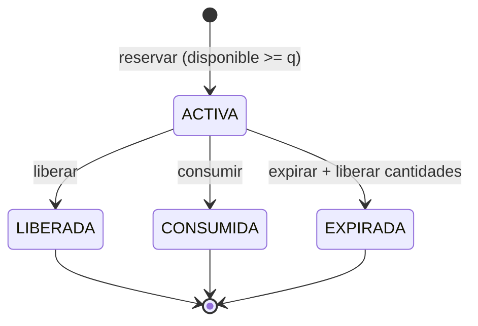

# DS-03 — `ServicioReservaInventario`

**Código documental:** `NM-SDD-DOM-DS-03`
**Tipo:** Domain Service (servicio con efecto)
**Versión:** 1.0
**Fecha:** 26 de octubre de 2026
**Estado del documento:** `COMPLETO`
**Estado de la definición de dominio:** Confirmado por fuente.

**Documentos relacionados:**

- Catálogo canónico: [`nexusmarket-domain-services.md`](../nexusmarket-domain-services.md) (`[DS]`), §3, §4.3, §5.1, §5.3, §6 y §7.
- Modelo de dominio: [`nexusmarket-domain-model.md`](../nexusmarket-domain-model.md) (`[MOD]`), §8.2, §8.2.1, §8.2.2, §8.2.3, §8.3, §18, §21, §22.3 y §22.5.
- Objetos de valor: [`nexusmarket-domain-object-values.md`](../nexusmarket-domain-object-values.md) (`[VO]`), §6.6, §6.7, §7.4, §7.5, §8.17, §8.21, §9.1 y §9.7.
- Arquitectura: [`nexusmarket-arquitectura.md`](../../Software%20Architecture/nexusmarket-arquitectura.md) (`[ARQ]`), §9.4, §12.1 y §12.2.
- Especificación funcional: [`enunciado.md`](../../enunciado.md) (`[ENU]`), Dominio 6 y §11.
- Servicios colaboradores: [`DS-01`](politica-autorizacion-dominio.md), [`DS-04`](servicio-asignacion-bodega.md), [`DS-06`](politica-transicion-pedido.md), [`DS-09`](servicio-auditoria.md).

---

## 1. Identificación

| Campo | Valor |
|---|---|
| Nombre canónico | `ServicioReservaInventario` |
| Identificador estable | `DS-03` |
| Código documental | `NM-SDD-DOM-DS-03` |
| Tipo | Domain Service — servicio con efecto sobre agregados |
| Propósito resumido | Validar disponibilidad y aplicar reserva, liberación, consumo o expiración de forma atómica e idempotente, dejando movimiento auditable. |
| Estado de definición | Confirmado por fuente; sin secciones bloqueadas. |
| Fuente primaria | `[MOD]` §8.2 y §18; `[ENU]` Dominio 6. |

---

## 2. Propósito y responsabilidad

### 2.1 Problema de dominio que resuelve

El inventario distribuido se compromete en checkout y se descuenta al despachar. Sin una regla única, dos compradores podrían recibir la última unidad, una reserva podría consumirse dos veces por un reintento de red o una reserva expirada podría usarse para despachar. Además, el stock dañado (`unavailable`) no debe contarse como disponible, y toda mutación debe poder auditarse.

El servicio resuelve la transición del ciclo de vida de la reserva junto con la posición de inventario que la soporta.

### 2.2 Resultado de negocio buscado

Aplicar exactamente una vez la operación solicitada —reservar, liberar, consumir o expirar— y devolver el estado resultante de la reserva, las cantidades de inventario y la referencia del movimiento generado. Ninguna unidad puede comprometerse dos veces ni quedar en un saldo inválido.

### 2.3 Responsabilidades

- Calcular la disponibilidad como `onHand - reserved - unavailable`.
- Crear una reserva `ACTIVA` cuando exista disponibilidad suficiente.
- Liberar una reserva `ACTIVA` una sola vez.
- Consumir una reserva `ACTIVA` una sola vez al despachar.
- Expirar una reserva mediante operación explícita que libere cantidades.
- Registrar el `MovimientoInventario` correspondiente.
- Rechazar operaciones duplicadas por clave de idempotencia.
- Rechazar reservas sobre bodega inactiva o variante no vendible.

### 2.4 Fuera de responsabilidad

- Ejecutar SQL, abrir transacciones o gestionar conexiones.
- Elegir la bodega; corresponde a `DS-04`.
- Cambiar el estado del pedido; corresponde a `DS-06`.
- Cobrar, reembolsar o facturar.
- Definir la política temporal de expiración; la recibe como dato.
- Decidir si el pedido es pagable; es coordinación del caso de uso.
- Realizar ajustes arbitrarios de saldo: los ajustes se registran como movimientos con motivo y autorización (`[DS]` §4.3 punto 15) y no forman parte de las cuatro operaciones de este servicio.

---

## 3. Justificación DDD

| Alternativa de modelado | Por qué no es suficiente |
|---|---|
| Método de `Inventario` | La posición de inventario conoce sus cantidades, pero la reserva es un concepto con identidad y ciclo de vida propios; la operación debe coordinar ambos. |
| Método de `ReservaInventario` | La reserva conoce su cantidad y estado, pero no la disponibilidad actual de la posición ni las demás reservas. |
| Método de `Bodega` | La bodega no conoce cantidades por variante ni reservas. |
| Validación de `Cantidad` | El VO valida enteros no negativos; no decide disponibilidad ni idempotencia. |
| Servicio de aplicación | La aplicación coordina varias posiciones, compensa y persiste; la regla de disponibilidad y transición de reserva es de negocio y debe ser independiente del transporte. |
| Repositorio o adaptador | Un adaptador no debe decidir si hay stock; puede reforzar atomicidad, pero no sustituye la regla. |

La operación compara posición de inventario, reserva, bodega, variante y clave de idempotencia. Es un servicio de dominio con efecto porque la regla exige aplicar una transición sobre agregados coordinados (`[MOD]` §18; `[PM]` §5.3).

---

## 4. Contexto de negocio

- **Momentos de uso:** checkout (reservar), cancelación o fallo de pago (liberar), despacho (consumir) y expiración temporal (expirar) (`[MOD]` §8.2.3, §22.3, §22.5).
- **Política de línea base:** la reserva se crea durante el checkout antes de solicitar o confirmar el pago, con expiración temporal. Si el pago falla o expira, la reserva se libera (`[MOD]` §8.2.3).
- **Stock dañado:** las unidades `unavailable` no forman parte de la disponibilidad (`[MOD]` §8.2; `[ENU]` §11).
- **Devoluciones:** el reingreso usa `DEVOLUCION_VENDIBLE` o `DEVOLUCION_NO_VENDIBLE` tras inspección; no reutiliza la reserva original (`INV-09`).
- **Ajustes:** no son una operación de este servicio; se registran como movimiento con motivo y autorización (`INV-08`).

### 4.1 Nota de numeración de invariantes

`[MOD]` §8.2.1 y §21 enumeran `INV-01…INV-10` con contenidos distintos. Se adopta §8.2.1, sección normativa del agregado `Inventario`, conforme a `C-11` en `DOCUMENTATION_STATUS.md`. Este documento no usa la numeración de §21.

---

## 5. Reglas de negocio

| ID | Enunciado | Condiciones de aplicación | Conceptos afectados | Resultado esperado | Excepciones o rechazos | Fuente | Estado |
|---|---|---|---|---|---|---|---|
| `INV-01` | `onHand`, `reserved` y `unavailable` son no negativos. | Toda mutación. | `Inventario`, `Cantidad` | El saldo resultante es válido. | `INV_NEGATIVE_BALANCE`. | `[MOD]` §8.2.1 | Confirmado |
| `INV-02` | `reserved + unavailable <= onHand`. | Toda mutación. | `Inventario` | Se preserva la relación de saldo. | `INV_NEGATIVE_BALANCE`. | `[MOD]` §8.2.1 | Confirmado |
| `INV-03` | Solo se reserva si `disponible >= cantidadSolicitada`. | Operación de reserva. | `Inventario`, `CantidadPositiva` | `reserved += q`; si no alcanza, rechazo. | `INV_INSUFFICIENT_AVAILABLE`. | `[MOD]` §8.2.1 | Confirmado |
| `INV-04` | Solo se reserva stock de bodega `ACTIVA` y variante vendible. | Reserva. | `Bodega`, `Variante`, `Producto` | Bodega o variante no elegible produce rechazo. | `INV_WAREHOUSE_INACTIVE`, `INV_VARIANT_NOT_SELLABLE`. | `[MOD]` §8.2.1 | Confirmado |
| `INV-05` | Toda mutación genera `MovimientoInventario` con cantidad, motivo, referencia, actor y timestamp. | Toda operación. | `MovimientoInventario` | Movimiento registrado e inmutable. | Operación sin movimiento: rechazo. | `[MOD]` §8.2.1 | Confirmado |
| `INV-06` | Un mismo comando o referencia de reserva no se aplica dos veces. | Reintento o duplicado. | `IdempotencyKey`, `ReservaInventario` | `YA_APLICADA` sin doble efecto. | `INV_IDEMPOTENCY_CONFLICT`. | `[MOD]` §8.2.1 | Confirmado |
| `INV-07` | Una reserva liberada o consumida no vuelve a procesarse como activa. | Liberar o consumir. | `EstadoReserva` | Solo una transición terminal. | `INV_RESERVATION_NOT_ACTIVE`, `INV_RESERVATION_TERMINAL`. | `[MOD]` §8.2.1 | Confirmado |
| `INV-08` | Los ajustes requieren motivo y actor autorizado; no se edita el saldo. | Ajuste o baja. | `MovimientoInventario`, actor | Se registra movimiento compensatorio. | `INV_MISSING_MOTIVE`. | `[MOD]` §8.2.1 | Confirmado |
| `INV-09` | Las devoluciones no se suman automáticamente al stock vendible. | Reingreso de devolución. | `Inventario`, `Devolucion` | Se inspecciona y clasifica antes del reingreso. | Reingreso directo: prohibido. | `[MOD]` §8.2.1 | Confirmado |
| `INV-10` | Una sola posición lógica por combinación variante-bodega. | Creación y operación. | `Inventario` | No hay posiciones duplicadas. | `INV_POSITION_NOT_FOUND` o conflicto. | `[MOD]` §8.2.1 | Confirmado |
| `INV-D-04` | La disponibilidad se deriva; no se almacena como fuente independiente. | Toda lectura de disponibilidad. | `Inventario` | `disponible` se calcula. | — | `[MOD]` §8.2; `DD-04` | Confirmado |
| `INV-D-05` | La reserva se crea en checkout antes del pago y expira o se libera de forma idempotente. | Checkout y fallo de pago. | Reserva, pago | Reserva activa o liberada una sola vez. | Reserva huérfana: compensación. | `[MOD]` §8.2.3; `DD-05` | Confirmado |

**Efecto por tipo de movimiento** (`[MOD]` §8.2.2):

| Tipo | Efecto | Uso en este servicio |
|---|---|---|
| `RESERVA` | `reserved += q` | Operación reservar. |
| `LIBERACION_RESERVA` | `reserved -= q` | Operación liberar o expirar. |
| `SALIDA_VENTA` | `onHand -= q`, `reserved -= q` | Operación consumir al despachar. |
| `INGRESO`, `AJUSTE_POSITIVO`, `AJUSTE_NEGATIVO`, `DEVOLUCION_*`, `BAJA_DANIO` | Según `[MOD]` §8.2.2 | Fuera del alcance operativo de `DS-03`; se documentan como movimientos autorizados. |

---

## 6. Entradas conceptuales

| Entrada | Significado | Origen conceptual | Restricciones | Validaciones relevantes | Naturaleza |
|---|---|---|---|---|---|
| Tipo de operación | Reservar, liberar, consumir o expirar. | Caso de uso. | Debe ser una de las cuatro. | Operación desconocida: rechazo. | Concepto de dominio enumerado. |
| `pedidoId` | Referencia de negocio de la reserva. | `Pedido`. | Identificador válido. | `INV-VO-ID-01`. | Identificador tipado. |
| Líneas: `varianteId`, `bodegaId`, `cantidad` | Posiciones afectadas. | Pedido y propuesta de `DS-04`. | Cantidad entera positiva; combinación existente. | `INV-VO-CANP-01`. | Identificadores tipados + `CantidadPositiva`. |
| `IdempotencyKey` | Evita el doble efecto. | Caso de uso. | No vacía; única en el ámbito. | `INV-VO-IDK-01`, `INV-VO-IDK-04`. | Objeto de valor. |
| Actor o identidad de sistema | Autoría de la operación. | Contexto de ejecución. | Obligatorio. | Identificador válido. | `UsuarioId` o identidad de sistema. |
| `Instant` de operación | Marca temporal UTC. | Reloj del sistema. | Válido y ordenable. | `INV-VO-INST-01…04`. | Objeto de valor. |
| `expiraEn` | Fin de vigencia de la reserva. | Política temporal. | Obligatorio al reservar. | Posterior a la creación. | `Instant`. |
| Referencia de reserva | Reserva a liberar, consumir o expirar. | `ReservaInventario`. | Obligatoria salvo al reservar. | Debe existir y estar `ACTIVA`. | Identificador tipado. |
| Referencia de negocio | Pedido, devolución u origen autorizado. | Caso de uso. | Obligatoria. | `INV-VO-TREF-01…03`. | `TipoReferencia` + identificador. |

---

## 7. Resultado conceptual

| Resultado | Significado |
|---|---|
| `APLICADA` | La operación produjo su efecto una vez y el movimiento quedó registrado. |
| `YA_APLICADA` | El mismo comando ya se había aplicado; no se mutó el saldo. |
| `RECHAZADA` | Una regla de negocio impidió la operación; el saldo no cambió. |
| Estado final de la reserva | `ACTIVA`, `CONSUMIDA`, `LIBERADA` o `EXPIRADA` según la operación. |
| Cantidades resultantes | `onHand`, `reserved`, `unavailable` y disponibilidad derivada. |
| Referencia del movimiento | Identificador del `MovimientoInventario` generado. |

**Fallos técnicos:** un fallo de concurrencia, de persistencia o de comunicación impide confirmar `APLICADA`. El caso de uso debe reintentar con la misma clave de idempotencia o compensar; el servicio no declara éxito sin efecto durable (`[ARQ]` §12.1–§12.2).

---

## 8. Precondiciones e invariantes

### 8.1 Precondiciones

| ID | Regla | Momento de verificación | Conceptos afectados | Consecuencia de incumplimiento | Fuente |
|---|---|---|---|---|---|
| `PRE-DS03-01` | Existe una posición de inventario para cada combinación variante-bodega. | Antes de mutar. | `Inventario` | `INV_POSITION_NOT_FOUND`. | `[MOD]` §8.2, §8.2.1 |
| `PRE-DS03-02` | La bodega está `ACTIVA`. | Antes de reservar. | `Bodega` | `INV_WAREHOUSE_INACTIVE`. | `INV-04` |
| `PRE-DS03-03` | La variante es vendible: activa, producto publicado y vendedor activo. | Antes de reservar. | `Variante`, `Producto`, `PerfilVendedor` | `INV_VARIANT_NOT_SELLABLE`. | `INV-04`; `[MOD]` §7.4 |
| `PRE-DS03-04` | Para liberar, consumir o expirar, la reserva existe y está `ACTIVA`. | Antes de la transición. | `ReservaInventario` | `INV_RESERVATION_NOT_ACTIVE`. | `[MOD]` §8.2.3 |
| `PRE-DS03-05` | La clave de idempotencia está presente. | Inicio. | `IdempotencyKey` | Rechazo por comando no idempotente. | `INV-06` |
| `PRE-DS03-06` | `expiraEn` está presente al crear la reserva. | Reserva. | `ReservaInventario` | Rechazo; no se crea reserva sin vigencia. | `[MOD]` §8.2.3 |

### 8.2 Invariantes

| ID | Regla | Momento de verificación | Conceptos afectados | Consecuencia de incumplimiento | Fuente |
|---|---|---|---|---|---|
| `INV-VO-CAN-01` | Cantidades enteras no negativas. | Creación y mutación. | `Cantidad` | Rechazo. | `[VO]` §6.6 |
| `INV-VO-CANP-01` | Cantidades de movimiento estrictamente positivas. | Cada movimiento. | `CantidadPositiva` | Rechazo. | `[VO]` §6.7 |
| `INV-VO-ERES-01` | Código de estado de reserva válido. | Creación y transición. | `EstadoReserva` | Rechazo. | `[VO]` §8.21 |
| `INV-VO-ERES-02` | Consumo o liberación única. | Consumir o liberar. | `ReservaInventario` | `INV_RESERVATION_NOT_ACTIVE`. | `[VO]` §8.21 |
| `INV-VO-ERES-03` | Los estados terminales no vuelven a `ACTIVA`. | Transición. | `EstadoReserva` | `INV_RESERVATION_TERMINAL`. | `[VO]` §8.21 |
| `INV-VO-ERES-04` | Una reserva expirada no se consume. | Consumir. | `ReservaInventario` | Rechazo. | `[VO]` §8.21 |
| `INV-VO-ERES-05` | La reserva solo se crea sobre bodega y variante elegibles. | Reserva. | Bodega, variante | Rechazo. | `[VO]` §8.21 |
| `INV-VO-IDK-01` | Clave de idempotencia no vacía. | Inicio. | `IdempotencyKey` | Rechazo. | `[VO]` §7.5 |
| `INV-VO-IDK-04` | La repetición del mismo comando no duplica efectos. | Reintento. | Operación, movimiento | `YA_APLICADA`. | `[VO]` §7.5 |
| `INV-VO-IDK-05` | La repetición con contenido incompatible se rechaza. | Reintento. | `IdempotencyKey` | `INV_IDEMPOTENCY_CONFLICT`. | `[VO]` §7.5 |
| `INV-VO-TMOV-06` | Los movimientos no se editan ni eliminan. | Toda corrección. | `MovimientoInventario` | Se registra movimiento compensatorio. | `[VO]` §8.17 |
| `INV-VO-TREF-02` | Todo movimiento tiene referencia de negocio. | Cada movimiento. | `TipoReferencia`, referencia | Rechazo. | `[VO]` §9.7 |

### 8.3 Estados de la reserva

| Estado actual | Operación | Estado resultante | Efecto sobre `reserved` | Condición |
|---|---|---|---|---|
| — | Reservar | `ACTIVA` | `+= q` | Disponibilidad suficiente; bodega y variante elegibles. |
| `ACTIVA` | Liberar | `LIBERADA` | `-= q` | Una sola vez. |
| `ACTIVA` | Consumir | `CONSUMIDA` | `-= q`; `onHand -= q` | Una sola vez; al despachar. |
| `ACTIVA` | Expirar | `EXPIRADA` | `-= q` | Operación explícita; no solo cambio de etiqueta. |
| `LIBERADA`, `CONSUMIDA`, `EXPIRADA` | Cualquier operación | Sin cambio | Sin cambio | Rechazo terminal. |

---

## 9. Entidades, agregados y objetos de valor relacionados

| Concepto | Función en el comportamiento | Información que aporta | Responsabilidad que conserva | Interacción conceptual | Invariantes que debe respetar |
|---|---|---|---|---|---|
| `Inventario` | Posición por variante-bodega. | `onHand`, `reserved`, `unavailable`, versión. | Proteger saldo y concurrencia. | Recibe la mutación condicional. | `INV-01`, `INV-02`, `INV-10`; `INV-VO-CAN-01`. |
| `ReservaInventario` | Compromiso de cantidad para un pedido. | Pedido, variante, bodega, cantidad, estado, expiración, clave. | Proteger su ciclo de vida. | Se crea o transiciona. | `INV-VO-ERES-01…05`. |
| `MovimientoInventario` | Evidencia del cambio. | Tipo, cantidad, referencia, actor, motivo, timestamp, clave. | Ser inmutable y trazable. | Se crea por cada mutación. | `INV-VO-TMOV-01…06`; `INV-VO-TREF-01…03`. |
| `Variante` / `Producto` | Elegibilidad de la unidad. | Estado de variante, estado de producto. | Proteger vendibilidad. | Aporta condición de venta. | `INV-VO-EVAR-02`; `INV-VO-EPROD-02`. |
| `Bodega` | Origen físico del stock. | Estado y tipo. | Proteger su operatividad. | Aporta condición de reserva. | `INV-VO-EBOD-02`. |
| `Pedido` | Referencia de negocio. | Identidad y estado. | Proteger su ciclo. | Se referencia; no se modifica aquí. | `INV-VO-EPED-01…07`. |
| `Cantidad`, `CantidadPositiva` | Magnitud del movimiento. | Entero no negativo o positivo. | Validar el valor. | Se consumen. | `INV-VO-CAN-01…03`; `INV-VO-CANP-01…03`. |
| `IdempotencyKey` | Deduplicación del comando. | Clave y ámbito. | Evitar doble efecto. | Se consume. | `INV-VO-IDK-01…05`. |
| `EstadoReserva`, `TipoMovimientoInventario`, `MotivoMovimiento`, `TipoReferencia`, `Instant` | Catálogos y valores de soporte. | Código válido y semántica. | Validar su valor. | Se consumen. | Las de `[VO]` §12. |

---

## 10. Flujo conceptual de ejecución

1. Verificar la clave de idempotencia; si el mismo comando ya se aplicó, devolver `YA_APLICADA` sin mutar.
2. Cargar la posición de inventario y la reserva, si existe.
3. Verificar bodega `ACTIVA` y variante vendible para reservar.
4. Para reservar: calcular disponibilidad y comparar con la cantidad solicitada.
5. Para liberar, consumir o expirar: verificar que la reserva esté `ACTIVA`.
6. Aplicar la mutación de cantidades de forma condicional sobre la versión del inventario.
7. Crear o transicionar la reserva.
8. Registrar el movimiento con referencia, actor, timestamp y motivo cuando aplique.
9. Devolver resultado, estado de la reserva y cantidades finales.

**Atomicidad:** cada posición de inventario y su reserva se tratan como una unidad. La coordinación de varias líneas, la compensación y la transacción pertenecen al caso de uso; el servicio no promete atomicidad distribuida (`[DS]` §4.3 punto 18; `[ARQ]` §9.4).

---

## 11. Estado y efectos del dominio

- **Naturaleza:** servicio con efecto (`DS-D-01`). Aplica una transición y registra evidencia.
- **Estado que modifica:** `Inventario` (cantidades y versión), `ReservaInventario` (estado) y `MovimientoInventario` (nuevo registro).
- **Estado que no modifica:** `Pedido`, `Pago`, `Envio`, `Devolucion`, `Reembolso`.
- **Eventos posibles:** `InventarioReservado`, `ReservaLiberada`; el caso de uso los publica, no el servicio (`[MOD]` §20).
- **Persistencia:** el servicio no persiste por sí mismo; actúa sobre los agregados y el caso de uso confirma la unidad de trabajo. La auditoría durable de movimientos corresponde a `DS-09` y a la infraestructura.

---

## 12. Colaboraciones y límites arquitectónicos

### 12.1 Colaboraciones

| Colaborador | Relación |
|---|---|
| `DS-04` | Propone bodegas y cantidades; `DS-03` decide y puede rechazar si el stock cambió. |
| `DS-06` | Requiere reservas vigentes para preparación y autoriza el despacho que dispara el consumo. |
| `DS-09` | Recibe la evidencia de cada movimiento; `AUD-02` exige correlación. |
| `DS-01` | Autoriza al actor humano o valida la identidad de sistema en operaciones automáticas. |
| Caso de uso de checkout/despacho | Coordina líneas, transacción, compensación e idempotencia externa. |

### 12.2 Responsabilidad de la capa de aplicación

- Recuperar posiciones y reservas mediante puertos de salida.
- Proporcionar reloj, identificadores y claves de idempotencia.
- Abrir y confirmar la transacción.
- Coordinar varias posiciones y compensar si una línea falla.
- Gestionar reintentos y traducir fallos técnicos.

### 12.3 Dependencias permitidas y prohibidas

| Permitidas | Prohibidas |
|---|---|
| Agregados `Inventario`, `ReservaInventario`, `MovimientoInventario`. | SQL, ORM, conexiones, MongoDB, transacciones gestionadas por el dominio. |
| VOs de cantidad, estado, referencia e idempotencia. | HTTP, DTOs, frameworks, SDKs. |
| Datos de reloj y actor suministrados como valores. | Consultas directas a base de datos o llamadas a proveedores. |

### 12.4 Límites de consistencia

- Consistencia fuerte dentro de la posición de inventario y su reserva, con control de concurrencia optimista o equivalente (`[MOD]` §8.2.3).
- Consistencia eventual o compensada entre líneas y entre módulos; no hay transacción distribuida (`[ARQ]` §9.4).
- Entre la propuesta de `DS-04` y la reserva, el stock puede cambiar; `DS-03` es la autoridad final.

---

## 13. Escenarios de ejemplo

| # | Situación inicial | Datos conceptuales relevantes | Regla aplicada | Resultado esperado | Origen |
|---|---|---|---|---|---|
| E-01 | Reservar 2 unidades con 5 disponibles. | `onHand = 5`, `reserved = 0`, `unavailable = 0`. | `INV-03` | `APLICADA`; `reserved = 2`; movimiento `RESERVA`. | `[DS]` §4.3 |
| E-02 | Reservar 6 unidades con 5 disponibles. | Disponibilidad insuficiente. | `INV-03` | `RECHAZADA`; saldo sin cambios. | `[DS]` §4.3 |
| E-03 | Consumir una reserva `ACTIVA` de 2 al despachar. | `onHand = 5`, `reserved = 2`. | `INV-07`; `SALIDA_VENTA` | `APLICADA`; `onHand = 3`, `reserved = 0`. | `[MOD]` §8.2.2, §22.5 |
| E-04 | Consumir una reserva `EXPIRADA`. | `EstadoReserva = EXPIRADA`. | `INV-VO-ERES-04` | `RECHAZADA`; no se consume. | `[MOD]` §8.2.3 |
| E-05 | Repetir el mismo comando de reserva. | Misma `IdempotencyKey` y mismo contenido. | `INV-06` | `YA_APLICADA`; un solo efecto. | `[DS]` §4.3 |
| E-06 | Reservar en bodega `INACTIVA`. | `EstadoBodega = INACTIVA`. | `INV-04` | `RECHAZADA` por `INV_WAREHOUSE_INACTIVE`. | `[MOD]` §8.1 |
| E-07 | Reservar unidades marcadas como dañadas. | `onHand = 5`, `reserved = 0`, `unavailable = 5`. | `INV-02`, `INV-03` | `RECHAZADA`; disponibilidad 0. | `[ENU]` §11 |
| E-08 | Liberar una reserva ya liberada. | `EstadoReserva = LIBERADA`. | `INV-07` | `RECHAZADA` o `YA_APLICADA` según el ámbito de la clave. | `[DS]` §4.3 |

**Escenarios ilustrativos:** los ejemplos no introducen reglas nuevas; aplican las invariantes de `[MOD]` §8.2.1 y §8.2.3.

---

## 14. Dependencias y restricciones

**Necesita:**

- Posición de inventario por variante-bodega y versión de concurrencia.
- Reserva existente para liberar, consumir o expirar.
- Estado de bodega, variante y producto.
- Clave de idempotencia, referencia de negocio, actor y reloj.

**No debe conocer:**

- Cómo se elige la bodega (`DS-04`).
- Cómo se calculan los importes (`DS-05`).
- Cómo se autoriza una transición de pedido (`DS-06`).
- Persistencia, transacciones, HTTP, mensajería o SDKs.
- La política concreta de plazo de expiración; la recibe como `expiraEn`.

---

## 15. Trazabilidad

| Elemento | Identificador o nombre | Fuente | Sección | Relación con el servicio | Estado de verificación |
|---|---|---|---|---|---|
| Servicio canónico | `ServicioReservaInventario` | `[MOD]` | §18 | Define su responsabilidad | Confirmado |
| Inventario | `DS-03` | `[DS]` | §3, §4.3 | Especificación canónica | Confirmado |
| Saldo no negativo | `INV-01` | `[MOD]` | §8.2.1 | Invariante de entrada | Confirmado |
| Relación de saldo | `INV-02` | `[MOD]` | §8.2.1 | Invariante de entrada | Confirmado |
| Disponibilidad | `INV-03` | `[MOD]` | §8.2.1 | Condición de reserva | Confirmado |
| Elegibilidad | `INV-04` | `[MOD]` | §8.2.1 | Bodega activa y variante vendible | Confirmado |
| Movimiento | `INV-05` | `[MOD]` | §8.2.1, §8.3 | Evidencia de mutación | Confirmado |
| Idempotencia | `INV-06` | `[MOD]` | §8.2.1 | Deduplicación | Confirmado |
| Reserva terminal | `INV-07` | `[MOD]` | §8.2.1 | Transición única | Confirmado |
| Ajustes | `INV-08` | `[MOD]` | §8.2.1 | Fuera del alcance operativo | Confirmado |
| Devoluciones | `INV-09` | `[MOD]` | §8.2.1 | Reingreso inspeccionado | Confirmado |
| Posición única | `INV-10` | `[MOD]` | §8.2.1 | Una posición por variante-bodega | Confirmado |
| Disponibilidad derivada | `DD-04` | `[MOD]` | §8.2 | No se almacena | Confirmado |
| Reserva en checkout | `DD-05` | `[MOD]` | §8.2.3 | Momento y expiración | Confirmado |
| Cantidades | `INV-VO-CAN-01…03`; `INV-VO-CANP-01…03` | `[VO]` | §6.6, §6.7 | Validación de magnitudes | Confirmado |
| Estado de reserva | `INV-VO-ERES-01…05` | `[VO]` | §8.21 | Ciclo de vida | Confirmado |
| Idempotencia | `INV-VO-IDK-01…05` | `[VO]` | §7.5 | Deduplicación | Confirmado |
| Movimiento inmutable | `INV-VO-TMOV-06` | `[VO]` | §8.17 | No edición | Confirmado |
| Referencia | `INV-VO-TREF-01…03` | `[VO]` | §9.7 | Trazabilidad del movimiento | Confirmado |
| Transacciones | — | `[ARQ]` | §9.4, §12.1, §12.2 | Límites de atomicidad | Confirmado |
| Conflicto de numeración INV | `C-11` | `[MOD]` | §8.2.1 vs §21 | Resuelto por sección normativa | Registrado |
| Decisión de efecto | `DS-D-01` | `[DS]` | §10 | Servicio con efecto | Decisión de diseño registrada |

---

## 16. Criterios de validación documental

- [x] La responsabilidad está delimitada y excluye elección de bodega, pedido y pagos.
- [x] Las reglas están identificadas y usan la numeración normativa de §8.2.1.
- [x] Las entradas y resultados son comprensibles sin firmas técnicas.
- [x] Las precondiciones, invariantes y validaciones de entrada están diferenciadas.
- [x] Las colaboraciones respetan DDD y los límites de agregado.
- [x] Los límites de atomicidad y compensación son explícitos.
- [x] La trazabilidad cubre modelo, objetos de valor, catálogo y arquitectura.
- [x] No se fija política de expiración ni valores de stock.
- [x] No se definen puertos, adaptadores, contratos ni código.
- [x] La colisión de códigos `INV` está tratada mediante `C-11`.

---

## 17. Historial y estado

| Fecha | Cambio | Autor |
|---|---|---|
| 2026-10-26 | Creación de la definición individual a partir de `[DS]` §4.3, `[MOD]` §8 y `[VO]` §6, §7, §8. | Agente documental |

**Estado de definición:** `COMPLETO`.
**Limitaciones reales:** la política concreta de expiración temporal no está fijada (`[MOD]` §8.2.3; `[ARQ]` §18); el servicio la recibe como `expiraEn`. El código `INV_MISSING_MOTIVE` del catálogo se conserva para movimientos de ajuste o baja, que no forman parte de las cuatro operaciones de este servicio.
